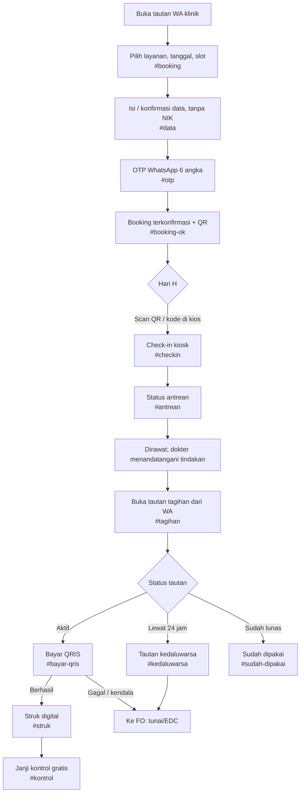
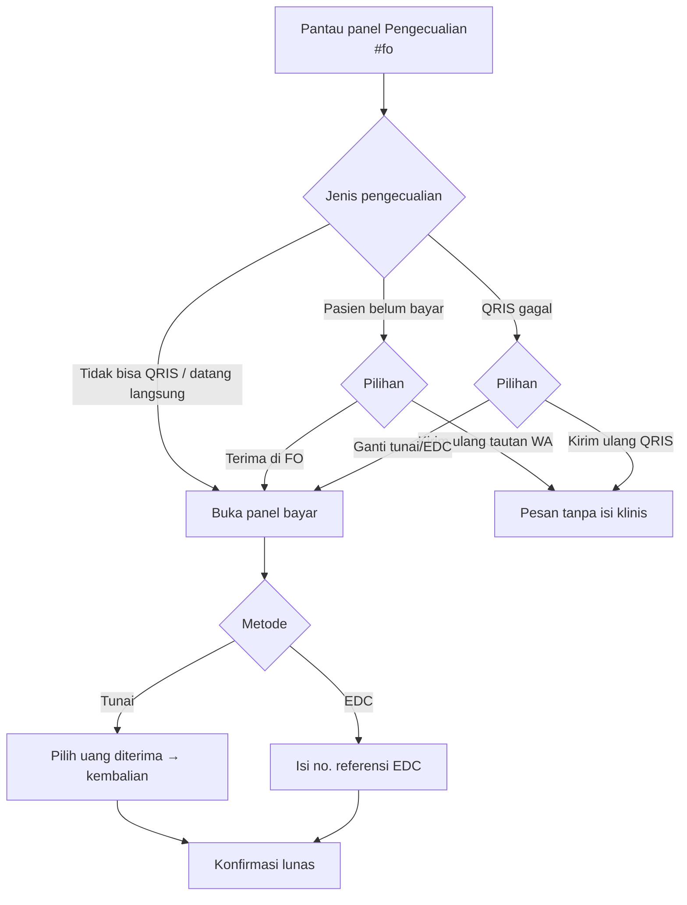
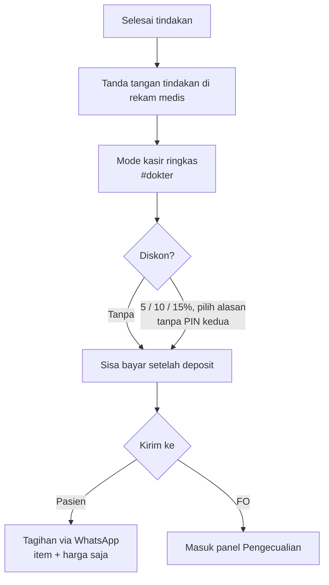

# Prototipe Layanan Mandiri — Bittodent

> **DATA SINTETIS — prototipe, bukan aplikasi produksi.** Semua nama, nomor (0800-000-000x), email (`@example.com`), kode QR, dan tagihan adalah karangan. QR bukan payload QRIS asli. Tidak ada OTP, pesan WhatsApp, atau pembayaran yang benar-benar dikirim. Kode OTP tidak disimpan dan tidak di-log.

Prototipe statis (HTML + CSS + sedikit JS, tanpa build) untuk klinik kecil: **1 FO + 1 dokter**. Pasien melayani diri sendiri dari HP (tautan WhatsApp) dan kios tablet di klinik; FO hanya menangani pengecualian; dokter bisa memberi diskon dari rekam medis lewat mode kasir ringkas.

Acuan visual & token: prototipe Kasir (`design/prototype/kasir/`, disalin, tidak diimpor).

## Cara membuka

```sh
cd design/prototype/self-service
python3 -m http.server 8000 --bind 127.0.0.1
# buka http://127.0.0.1:8000/
```

Atau buka `index.html` langsung di peramban. Font memakai Google Fonts (perlu internet; jika tidak ada, jatuh ke Inter/system-ui).

## Pengalih (selalu tampil, khusus peninjau)

- **Mode:** Pasien | Kiosk | FO | Dokter — mengganti kerangka (HP 390 / tablet kiosk 1024×768 / shell staf dengan sidebar).
- **Layar:** daftar layar untuk mode aktif.
- Tautan langsung: `index.html#tagihan` atau `index.html?layar=tagihan`. Setiap layar punya `id="screen-…"` dan `data-screen="…"`. Jika hash milik mode lain, mode ikut berganti.

## Daftar layar

| # | Layar | Hash | Mode | Dirancang untuk |
|---|---|---|---|---|
| 1 | Pilih layanan, tanggal, slot | `#booking` | Pasien, Kiosk | 390 (kiosk: 2 kolom) |
| 2 | Isi / konfirmasi data (tanpa NIK) | `#data` | Pasien, Kiosk | 390 |
| 3 | OTP WhatsApp 6 angka | `#otp` | Pasien, Kiosk | 390 |
| 4 | Booking terkonfirmasi + QR | `#booking-ok` | Pasien, Kiosk | 390 |
| 5 | Kios: ketuk untuk mulai → scan QR / kode | `#checkin` | Kiosk | 1024×768 |
| 6 | Status antrean | `#antrean` | Pasien, Kiosk | 390 & 1024×768 |
| 7 | Tagihan Budi (item + harga saja) | `#tagihan` | Pasien | 390 |
| 8 | Bayar QRIS (QR contoh, hitung mundur) | `#bayar-qris` | Pasien | 390 |
| 9 | Struk digital 80 mm | `#struk` | Pasien | 390 |
| 10 | Janji kontrol (Rp 0) | `#kontrol` | Pasien | 390 |
| 11 | Tautan kedaluwarsa | `#kedaluwarsa` | Pasien | 390 |
| 12 | Tautan sudah dipakai | `#sudah-dipakai` | Pasien | 390 |
| 13 | Panel pengecualian FO | `#fo` | FO | 1024×768 (juga 1440) |
| 14 | RM ringkas + mode kasir ringkas | `#dokter` | Dokter | 1024×768 (juga 1440) |

Bawaan per mode: Pasien → `#booking`, Kiosk → `#checkin`, FO → `#fo`, Dokter → `#dokter`.

## Parameter demo

| Parameter | Efek |
|---|---|
| `?mode=kiosk` (`pasien`/`fo`/`dokter`) | Mulai di mode tertentu |
| `?layar=<hash>` | Sama dengan `#<hash>` |
| `?demo=bayar` | Tagihan Budi |
| `?demo=qris` | Layar bayar QRIS (menunggu) |
| `?demo=qris-gagal` | Layar QRIS dalam keadaan kedaluwarsa + "Buat kode QRIS baru" |
| `?demo=kedaluwarsa` | Tautan Joko Wijaya kedaluwarsa |
| `?demo=dipakai` | Tautan Hendra Gunawan sudah lunas |
| `?demo=kiosk` / `fo` / `dokter` | Layar utama mode itu |

## Aturan produk (ringkas)

- **Tanpa NIK** di tautan publik maupun kios. Identitas = nama + tanggal lahir + WhatsApp, diverifikasi **OTP WhatsApp sintetis** 6 angka (prototipe menerima angka apa saja; kode tidak disimpan/di-log).
- **Tagihan di HP hanya item tindakan + harga.** Tanpa catatan klinis, diagnosis, temuan odontogram, atau nomor gigi. Hanya tindakan **bertanda tangan** yang ditagih; temuan tidak pernah ditagih.
- **Bayar di HP = QRIS saja.** Tunai dan EDC hanya di FO sebagai pengecualian.
- **Saldo deposit** dipotong otomatis (Budi: Rp 800.000 − Rp 200.000 = **Rp 600.000**; ada `console.assert`).
- Semua pasien **Umum**, tanpa asuransi.
- **FO** hanya melihat pengecualian: bayar tunai/EDC, belum bayar, QRIS gagal.
- **Dokter** menyetujui diskon (Tanpa/5/10/15%) dari mode kasir ringkas **tanpa PIN kedua** — dokter adalah pemberi persetujuan; alasan dipilih dan tercatat di audit. Tanpa keypad tunai.
- Pesan WhatsApp keluar tanpa isi klinis.

## Alur per peran

### Pasien (tautan WhatsApp)



### FO



### Dokter



## Keputusan desain yang tidak ada di brief

- **Hari dalam seminggu:** brief menulis 14 Nov = Sabtu dan 18 Nov = Rabu, sehingga 17 Nov 2026 = **Selasa** (bukan "Senin" seperti di brief). Prototipe memakai Selasa. Perlu dicek oleh pemilik cerita.
- **Waktu hari H:** layar kiosk dan antrean Ratna diberi label "Selasa, 17 Nov 2026 (simulasi hari H) · 08.50", karena janji 09.00 tidak masuk akal pada 20.30. Layar staf dan tagihan Budi tetap Sabtu 14 Nov 20.30.
- **Slot "hari ini" (14 Nov):** sesuai brief, hanya 15.30 dan 16.00 yang tersisa, meski jam beku 20.30. Ini untuk demo saja.
- **Nomor gigi tidak tampil** di tagihan HP dan struk; tautan WA bisa diteruskan ke orang lain. Nomor gigi (FDI) hanya tampil di layar dokter.
- **Kedaluwarsa tidak menyebut nama** (Joko) maupun jumlah; tautan lama bisa sudah diteruskan.
- **Sudah dipakai:** "Lihat struk" membuka ringkasan pendek (lunas, Rp 150.000, tunai di FO, waktu), tanpa item.
- **Kiosk** punya keadaan siaga "Ketuk untuk mulai", dan menyingkat nama ("Ratna D.") karena layarnya publik.
- **Janji kontrol** dari struk tidak meminta OTP lagi (sesi tautan tagihan sudah terverifikasi). Kode booking kontrol `SS-18-B6D` dikarang.
- **FO:** baris "Bayar tunai / EDC" berisi pasien sintetis tambahan **Siti Marlina** (Rp 150.000). KPI "pengecualian terbuka" dihitung dari baris yang belum lunas (awal 3). EDC meminta no. referensi (opsional).
- **Alya (6 th):** tautan WA dikirim ke nomor orang tua (contoh 0800-000-0002).
- **Diskon dokter tidak mengubah tagihan HP**; layar tagihan tetap memakai cerita Rp 600.000.
- **RM ringkas** menampilkan satu temuan sintetis ("Temuan 46 — dicatat, tidak ditagih") untuk menunjukkan bahwa temuan tidak masuk tagihan. Tidak ada kode ICD.
- **No. RM `RM-000123`** dan nomor tagihan lain (`…-002/003/005`) dikarang.
- Warna peringatan memakai `#B54708` dari brief (Kasir memakai `#7A4A00`).
