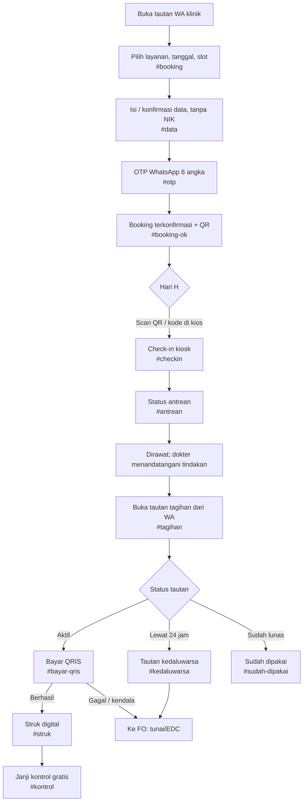
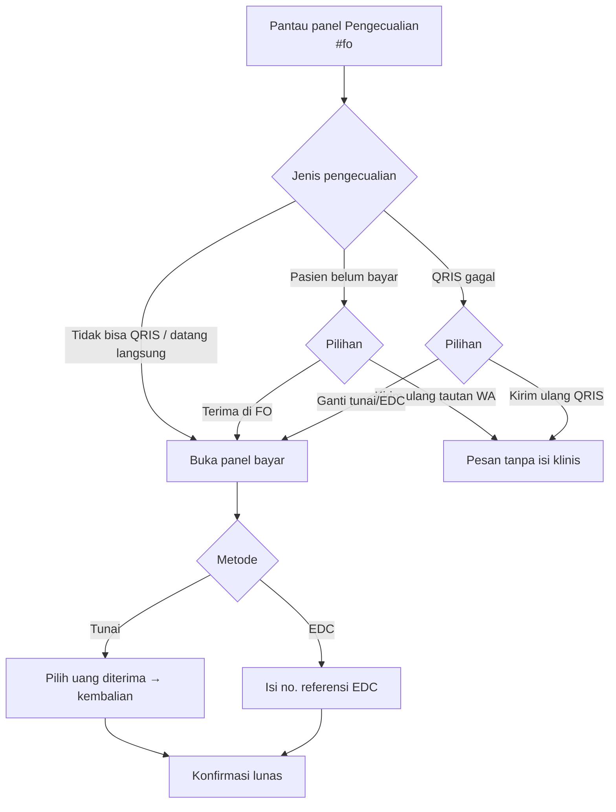
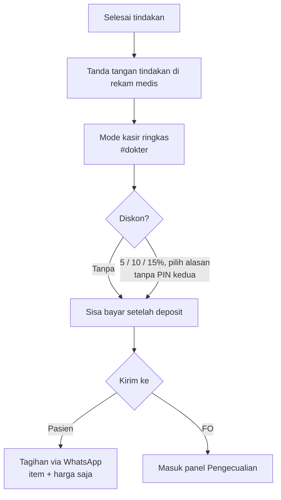

# Prototipe layanan mandiri Bittodent

> **DATA SINTETIS.** Prototipe statis, bukan aplikasi produksi. Nama, nomor (0800-000-000x), QR, dan tagihan dikarang. Tidak ada OTP, WhatsApp, atau pembayaran yang dikirim.

Klinik kecil, 1 FO + 1 dokter. Pasien melayani diri lewat HP dan kios. FO hanya menangani pengecualian. Dokter memberi diskon dari kasir ringkas. Token visual disalin dari `design/prototype/kasir/`.

## Cara membuka

```sh
cd design/prototype/self-service
python3 -m http.server 8000 --bind 127.0.0.1
# buka http://127.0.0.1:8000/
```

Atau buka `index.html` langsung. Pengalih di atas (khusus peninjau): **Mode** (Pasien, Kiosk, FO, Dokter) dan **Layar**. Tautan langsung: `#tagihan` atau `?layar=tagihan`.

## Layar

| # | Hash | Mode | Ukuran |
|---|---|---|---|
| 1 | `#booking` layanan, tanggal, slot | Pasien, Kiosk | 390 |
| 2 | `#data` data diri, tanpa NIK | Pasien, Kiosk | 390 |
| 3 | `#otp` OTP WhatsApp | Pasien, Kiosk | 390 |
| 4 | `#booking-ok` terkonfirmasi + QR | Pasien, Kiosk | 390 |
| 5 | `#checkin` kios check-in | Kiosk | 1024×768 |
| 6 | `#antrean` status antrean | Pasien, Kiosk | 390, 1024×768 |
| 7 | `#tagihan` tagihan Budi | Pasien | 390 |
| 8 | `#bayar-qris` bayar QRIS | Pasien | 390 |
| 9 | `#struk` struk 80 mm | Pasien | 390 |
| 10 | `#kontrol` janji kontrol Rp 0 | Pasien | 390 |
| 11 | `#kedaluwarsa` tautan kedaluwarsa | Pasien | 390 |
| 12 | `#sudah-dipakai` tautan sudah dipakai | Pasien | 390 |
| 13 | `#fo` pengecualian FO | FO | 1024×768, 1440 |
| 14 | `#dokter` RM + kasir ringkas | Dokter | 1024×768, 1440 |

## Parameter demo

| Parameter | Efek |
|---|---|
| `?mode=pasien\|kiosk\|fo\|dokter` | Mulai di mode itu |
| `?layar=<hash>` | Sama dengan `#<hash>` |
| `?demo=bayar` | Tagihan Budi |
| `?demo=qris` | QRIS menunggu |
| `?demo=qris-gagal` | QRIS kedaluwarsa + "Buat QR baru" |
| `?demo=kedaluwarsa` | Tautan kedaluwarsa |
| `?demo=dipakai` | Tautan sudah lunas |
| `?demo=kiosk\|fo\|dokter` | Layar utama mode itu |

Demo: OTP 6 angka apa saja, kode check-in `SS-17-R4T`.

## Aturan produk

- Tanpa NIK di tautan publik dan kios. Identitas: nama, tanggal lahir, WhatsApp, lalu OTP.
- Tagihan dan struk publik hanya item + harga. Tanpa catatan klinis, diagnosis, temuan, atau nomor gigi (FDI hanya di layar dokter).
- Hanya tindakan bertanda tangan yang ditagih. Temuan tidak ditagih.
- HP bayar QRIS saja. Tunai/EDC di FO.
- Deposit dipotong otomatis: Rp 800.000 - Rp 200.000 = Rp 600.000 (`console.assert`).
- Dokter memberi diskon 5/10/15% tanpa PIN kedua, alasan dicatat di audit (15% jadi Rp 480.000).
- Pesan WhatsApp tanpa isi klinis.
- Jam beku: Sabtu 14 Nov 2026, 20.30 WIB. Slot hari ini yang lewat disembunyikan; 14 Nov "Tidak ada slot", 15 Nov tutup. Kios dan antrean memakai simulasi hari H Selasa 17 Nov, 08.50.
- 17 Nov 2026 = Selasa (brief menulis Senin, perlu dicek).
- Kios menyingkat nama ("Ratna D."). Tautan kedaluwarsa tidak menyebut nama atau jumlah.
- Pasien sintetis tambahan: Siti Marlina (FO). Nomor RM dan tagihan lain dikarang.

## Alur per peran

### Pasien (tautan WhatsApp)



### FO



### Dokter


