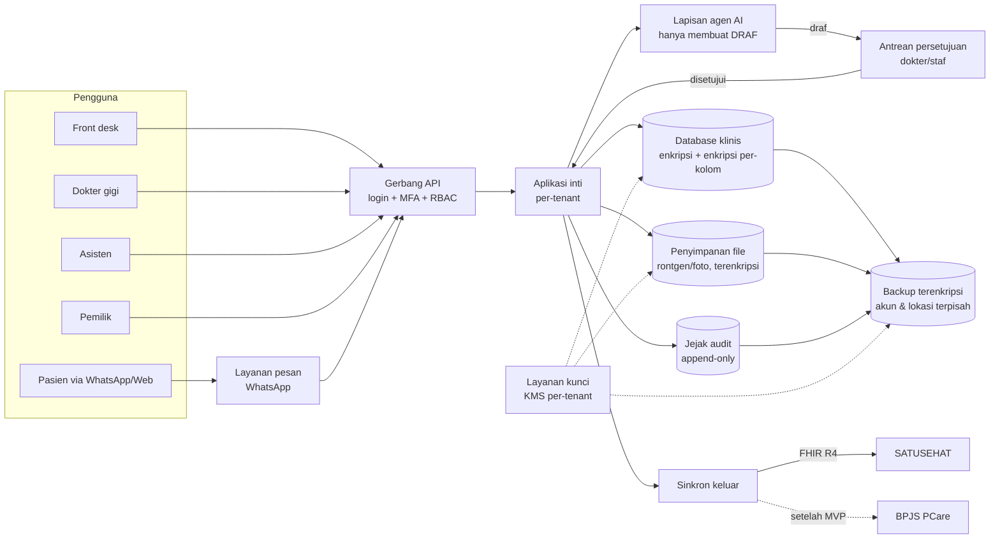
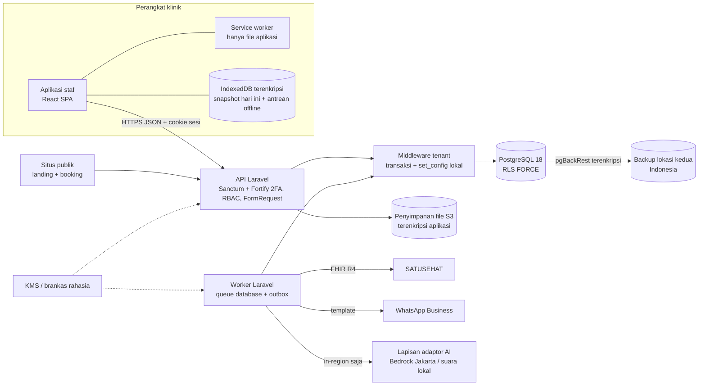
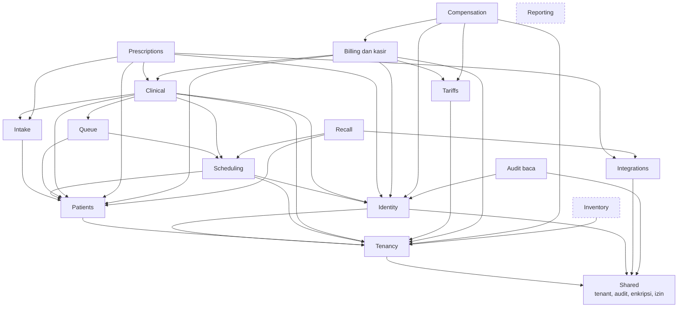

# Arsitektur (draf 4, stack Laravel D-029)

*Arah teknis. Cloud produksi belum dipilih (D-010). Usulan tech stack ada di bagian 11 (D-014), desain database di [database.md](database.md). Urutan prioritas: keamanan & privasi → keselamatan klinis & keutuhan data → regulasi → produk.*

## Gambaran besar
- **SaaS multi-tenant**: satu aplikasi dipakai banyak klinik, tapi data tiap klinik (*tenant*) terpisah ketat.
- **Lokasi data di Indonesia** (Permenkes 24/2022 Pasal 22 meminta penyimpanan di dalam negeri bila klinik menyimpan lewat PSE).

## Komponen & aturan

### 1. Isolasi klinik (tenant)
- Setiap baris data punya `tenant_id`; database menegakkan filter (*row-level security* = aturan di database yang menolak baris milik klinik lain), bukan hanya kode aplikasi.
- Kunci enkripsi terpisah per klinik.
- Tes otomatis wajib: user klinik A tidak pernah bisa membaca data klinik B.
- Struktur `tenant → cabang → kursi` (D-007). Setiap tenant minimal punya satu cabang; data klinis, jadwal, dan kasir terikat ke cabang. Izin per cabang di dalam tenant.
- **Mode sederhana** (praktik mandiri) memakai struktur yang sama, hanya menyembunyikan menu dan boleh menggabungkan peran admin; tanda tangan klinis tetap khusus dokter.

### 2. Enkripsi
- **Saat transit**: TLS 1.2+ untuk semua koneksi (TLS = penguncian lalu lintas data di jaringan).
- **Saat disimpan**: disk & database terenkripsi.
- **Per-kolom (field-level)**: kolom data kesehatan dan identitas sensitif (NIK, diagnosis, catatan klinis, audio) dienkripsi lagi dengan kunci tenant, sehingga admin database pun tidak bisa membacanya.
- Kunci dikelola di **KMS** (layanan khusus penyimpan kunci), dirotasi berkala, akses tercatat.

### 3. Hak akses berbasis peran (RBAC)
*RBAC = izin ditentukan oleh peran, bukan per orang.*

| Peran | Bisa | Tidak bisa |
|---|---|---|
| Dokter gigi | Baca/tulis klinis, setujui draf agen, tanda tangan; laporan bagi hasil milik sendiri, hanya baca (D-039) | Ubah keuangan klinik, atur bagi hasil, lihat aturan atau angka dokter lain |
| Asisten | Siapkan data klinis (draf), lihat jadwal | Menandatangani catatan |
| Front desk | Pendaftaran, jadwal, kasir | Lihat catatan klinis lengkap (hanya ringkasan perlu) |
| Pemilik | Laporan, pengaturan, kelola user & hak akses; buka catatan klinis hanya baca, setiap buka tercatat (D-040) | Mengubah atau menandatangani catatan klinis dokter lain |
| Agen AI | Hanya alat & data sesuai tugasnya (lihat agents.md) | Menyetujui, menghapus, lintas tenant |

- Login wajib **MFA** (verifikasi dua langkah). Sesi otomatis habis.
- Hak akses ditetapkan pimpinan klinik (Permenkes 24/2022 Pasal 30).
- Akses darurat ("break-glass") tercatat dan ditinjau.

### 4. Jejak audit
- Catat setiap baca, tulis, ekspor, cetak, login, dan aksi agen: siapa, apa, kapan, dari mana.
- **Append-only** (hanya bisa ditambah, tidak bisa diubah/dihapus), disimpan terpisah, ikut aturan retensi.
- Catatan klinis tidak pernah ditimpa; setiap koreksi membuat versi baru. Edit bebas hanya 2x24 jam; setelah itu perlu persetujuan (Pasal 30).

### 5. Persetujuan (consent)
- Simpan setiap persetujuan sebagai data: jenis (pemrosesan data, kontak WhatsApp, rekam audio, tindakan), versi teks, waktu, cara (tertulis/lisan/TTE), saksi, status dicabut.
- Agen memeriksa consent sebelum bertindak (misal tidak kirim WhatsApp tanpa izin kontak).

### 6. Backup & pemulihan
- Backup terenkripsi, di **akun dan lokasi terpisah** dari produksi (Permenkes 24/2022 Pasal 20: lokasi berbeda, berkala, ada SOP), tetap di Indonesia.
- Backup tidak bisa diubah selama masa simpan (*immutable*), untuk tahan ransomware.
- **Uji pemulihan terjadwal** (usul: bulanan), hasil dicatat. Target RPO/RTO ditentukan di decisions.md (*RPO* = maksimal data yang boleh hilang; *RTO* = maksimal waktu sampai sistem pulih).

### 7. Sinkron SATUSEHAT
- Hanya data yang sudah disetujui dokter yang dikirim.
- Antrean dengan coba ulang dan status per kunjungan (terkirim/gagal/perlu perbaikan); kunci API disimpan di brankas rahasia.

### 8. Agen AI
- Agen berjalan sebagai "user layanan" dengan izin terbatas; tidak bisa menulis langsung ke catatan final.
- Penyedia model AI: wajib kontrak pemrosesan data, tanpa pelatihan dengan data kita, lokasi pemrosesan dinilai terhadap UU PDP Pasal 56. Data dikurangi seminimal mungkin sebelum dikirim.
- Model data penjamin siap BPJS sejak awal (D-008), walau bridging BPJS belum dibuat.

### 9. Lokasi pemrosesan AI (D-009, diterima)
*Dicek dari halaman resmi vendor, 14 Nov 2026. Ketersediaan bisa berubah; cek ulang sebelum memilih.*

**Dasar hukum yang membatasi:**
- Permenkes 24/2022 Pasal 20 (cloud tersertifikasi), Pasal 22 (PSE penyimpan RME harus punya penyimpanan di dalam negeri). Apakah pemrosesan sesaat (audio dikirim, diproses, tidak disimpan) termasuk "penyimpanan": **perlu dicek** dengan konsultan hukum. Asumsi aman: perlakukan sama.
- UU PDP Pasal 56: transfer ke luar negeri hanya jika negara tujuan setara/lebih tinggi perlindungannya, ada perlindungan mengikat, atau persetujuan subjek. Pasal 34: DPIA wajib untuk data spesifik & teknologi baru.

**Apa yang benar-benar tersedia di Jakarta (bukti):**

| Layanan | Jakarta? | Bukti |
|---|---|---|
| Region Google Cloud Jakarta `asia-southeast2` | Ada, dengan GPU (N1+T4, G4) | [Google GPU regions](https://cloud.google.com/compute/docs/gpus/gpu-regions-zones) |
| Google Speech-to-Text v2, Bahasa Indonesia (`id-ID`) | **Tidak**. Lokasi terdekat: Singapura `asia-southeast1` (chirp, chirp_2); chirp_3 hanya `us`/`eu` | [Bahasa yang didukung](https://cloud.google.com/speech-to-text/v2/docs/speech-to-text-supported-languages) |
| Google Vertex AI (Gemini) | **Tidak** tercantum. Region Asia Pasifik: Mumbai, Singapura, Hong Kong, Taiwan, Tokyo, Sydney, Seoul | [Vertex AI locations](https://cloud.google.com/vertex-ai/generative-ai/docs/learn/locations) |
| AWS Jakarta `ap-southeast-3` – Amazon Transcribe | **Tidak** tercantum (ada Singapura, Malaysia, Thailand) | [Endpoint Transcribe](https://docs.aws.amazon.com/general/latest/gr/transcribe.html) |
| AWS Jakarta – Amazon Bedrock | **Ada** endpoint. Model **in-region** di Jakarta antara lain: Amazon Nova Pro & Nova Lite, DeepSeek V3.2/V3.1, Qwen3 (235B, 32B), gpt-oss-120b/20b, MiniMax, Kimi K2.5, NVIDIA Nemotron, GLM 4.7, Devstral. Claude, GPT-5.x/6.x, Grok di Jakarta **hanya lewat inferensi Global** (data bisa diproses di region mana pun). Nova Pro/Lite juga punya opsi Geo (dialihkan ke region lain dalam satu geografi) — bisa keluar Indonesia, jadi dilarang | [Endpoint Bedrock](https://docs.aws.amazon.com/general/latest/gr/bedrock.html) · [Ketersediaan model per region](https://docs.aws.amazon.com/bedrock/latest/userguide/models-region-compatibility.html) |
| AWS Jakarta – SageMaker (untuk host model sendiri) | Ada endpoint | [Endpoint SageMaker](https://docs.aws.amazon.com/general/latest/gr/sagemaker.html). Jenis GPU di Jakarta: **perlu dicek** |
| Azure Indonesia Central (`indonesiacentral`, Jakarta) | Region ada | [Daftar region Azure](https://learn.microsoft.com/en-us/azure/reliability/regions-list) |
| Azure AI Speech | **Tidak** ada `indonesiacentral` di daftar region Speech (terdekat `southeastasia`) | [Region Speech](https://learn.microsoft.com/en-us/azure/ai-services/speech-service/regions) |
| Azure OpenAI di Indonesia Central | Tidak ditemukan di halaman yang dicek — **perlu dicek** | — |
| Prosa.ai (Bandung, Indonesia) – suara→teks Bahasa Indonesia | Vendor menyatakan produk Meemo bisa dipasang **on-premise** di server klien | [Blog Prosa](https://blog.prosa.ai/id/meemo-aplikasi-notulen-ai-lokal-yang-cerdas-dan-aman-untuk-bisnis-dan-pemerintahan/) · [Salyns](https://salyns.prosa.ai/). Lokasi server API, kontrak, harga, akurasi istilah gigi: **perlu dicek** |

Data privasi Bedrock: penyedia model tidak punya akses ke log, prompt, atau keluaran ([AWS Bedrock data protection](https://docs.aws.amazon.com/bedrock/latest/userguide/data-protection.html)); AWS juga menyatakan Bedrock tidak menyimpan/mencatat prompt dan tidak memakainya untuk melatih model ([blog AWS](https://aws.amazon.com/blogs/alps/security_bedrock/)).

**Opsi dan pertimbangan**

| Opsi | Keamanan/privasi | Kualitas istilah gigi Bahasa Indonesia | Biaya | Kerumitan |
|---|---|---|---|---|
| A. Semua di Jakarta: Bedrock in-region (LLM) + model suara di-host sendiri di GPU Jakarta | **Terbaik**: tidak ada transfer ke luar negeri | Perlu uji; model in-region bukan yang terkuat | Sedang (GPU jalan terus atau autoscale) | Tinggi untuk suara (operasikan model sendiri) |
| B. Bedrock in-region (LLM) + Prosa.ai dalam negeri/on-prem (suara) | Sangat baik, tergantung kontrak & lokasi server Prosa | Berpotensi baik (spesialis Bahasa Indonesia) — perlu uji | Perlu penawaran | Sedang (satu vendor tambahan) |
| C. Suara di Singapura (Google `asia-southeast1` / AWS / Azure) + LLM Jakarta | Ada transfer lintas negara → DPIA + Pasal 56 + kontrak | Layanan terkelola matang; istilah gigi perlu uji | Rendah–sedang, bayar per menit | Rendah |
| D. Model frontier via inferensi Global | **Terlemah**: lokasi pemrosesan tidak pasti | Kemungkinan terbaik | Rendah–sedang | Rendah |

**Rekomendasi:** Opsi A/B (semua pemrosesan di Indonesia). LLM di Bedrock Jakarta dengan model in-region saja; blokir inferensi Geo/Global lewat kebijakan akses AWS (cara teknis persisnya perlu dicek). Untuk suara, uji banding model open-source di-host sendiri di Jakarta vs Prosa.ai memakai rekaman diktasi gigi **sintetis** (tanpa data pasien asli), lalu pilih berdasarkan tingkat salah kata pada istilah gigi. Opsi C hanya cadangan setelah DPIA dan pendapat hukum. Opsi D tidak dipakai untuk data klinis.

**Kontrol teknis wajib apa pun opsinya:** endpoint privat (tanpa internet publik), enkripsi transit, audio dihapus setelah catatan disetujui (menunggu Q-4), tidak ada log isi prompt, data diminimalkan (tanpa NIK/nama di prompt bila tidak perlu), versi model dicatat di jejak audit, uji kualitas berkala.

### 10. Penilaian Hostinger Cloud Startup sebagai cloud utama (usulan D-010)
*Dicek dari halaman resmi Hostinger, 14 Nov 2026. Harga & fitur promosi bisa berubah.*

**Apa paketnya:** Cloud Startup adalah **hosting cloud terkelola** (Hostinger mengurus server, kita pakai panel hPanel): 4 CPU, 4 GB RAM, 100 GB NVMe, 10 Web Apps, 100 PHP workers, IP khusus, backup harian ([cloud hosting](https://www.hostinger.com/cloud-hosting) · [versi Indonesia](https://www.hostinger.co.id/cloud-hosting)). Hostinger sendiri membedakan: VPS = sumber daya khusus + **root access**, dikelola sendiri; cloud hosting = lingkungan siap pakai tanpa urus server (FAQ halaman cloud). Web Apps = runtime Node.js dengan **MySQL terkelola**; Postgres hanya lewat integrasi Supabase ([web apps](https://www.hostinger.com/web-apps-hosting)). Docker & root disebut sebagai fitur **VPS** ([VPS](https://www.hostinger.com/vps-hosting)).

| Kebutuhan kita | Cloud Startup | VPS Hostinger (Jakarta) |
|---|---|---|
| Data center Indonesia, bisa dipilih | Ya, "Indonesia" ada di daftar lokasi; bisa pindah lokasi gratis. Kota persis: perlu dicek | Ya, "from Boston to Jakarta"; pindah lokasi = install ulang, data & backup terhapus |
| Node.js | Ya (Web Apps) | Ya (kita pasang sendiri) |
| PHP / Laravel (D-029) | Ada "100 PHP workers" di paket; menjalankan Laravel (Composer, SSH, cron untuk antrean) **perlu dicek**. Halaman Laravel Hostinger mengarahkan ke VPS ([Laravel hosting](https://www.hostinger.com/laravel-hosting)) | Ya, ada template VPS Laravel; MySQL atau PostgreSQL ([Laravel hosting](https://www.hostinger.com/laravel-hosting)) |
| Python | Tidak disebut — perlu dicek | Ya (root) |
| PostgreSQL | Tidak bawaan (MySQL); Postgres via Supabase = pihak ketiga, lokasi data perlu dicek | Ya, pasang sendiri (ada template 1-klik PostgreSQL) |
| Background jobs (antrean, sinkron SATUSEHAT) | Tidak disebut — perlu dicek | Ya |
| Docker / root | Tidak | Ya |
| Backup bawaan | Harian (halaman produk); ketentuan umum: mingguan, 2 minggu disimpan, di "remote server" tanpa lokasi | Mingguan gratis |
| Enkripsi per-kolom, audit trail | Bisa di level aplikasi (tanggung jawab kita), tapi tanpa KMS terkelola | Sama; KMS harus kita sediakan sendiri |

**Ketentuan & keamanan (sumber resmi):**
- [Hosting agreement](https://www.hostinger.com/legal/hosting-agreement): SLA uptime 99,9%/bulan, kompensasi kredit 5% biaya bulanan. Pelanggan **wajib** membuat backup sendiri. Backup Hostinger mingguan, menimpa backup lama, 2 minggu disimpan di remote server. Layanan **tidak dimaksudkan sebagai lingkungan PCI atau HIPAA**. Layanan GPU dilarang untuk data kesehatan dan tidak dicakup DPA.
- [DPA](https://www.hostinger.com/legal/dpa): mencakup enkripsi data pribadi & sensitif saat disimpan dan enkripsi komunikasi (Appendix 2, langkah internal Hostinger); notifikasi insiden "without undue delay" (tanpa batas jam); data sensitif (termasuk data kesehatan) boleh diunggah tapi **pengamanannya tanggung jawab pelanggan**; ada sub-prosesor dan hak audit atas permintaan tertulis; transfer data diatur dengan EU SCC (kerangka Eropa, bukan UU PDP).
- [Security policy](https://www.hostinger.com/legal/security-policy): kebijakan keamanan mengacu pada ISO/IEC 27001:2022. **Tidak ditemukan sertifikat ISO 27001** atau sertifikasi khusus data center Indonesia di halaman yang dicek — perlu dicek.

**Dicek terhadap regulasi:**

| Ketentuan | Status untuk Hostinger |
|---|---|
| Permenkes 24/2022 Pasal 20 ayat 3: cloud **tersertifikasi** | Belum terbukti (sertifikat tidak ditemukan) — perlu dicek |
| Pasal 20 ayat 4–5: backup di lokasi berbeda, berkala | Backup bawaan ada, tapi lokasi tidak disebut; retensi 2 minggu jauh di bawah kebutuhan kita. Harus ada backup kedua milik kita |
| Pasal 22: PSE penyimpan di dalam negeri + rekomendasi Kemenkes + NDA + akses penuh | Data center Indonesia ada; rekomendasi Kemenkes & status PSE Hostinger di Indonesia: perlu dicek. Catatan: jika kita (bukan Hostinger) yang berstatus PSE, kewajiban rekomendasi bisa jatuh ke kita — perlu dicek hukum |
| UU PDP Pasal 35 (keamanan), enkripsi per-kolom, audit | Bisa dibangun di aplikasi kita; tidak ada KMS/HSM terkelola dari Hostinger |
| UU PDP Pasal 46 (notifikasi 3x24 jam) | DPA Hostinger tanpa batas jam → risiko kita terlambat. Perlu klausul tambahan |
| UU PDP Pasal 56 (transfer luar negeri) | Data center Indonesia aman, tapi lokasi backup, sub-prosesor, dan akses support dari luar negeri: perlu dicek |

**Implikasi hibrida:** aplikasi di Hostinger (Indonesia) memanggil Bedrock di AWS Jakarta. Data tetap di Indonesia, tapi melewati internet publik antar-penyedia → wajib TLS, kunci API AWS dengan izin minimum, IP allowlist, minimisasi data. AWS PrivateLink tidak bisa dipakai dari Hostinger. Dua penyedia = dua kontrak, dua jejak audit, dua titik insiden.

**Rekomendasi:**
- **Prototipe/demo dengan data palsu:** Hostinger boleh. Untuk stack lengkap kita (Laravel + PostgreSQL + Docker + pekerja latar belakang, bagian 11), **VPS Jakarta** wajib; Cloud Startup **tidak bisa** menjalankannya apa adanya (tanpa Docker/root, database bawaan MySQL, Postgres hanya via Supabase pihak ketiga). Cloud Startup hanya untuk varian demo MySQL (10.1). Ukuran (cek 14 Nov 2026, [VPS](https://www.hostinger.com/vps-hosting)): **KVM 2** (2 vCPU, 8 GB RAM, 100 GB NVMe) cukup untuk demo Docker Compose (Postgres ±2 GB, api + worker ±0,5–1 GB, SeaweedFS + Caddy ±0,5 GB, sisa untuk build). Uji kecepatan D-024 dengan seed penuh (200 juta baris audit, 40 juta odontogram) butuh disk dan RAM lebih: pakai **KVM 4** (4 vCPU, 16 GB, 200 GB) atau server uji sementara, dan ukur ukuran database setelah seed.
- **Produksi dengan data pasien asli:** **belum**. Syarat minimal sebelum dipertimbangkan: bukti sertifikasi ISO 27001 yang mencakup data center Indonesia, lokasi backup di Indonesia, kontrak yang menerima data kesehatan dengan notifikasi insiden ≤24–48 jam, dan kejelasan Pasal 22. Bandingkan dengan menaruh aplikasi di AWS Jakarta (satu penyedia dengan AI; sertifikasinya juga perlu dicek).
- Bangun aplikasi agar **mudah pindah** (Docker, PostgreSQL standar, konfigurasi via variabel lingkungan), supaya keputusan produksi tidak terkunci.

### 10.1 MVP di MySQL, termasuk demo di Cloud Startup (D-030, data palsu saja)
MVP berjalan di MySQL 8.4 LTS (lokal dan demo), **data palsu saja**, sampai pindah ke PostgreSQL + RLS (gerbang keras). Rincian desain database: database.md bagian 11. Batasannya:
- **Tidak ada RLS.** MySQL tidak punya kebijakan keamanan per baris seperti `CREATE POLICY` di PostgreSQL. Isolasi antar klinik di MVP **hanya** dari kode Laravel (global scope wajib `BelongsToTenant` + tes arsitektur) dan FK gabungan. Satu query yang lupa filter = data klinik lain terlihat. Karena itu: **dilarang memuat data pasien asli** di varian ini, selamanya.
- **Fitur PostgreSQL yang hilang** dan penggantinya di demo:
  | Di PostgreSQL (target) | Di MVP MySQL |
  |---|---|
  | RLS `FORCE` + peran non-pemilik | global scope Laravel saja (tes isolasi PostgreSQL tidak berlaku) |
  | `set_config('app.tenant_id', ?, true)` | tidak ada; tenant hanya di memori aplikasi |
  | constraint anti-bentrok jadwal (`EXCLUDE ... gist`) | cek di kode + kunci baris (`SELECT ... FOR UPDATE`), bisa bocor bila dua permintaan bersamaan |
  | trigger tolak `UPDATE/DELETE`/`TRUNCATE` catatan bertanda tangan | trigger MySQL `BEFORE UPDATE/DELETE`; `TRUNCATE` tidak memicu trigger, jadi dijaga hak akses (user aplikasi tanpa `DROP`, dan `TRUNCATE` butuh `DROP`) |
  | fungsi `search_patient` + indeks trigram | indeks FULLTEXT (awalan) atau `LIKE 'nama%'`; tanpa pencarian tengah kata/salah ketik |
  | `uuidv7()` bawaan | UUID dibuat Laravel (`Str::uuid7()`) |
  | view `security_invoker` | view biasa (`SQL SECURITY INVOKER` ada di MySQL, tapi tanpa RLS tidak bermakna sama) |
- **Antrean**: Cloud Startup tidak menjalankan proses permanen (perlu dicek), jadi `queue:work --stop-when-empty` lewat cron tiap menit. Kiriman keluar (SATUSEHAT, WhatsApp) **dimatikan** di demo.
- **Kode tetap mudah dipindah**: kode aplikasi tanpa SQL khusus MySQL; SQL khusus MySQL hanya di `backend/database/migrations/mysql/`. Banner "DATA SINTETIS - PROTOTIPE" di layar.
- Perlu dicek sebelum demo dipasang: dukungan Laravel/Composer/SSH/cron di Cloud Startup, versi MySQL yang disediakan, dan versi PHP (Laravel 13 butuh ≥ 8.3).

## 11. Tech stack (D-029 diterima, menggantikan bagian server D-014; D-015 tetap)
*Dipilih untuk keamanan dan kemudahan dirawat: alat yang membosankan, populer, dokumentasinya lengkap, dan dikuasai baik oleh Claude Code. Versi dicek 14 Nov 2026.*

### 11.1 Pilihan: Laravel (API saja) + React SPA + PostgreSQL
| Lapisan | Pilihan | Alasan |
|---|---|---|
| Bahasa | **PHP 8.4** di server, **TypeScript** (JavaScript dengan tipe data) di layar | Laravel 13 butuh PHP 8.3–8.5 ([rilis Laravel](https://laravel.com/docs/13.x/releases)). Dua bahasa adalah harga D-029; ditebus dengan cara kerja yang sama seperti HRIS Alesco. |
| Aplikasi staf klinik | **React SPA** dibangun dengan **Vite** (alat build), berdiri sendiri, bicara ke server hanya lewat API JSON | SPA = aplikasi satu halaman yang berganti layar tanpa memuat ulang. Isi pasien tidak pernah tertanam di HTML buatan server atau cache CDN (D-015). Dasar mode offline (bagian 12). **Tanpa Inertia**: Inertia menaruh data halaman di HTML awal, itu yang dihindari D-015. |
| Situs publik (landing + booking pasien) | Halaman statis/SSR terpisah (misal Astro) | SSR = HTML dibuat server, baik untuk mesin pencari. Tidak memuat data pasien selain formulir booking. |
| API server | **Laravel 13** (rilis 17 Mar 2026; perbaikan bug sampai Q3 2027, keamanan sampai 17 Mar 2028; terbaru 13.42.0, 10 Nov 2026, [Packagist](https://packagist.org/packages/laravel/framework)) dipakai **sebagai API JSON saja** | Kerangka web PHP paling populer, login/antrean/enkripsi/migrasi bawaan. Setiap input dicek dengan `FormRequest` (aturan validasi Laravel) di pintu masuk. |
| Database | **MVP: MySQL 8.4 LTS, data palsu saja (D-030)** → **target: PostgreSQL 18** standar, wajib sebelum data asli | MySQL 8.4.13 (dukungan sampai Apr 2032, [endoflife.date](https://endoflife.date/mysql)); tanpa RLS, lihat 10.1 dan database.md 11. PostgreSQL: mayor terbaru (18.7, 9 Nov 2026; didukung sampai Nov 2030, [endoflife.date](https://endoflife.date/postgresql)). RLS, constraint anti-bentrok, `uuidv7()`, partisi, trigram (batasan trigram + RLS di database.md 7.2). |
| Akses database | Eloquent/Query Builder Laravel untuk query biasa; **migrasi Laravel berisi SQL tangan** (`DB::unprepared`) untuk peran, RLS `ENABLE` + `FORCE`, kebijakan, view `security_invoker`, trigger penolak `UPDATE/DELETE` dan `BEFORE TRUNCATE`, fungsi `search_patient` | Migrasi Laravel tidak punya perintah khusus RLS, jadi semua aturan keamanan ditulis sebagai SQL yang bisa dibaca dan diuji. Dua koneksi: `pgsql` (peran aplikasi `ehr_app`, dipakai saat jalan) dan `pgsql_admin` (hanya untuk migrasi/seed/setup tes). |
| Pekerja latar belakang | **Antrean Laravel driver `database`** di database yang sama + penjadwal Laravel; tabel `outbox` sendiri untuk semua kiriman keluar | Tidak perlu Redis. Pekerjaan bisa jalan lebih dari sekali, jadi setiap tugas harus aman diulang. Kiriman keluar: ambil baris outbox dengan `FOR UPDATE SKIP LOCKED`, beri `lease_token` baru + `lease_until`, kirim dengan kunci idempotensi, tulis hasil **hanya** bila `lease_token` masih sama (pagar terhadap pekerja lama yang telat). Setiap pekerjaan membuka transaksi tenant sendiri (bagian 11.6). |
| Login & MFA | **Laravel Sanctum** (login SPA dengan cookie sesi + token CSRF) + **Laravel Fortify** (login, TOTP, kode cadangan) ([Sanctum SPA](https://laravel.com/docs/13.x/sanctum#spa-authentication) · [Fortify](https://laravel.com/docs/13.x/fortify#two-factor-authentication)) | TOTP = kode 6 angka dari aplikasi authenticator. 2FA Fortify diaktifkan per pengguna, bukan wajib otomatis, jadi middleware kita menolak semua rute (kecuali pendaftaran 2FA) untuk pengguna yang belum mengaktifkan TOTP. "Remember me" dimatikan. Login dan tantangan 2FA dibatasi jumlah percobaannya (rate limit Fortify). Peran per cabang ada di tabel `membership` kita sendiri. |
| Enkripsi per kolom | Kelas enkripsi sendiri di atas `Encrypter` Laravel (AES-256 + MAC, [Encryption](https://laravel.com/docs/13.x/encryption)) dengan kunci **terpisah dari `APP_KEY`**; blind index HMAC-SHA256 dengan kunci lain lagi | Cast `encrypted` bawaan Laravel memakai `APP_KEY` yang juga menandatangani cookie; kunci data pasien sebaiknya terpisah. Laravel bisa membaca kunci lama lewat `APP_PREVIOUS_KEYS` saat rotasi, tapi **kunci per tenant dibungkus KMS (D-020) tetap harus dibuat sendiri** sebelum data asli. |
| File (rontgen, foto, tanda tangan, audio) | API **S3-compatible**, file **dienkripsi aplikasi sebelum diunggah** | Prototipe: SeaweedFS di VPS ([GitHub](https://github.com/seaweedfs/seaweedfs)). **Bukan MinIO**: repositori komunitas `minio/minio` berstatus archived ([GitHub](https://github.com/minio/minio)). |
| Tes | PHPUnit/Pest (server, ke database sungguhan: MySQL di MVP, PostgreSQL di target; bukan SQLite), Vitest (layar), Playwright (klik di browser), tes isolasi tenant otomatis | Tes isolasi dijalankan sebagai `ehr_app`, bukan superuser. |
| Kemasan & jalan | **Docker Compose**: `web` (file statis), `api` (PHP-FPM), `worker` (`queue:work`), `scheduler`, `mysql` (MVP) / `postgres` (target), `storage`, reverse proxy **Caddy** | Satu perintah untuk menyalakan seluruh sistem; mudah pindah server (D-010). |
| Backup | **pgBackRest ≥ 2.59.3** (sekarang 2.60.0) ke lokasi kedua di Indonesia | Pengumuman "Weak Encryption Subkeys and Salts" (4 Okt 2026): pakai ≥ 2.59.3 sejak stanza pertama ([berita pgBackRest](https://pgbackrest.org/news.html)). |

**Tidak dipakai lagi (D-014 lama, digantikan D-029):** Node.js 26 + Fastify, Zod, Drizzle ORM, pg-boss, Better Auth. Prototipe lamanya diarsipkan di `archive-node/`.

### 11.2 Alternatif
| Alternatif | Kelebihan | Kenapa tidak dipilih |
|---|---|---|
| **Laravel + Inertia/React** (starter kit Laravel) | Paling cepat dibuat; persis HRIS | Inertia mengirim data halaman di HTML awal; bentrok dengan D-015 dan mode offline. |
| **TypeScript penuh (Node + Fastify + Drizzle)**, usulan D-014 lama | Satu bahasa | Jerome memilih Laravel (D-029). Desain SQL-nya dipakai ulang. |
| **Next.js full-stack** | Populer | Kekuatannya di SSR, padahal aplikasi staf sengaja SPA. Cocok untuk situs publik saja. |

### 11.3 Diagram komponen

### 11.4 Batas modul
Satu repo: `backend/` (Laravel) dan `frontend/` (React). Setiap modul memiliki datanya sendiri; modul lain hanya memanggil fungsi publiknya.

| Bagian | Memiliki | Catatan |
|---|---|---|
| `frontend/` | layar staf (SPA), nanti juga mode offline | tidak tahu SQL; tidak menyimpan data pasien di `localStorage` |
| `backend/routes`, `app/Http` | rute, sesi, validasi `FormRequest`, cek izin | tipis: validasi → panggil domain → jawab JSON dengan `Cache-Control: no-store` |
| `backend/app/Domain` | aturan murni: transisi state machine, aturan 2x24 jam, cek persetujuan, hitung tagihan | tanpa database, mudah dites |
| `backend/app/Tenancy` | middleware tenant, satu-satunya tempat `set_config` dipanggil | kode lain **tidak boleh** membuka koneksi `pgsql_admin` |
| `backend/database/migrations` | skema, peran, RLS, trigger, fungsi (SQL tangan) | |
| `backend/app/Crypto` | enkripsi kolom, blind index, enkripsi file | satu tempat untuk semua kunci |
| `backend/app/Integrations` | adaptor SATUSEHAT, WhatsApp, AI (penyedia tidak di-hardcode, D-009) | |
| `backend/app/Jobs` | pekerjaan antrean + pengirim outbox | setiap job membuka transaksi tenant sendiri |

### 11.5 Pekerjaan latar belakang
| Pekerjaan | Jadwal | Aman diulang karena |
|---|---|---|
| Kirim outbox SATUSEHAT | terus-menerus | kunci idempotensi per versi; cek ke SATUSEHAT dulu bila hasil kiriman sebelumnya tidak diketahui (cara persisnya perlu dicek) |
| Kirim pengingat janji WhatsApp (JDW-3) | tiap 15 menit | kunci `wa_pengingat:<janji>:<jenis>`; izin dicek ulang saat kirim |
| Pindai recall jatuh tempo (RCL-2) | tiap malam per zona cabang | kunci `wa_recall:<recall_plan>:<due_date>` |
| Buat partisi audit bulan depan | bulanan | `CREATE ... IF NOT EXISTS` |
| Checkpoint audit harian | tiap malam, dengan jeda (misal pukul 01.00 untuk hari kemarin) supaya transaksi yang telat commit ikut terhitung | **sekali tulis**: bila checkpoint hari itu sudah ada, hitung ulang dan bandingkan; beda = alarm, **tidak** ditimpa. Salinan checkpoint dikirim ke luar server (bersama backup), karena penyerang yang menguasai server dan kunci sistem bisa menghitung ulang checkpoint di server yang sama |
| Uji pemulihan backup | bulanan (usul) | memulihkan ke server uji terpisah |
| Hapus audio scribe setelah catatan disetujui | menunggu Q-4 | — |

### 11.6 Login, RBAC, rahasia
- **Login**: email + kata sandi + TOTP wajib (RBA-3). Sesi pendek, cookie `HttpOnly` + `Secure` + `SameSite`. Perangkat klinik didaftarkan per cabang (bagian 12).
- **MVP MySQL (D-030)**: konteks tenant hanya di objek per-request + global scope `BelongsToTenant` (database.md 11). Poin di bawah berlaku saat pindah ke PostgreSQL.
- **Konteks tenant di Laravel + PostgreSQL (target)**: middleware membuka `DB::transaction` per request di koneksi `pgsql`, lalu `select set_config('app.tenant_id', ?, true), set_config('app.user_id', ?, true)` dengan parameter terikat. Nilai `true` = berlaku **hanya sampai transaksi selesai** ([PostgreSQL set_config](https://www.postgresql.org/docs/18/functions-admin.html#FUNCTIONS-ADMIN-SET)). Tenant diambil dari keanggotaan pengguna di sesi, tidak pernah dari isi permintaan. Tanpa tenant, RLS memberi 0 baris. Jebakan:
  - **Koneksi persisten / Octane**: Octane menjaga aplikasi tetap hidup di memori antar-request ([Octane](https://laravel.com/docs/13.x/octane)), dan koneksi database bisa dipakai ulang. Aman **hanya** karena pengaturan bersifat lokal transaksi. Dilarang memakai `set_config(..., false)` atau `SET` tanpa `LOCAL`: nilai tenant akan menempel ke request klinik berikutnya.
  - **PgBouncer mode transaction**: `SET`/`RESET` tingkat sesi tidak didukung ([PgBouncer](https://www.pgbouncer.org/features.html)); pengaturan lokal transaksi tetap aman karena satu transaksi selalu di satu koneksi server. Prepared statement sisi server juga perlu dicek bila PgBouncer dipakai.
  - **Query di luar transaksi** (misal dijalankan setelah respons dikirim, event `terminating`, atau job antrean) tidak membawa tenant → 0 baris. Job antrean wajib membuka transaksi tenant sendiri dari `tenant_id` yang disimpan di job.
  - **Transaksi bersarang** di Laravel menjadi savepoint; aman, pengaturan tetap berlaku sampai transaksi luar selesai.
- **Login 2FA**: Sanctum cookie sesi `HttpOnly` + `SameSite=Lax`, `Secure` di HTTPS; CSRF lewat cookie `XSRF-TOKEN`. Sesi disimpan di tabel global (bukan data klinik). Rahasia TOTP Fortify disimpan terenkripsi oleh Laravel.
- **RBAC**: hak dihitung dari `membership` → satu matriks izin di kode (peran × izin), dicek middleware di setiap rute; penolakan ditulis ke audit. Tanda tangan klinis dicek dua kali: di modul domain dan di database. Dokter gigi boleh membuka riwayat klinis pasien dari cabang lain dalam tenant yang sama (D-027); setiap tampilan lintas cabang dicatat di audit (`cross_branch`), tanpa layar minta alasan.
- **Rahasia** (kunci API SATUSEHAT, kunci AWS, kunci induk enkripsi): tidak di kode, tidak di repo. Prototipe: file rahasia Docker di server. Produksi: KMS/brankas rahasia (AWS KMS Jakarta atau brankas yang kita kelola, ikut D-010).
- **Header keamanan**: `Cache-Control: no-store` untuk semua respons API berisi data pasien; CSP ketat (aturan browser yang membatasi skrip).

### 11.7 Backup
- PostgreSQL: backup penuh mingguan + diferensial harian + arsip WAL terus-menerus (WAL = catatan setiap perubahan, memungkinkan pemulihan ke titik waktu tertentu), dienkripsi, ke lokasi kedua di Indonesia di akun terpisah.
- File: salinan kedua di lokasi terpisah, tetap terenkripsi aplikasi.
- Target RPO/RTO belum ada (Q-6). Desain di atas memungkinkan RPO dalam hitungan menit, tapi angka ini **belum diuji**.

## Peta modul (D-031)
*Supaya pengembangan mudah: setiap bagian aplikasi punya "kamar" sendiri. Modul = satu bagian aplikasi dengan data, rute, dan tesnya sendiri. Modul lain hanya boleh memakai "pintu depan"-nya (Contracts = daftar fungsi yang dijanjikan, Events = pengumuman kejadian), tidak boleh masuk ke dalam. Diperbarui 14 Nov 2026: kerangka modul yang sudah ada digabung dengan alur 9 langkah ([flows/kunjungan.md](flows/kunjungan.md)) dan D-033 sampai D-036, tanpa membuat bagian "Peta modul" kedua.*

| Modul | Memiliki (data yang dia jaga) | Boleh memakai |
|---|---|---|
| **Shared** (inti bersama) | konteks tenant + `BelongsToTenant`, jejak audit (tulis), enkripsi + blind index, matriks izin, middleware | tidak memakai modul mana pun |
| **Tenancy** | klinik, cabang | Shared |
| **Identity** | pengguna, keanggotaan, login + TOTP, masuk cepat dev, SIP/STR dokter | Shared, Tenancy |
| **Patients** | pasien, pencarian, cek ganda, keluarga, penanggung biaya, wali | Tenancy |
| **Intake** | anamnesis dan riwayat medis berversi, alergi, obat yang diminum, premedikasi, peringatan yang selalu tampil, persetujuan pemrosesan data | Patients, Tenancy, Identity |
| **Scheduling** | kursi, janji, daftar tunggu, cek bentrok kursi + dokter, janji dari catatan rencana dokter, stempel jam datang/duduk/selesai | Tenancy, Patients, Identity |
| **Queue** | papan tunggu dan keadaan antrean: `menunggu`, `dipanggil`, `terlambat`, `batal_antre` | Scheduling, Patients |
| **Clinical** | kunjungan (mesin keadaan D-033), odontogram, SOAP, tanda tangan, koreksi, hasil perawatan, rencana kunjungan berikutnya. **Tidak** menyimpan atau menampilkan daftar harga | Patients, Intake, Scheduling, Queue, Tenancy, Identity |
| **Prescriptions** | resep elektronik, item KFA, peringatan alergi/dobel (bukan saran obat), batal + terbit ulang, kode/QR verifikasi | Patients, Intake, Clinical, Identity, Integrations |
| **Tariffs** | daftar tarif per cabang, varian tingkat kesulitan, tanggal berlaku; memberi **foto harga** (salinan angka saat itu) kepada Billing | Tenancy |
| **Billing** (kasir) | tagihan dibuat otomatis dari peristiwa "tindakan selesai" (bukan dari dokter mengetik harga), pembayaran tunai/transfer/kartu/QRIS sementara, bagi asuransi, kuitansi tanpa diagnosis, diskon/koreksi terpisah dari baris tagihan, tutup kas | Clinical (hanya Events/Contracts), Tariffs, Patients, Tenancy, Identity |
| **Compensation** (bagi hasil dokter) | aturan per dokter per kelompok tindakan (persen atau nominal, sebelum/sesudah bahan-lab), riwayat tanggal berlaku; **hanya pemilik yang mengatur**; laporan semua dokter untuk pemilik; dokter hanya laporan miliknya, hanya baca (D-039) | Billing (hanya Contracts), Tariffs, Identity, Tenancy |
| **Inventory** | kerangka stok bahan/alat (setelah MVP) | Tenancy |
| **Recall** | rencana kontrol rutin, template pesan, izin kirim | Patients, Scheduling, Integrations |
| **Integrations** | adaptor SATUSEHAT, WhatsApp, AI (penyedia tidak di-hardcode) | Shared |
| **Reporting** | laporan operasional (bukan bagi hasil; itu milik Compensation) | memakai pintu depan modul lain; **tidak boleh** dipakai modul mana pun |
| **Audit** (baca jejak) | tampilan jejak audit untuk pemilik; penulisan jejak tetap di Shared agar tidak ada siklus | Shared, Identity |

Aturan penting yang dites:

- **Clinical tidak boleh bergantung pada Billing atau Tariffs.** Dokter mencatat tindakan dan tingkat kesulitan; harga dihitung dan disalin oleh Billing dari Tariffs saat item tagihan dibuat. Layar Charting boleh menampilkan ringkas tagihan lewat pintu depan Billing di cangkang layar, bukan lewat kode Clinical.
- **Prescriptions:** resep yang sudah ditandatangani tidak diubah dan tidak "diversi" dengan nomor yang sama; koreksi = batal + terbit ulang dengan alasan (D-036).
- **Compensation** tidak dibaca modul lain untuk ditampilkan ke kasir. Dokter hanya melihat laporan miliknya sendiri lewat pintu depan Compensation (D-039).
- **Intake** adalah sumber peringatan alergi/obat; Clinical, Prescriptions, dan pita pasien hanya menampilkan yang sudah diterbitkan Intake.

Daftar ini adalah `backend/config/modules.php`; isi persisnya selalu mengikuti file itu. Tes arsitektur (`ModuleBoundaryTest`) memeriksa setiap `use` di kode dan gagal bila sebuah modul menyentuh bagian dalam modul lain atau memakai sambungan yang tidak terdaftar. Menambah sambungan = keputusan sadar, dicatat di file itu.

**Layar (frontend)** meniru pembagian yang sama: `src/modules/{auth,patients,intake,scheduling,queue,clinical,prescriptions,billing,tariffs,compensation,recall,reporting}` masing-masing punya layar dan `api.ts` sendiri; bagian bersama di `src/shared` (klien HTTP, komponen UI, cangkang A, pita peringatan pasien). Tes memastikan sebuah modul layar hanya mengimpor `index.ts` modul lain. Laci (panel sisi) adalah pola tampilan bersama, bukan modul data.

**Kemudahan pengembangan:** `composer dev:reset` mengosongkan dan mengisi ulang data palsu; `composer dev` menyalakan server dan layar di 127.0.0.1. **Masuk cepat (dev)** melewati TOTP hanya bila `APP_ENV=local` **dan** `DEV_QUICK_LOGIN=true`, hanya untuk akun palsu `*.test`; di keadaan lain rutenya tidak ada (404) dan dites (D-032).

## 12. Mode offline (usulan D-026)
*Permintaan Jerome: klinik tetap bisa bekerja saat internet putus, tanpa kehilangan data, dengan keamanan cache yang ketat.*

### 12.1 Pilihan yang dibandingkan
| Pilihan | Cara kerja | Keamanan | Data hilang? | Kerumitan |
|---|---|---|---|---|
| A. Hanya baca | Simpan snapshot terenkripsi jadwal hari ini; tidak bisa mengubah apa pun | Paling kecil risikonya | Pekerjaan saat offline pindah ke kertas → risiko salah salin | Rendah |
| **B. Snapshot + antrean perintah terbatas** (dipilih) | Snapshot kecil terenkripsi + daftar perintah yang boleh dikerjakan offline, disimpan terenkripsi lalu dikirim ulang saat online | Data di perangkat sedikit dan berumur pendek | Tidak, untuk perintah yang sudah tersimpan di perangkat (lihat risiko sisa) | Sedang |
| C. Local-first penuh | Salinan database klinik di browser, sinkron dua arah otomatis | Banyak data pasien di banyak perangkat | Konflik data klinis bisa digabung otomatis secara salah | Tinggi |

**Kenapa B.** C bertentangan dengan urutan prioritas: menaruh banyak rekam medis di browser memperbesar kerugian bila perangkat hilang, dan penggabungan otomatis tidak boleh terjadi pada data klinis. A memindahkan masalah ke kertas. B memberi cukup kemampuan untuk satu hari kerja dengan data seminimal mungkin.

### 12.2 Data yang disimpan di perangkat (seminim mungkin)
| Data | Untuk peran | Batas |
|---|---|---|
| Jadwal hari ini (dan besok pagi) untuk cabang perangkat | semua peran di cabang itu | hanya cabang tempat perangkat terdaftar |
| Kepala pasien yang punya janji hari ini: nama, no. RM, umur, nomor HP tersamar | front desk, dokter, asisten | **bukan** seluruh database pasien; tanpa NIK, tanpa alamat |
| Alergi dan peringatan medis aktif pasien hari ini | dokter, asisten | untuk keselamatan pasien |
| Odontogram final terakhir pasien hari ini | dokter | tanpa riwayat catatan lengkap |
| Dokumen persetujuan yang sudah dikunci online (`siap_tanda_tangan`) untuk pasien hari ini | dokter, asisten | hanya yang disiapkan sebelum offline |
| Daftar harga cabang, kode tindakan | kasir, dokter | tidak sensitif |

Tidak disimpan: NIK, alamat, isi SOAP lama, rontgen/foto, data pasien yang tidak punya janji hari ini, data cabang lain, kunci blind index.

### 12.3 Perlindungan penyimpanan lokal
1. **Service worker hanya menyimpan file aplikasi** (JS/CSS/font berversi) di Cache Storage. Untuk `/api/*` dan semua permintaan non-GET, service worker **tidak memanggil `respondWith`** sama sekali (browser menangani langsung ke jaringan), dan server mengirim `Cache-Control: no-store`. Daftar file yang di-cache dibuat dari manifest build (allowlist), bukan aturan "cache semua yang lewat".
2. **Semua data pasien di IndexedDB dienkripsi** (IndexedDB = database kecil di dalam browser) dengan AES-GCM lewat WebCrypto (fitur enkripsi bawaan browser). Kunci data lokal dibuat acak di perangkat, disimpan dalam keadaan **terbungkus** oleh kunci turunan **PIN 6 angka** (D-028). Penurunan kunci memakai KDF kuat (fungsi yang sengaja lambat dan boros memori untuk menahan tebakan): Argon2id lewat WebAssembly, atau PBKDF2-SHA256 bawaan WebCrypto dengan iterasi tinggi sebagai cadangan. Parameter dipilih supaya satu buka kunci makan sekitar 0,5–1 detik di tablet klinik paling lambat (harus diukur, perlu dicek). PIN digabung dengan garam acak per perangkat. Kunci yang sudah dibuka hanya ada di memori.
3. **Kunci otomatis**: setelah 5 menit tidak dipakai (usul), kunci di memori dibuang dan layar meminta PIN. **Batas percobaan**: jeda makin panjang setelah setiap salah PIN; salah **5 kali → snapshot dan kunci PIN dihapus** (D-028). Supaya penghapusan ini tidak menghilangkan data, setiap perintah offline juga disimpan dalam salinan kedua yang dienkripsi dengan **kunci publik server** (enkripsi hibrida: kunci AES acak per perintah dibungkus kunci publik server; hanya server yang bisa membukanya). Salinan ini tetap tinggal dan terkirim saat online, walau perangkat sudah terkunci atau terhapus. Salinan ini membawa `command_id` dan `idempotency_key` **yang sama** dengan perintah aslinya dan ditandatangani perangkat saat dibuat, jadi server memproses mana pun yang tiba duluan dan menandai yang lain `duplikat`. Jumlah salah PIN dan penghapusan dilaporkan ke server saat online.
4. **Umur pendek**: snapshot berlaku sampai akhir hari kerja cabang, maksimal 12 jam (diterima, D-028). Lewat dari itu snapshot dihapus walau masih offline. **Perintah yang belum terkirim tidak ikut dihapus**, tetap terenkripsi, dan layar menampilkan peringatan.
5. **Logout** menghapus snapshot, kunci, dan Cache Storage (plus header `Clear-Site-Data` dari server; nilai `"storage"` ikut menghapus IndexedDB **termasuk salinan cadangan perintah** dan service worker, jadi header ini hanya dikirim setelah antrean kosong). Logout **ditahan** selama masih ada perintah yang belum terkirim, kecuali pemilik/PJ menyetujui penghapusan paksa dengan alasan tercatat.
6. **Satu penulis**: beberapa tab dikoordinasikan dengan Web Locks API supaya antrean tidak ditulis bersamaan.
7. **Minta penyimpanan permanen** (`navigator.storage.persist()`) supaya browser tidak menghapus data saat ruang penuh. Browser boleh menolak; status ini ditampilkan di pengaturan perangkat.

### 12.4 Pendaftaran dan pencabutan perangkat
- Perangkat (tablet/PC klinik) harus **didaftarkan per cabang** oleh pemilik atau PJ, sekali, saat online. Perangkat membuat pasangan kunci di WebCrypto dengan `extractable: false`. Server menyimpan kunci publiknya, dan setiap kiriman antrean ditandatangani perangkat (usul). Batasannya: `extractable: false` hanya mencegah JavaScript mengekspor kunci; kunci tetap tersimpan di profil browser di disk, jadi orang yang menyalin profil ikut menyalin identitas perangkat. Tanda tangan ini membuktikan "profil browser terdaftar", bukan perangkat keras. Bila butuh ikatan ke perangkat keras: WebAuthn/passkey platform (perlu dicek dukungan tablet).
- Mode offline hanya aktif di perangkat terdaftar. HP pribadi yang tidak terdaftar = online saja.
- **Perangkat hilang**: pemilik menekan "cabut perangkat". Sesi dan kunci publik perangkat langsung tidak berlaku. Begitu perangkat tersambung lagi, langkah pertama aplikasi adalah cek status perangkat; jika dicabut, semua data lokal, cache, dan service worker dihapus sebelum layar apa pun tampil, lalu konfirmasi penghapusan dicatat.
- Perangkat yang hilang dan **tidak pernah online lagi** tidak bisa dihapus dari jauh. Perlindungannya tinggal enkripsi + PIN + umur data. Kejadian ini diperlakukan sebagai **dugaan kebocoran data**: dinilai, dan bila perlu diberitahukan dalam 3x24 jam (UU PDP Pasal 46). Kewajiban pengendali menjaga keamanan data (UU PDP Pasal 35, lihat compliance.md) menjadi dasar semua kontrol di atas.

### 12.5 Apa yang boleh dan tidak boleh offline
| Aksi | Offline? | Alasan |
|---|---|---|
| Lihat jadwal hari ini, kepala pasien hari ini, alergi | Boleh | inti pelayanan hari itu |
| Check-in, tandai selesai/tidak datang | Boleh (antrean) | perpindahan status dicek ulang di server |
| Buat janji baru / pasien datang langsung | Boleh (antrean), bisa jadi konflik | server memeriksa bentrok dengan constraint |
| Pasien baru tanpa janji | Boleh sebagai **pasien sementara** tanpa no. RM | no. RM dan cek NIK ganda hanya di server (kunci blind index tidak pernah di perangkat) |
| Tulis draf SOAP manual dan draf odontogram | Boleh (antrean) | tetap draf |
| **Tanda tangan catatan klinis** | **Tidak** | butuh waktu resmi server, cek peran terbaru, dan versi terbaru; tanda tangan dilakukan setelah online |
| Tanda tangan pasien pada dokumen persetujuan yang sudah dikunci online | Boleh (antrean) | server menghitung ulang sidik dokumen saat sinkron; bila beda → tidak sah |
| Membuat dokumen persetujuan baru | Tidak | dokumen harus dikunci dan disidik di server |
| Catat pembayaran **tunai** | Boleh sebagai **pembayaran sementara** + kuitansi bertanda "SEMENTARA" | kunci idempotensi mencegah tercatat dua kali |
| Pembayaran transfer/kartu, pelunasan resmi, tutup kas | Tidak | butuh verifikasi dan saldo server |
| Koreksi catatan final, resep final | Tidak | butuh versi terbaru dan alur persetujuan |
| Agen AI (scribe, koding, recall) | Tidak | AI hanya di server Indonesia (D-009); tidak ada AI di perangkat |
| Sinkron SATUSEHAT, kirim WhatsApp | Tidak (otomatis jalan setelah online) | butuh internet |
| Cari seluruh pasien, ekspor, cetak rekam medis, ubah pengaturan/peran | Tidak | data tidak ada di perangkat / risiko terlalu besar |

### 12.6 Antrean perintah dan aturan konflik
- Setiap aksi offline menjadi **perintah**: `{command_id (UUIDv7 dibuat perangkat), idempotency_key, jenis, data, device_id, user_id, waktu_perangkat}`, dienkripsi dan disimpan di IndexedDB **sebelum** layar menyatakan "tersimpan di perangkat".
- Saat online, perintah dikirim **berurutan** per perangkat. Server mencatatnya di `sync_command` dengan kunci unik `(tenant_id, idempotency_key)`. Kiriman ulang perintah yang sama mendapat jawaban yang sama, tidak membuat data ganda.
- ID baris baru (janji, draf, pembayaran) dibuat di perangkat dengan UUIDv7, jadi perintah lanjutan (misal check-in janji yang dibuat offline) bisa menunjuk ID itu.

| Jenis perintah | Jika keadaan server sudah berubah |
|---|---|
| Ubah status janji | diterapkan bila perpindahan masih sah dari status server saat ini; jika tidak → **konflik**, masuk daftar "perlu ditinjau" |
| Janji baru bentrok | ditolak constraint → **konflik**, front desk memilih jalan keluarnya. Tidak ada "yang terakhir menang" |
| Draf SOAP / odontogram | selalu disimpan sebagai **draf baru**; tidak menimpa draf atau catatan lain. Catatan final tidak pernah tersentuh (hanya ditambah) |
| Pasien sementara | dibuat dengan status `draf_pendaftaran`; bila NIK/HP cocok dengan pasien lain → tugas penggabungan untuk front desk |
| Tanda tangan persetujuan | sidik cocok → sah; beda → dokumen `tidak_sah`, minta tanda tangan ulang |
| Pembayaran tunai sementara | bila tagihan sudah lunas dari perangkat lain → konflik untuk kasir (pengembalian diputuskan manusia) |

### 12.7 Waktu dan audit
- Setiap perintah membawa `device_time` dan selisih jam perangkat terhadap server (diukur saat sinkron terakhir). Server mencatat `received_at` sendiri.
- `audit_event` mendapat kolom `device_id`, `device_time`, `recorded_offline`. Layar menampilkan "dicatat offline pukul 10.12 (waktu perangkat), diterima server 11.40".
- Aturan 2x24 jam dan waktu tanda tangan memakai **waktu server**, bukan waktu perangkat, karena jam perangkat bisa diubah.

### 12.8 Tampilan
- Pita jelas di atas layar: "Offline. Perubahan disimpan terenkripsi di perangkat ini. 3 menunggu sinkron."
- Tombol yang tidak boleh offline tetap terlihat tapi nonaktif, dengan alasan singkat.
- Setelah online: hitungan turun ke 0, lalu daftar "perlu ditinjau" untuk konflik.
- Peringatan merah bila ada perintah tertunda lebih dari beberapa jam, atau browser menolak penyimpanan permanen.

### 12.9 Risiko sisa (jujur)
- **Penyimpanan browser lebih lemah dari server.** Orang yang menguasai perangkat dan menyalin profil browser bisa mencoba menebak PIN di luar aplikasi; batas 5 kali salah tidak berlaku di sana. PIN 6 angka hanya punya sejuta kemungkinan. Perkiraan kasar (belum diukur): parameter KDF disetel ~0,5–1 detik di **tablet paling lambat**, padahal satu inti desktop penyerang bisa beberapa kali lebih cepat. Sejuta PIN × ~0,1–0,3 detik ≈ 1–3,5 hari per inti, jadi dengan 8–16 inti hanya **beberapa jam**. Anggap PIN hanya penghambat, bukan pelindung kuat. Argon2id yang boros memori membuat tebakan paralel lebih mahal daripada PBKDF2. Mitigasi: data sedikit (hanya pasien hari itu), umur maks 12 jam, KDF kuat + garam per perangkat, perintah tertunda terenkripsi ke kunci server sehingga tidak bisa dibaca dengan PIN, wajib enkripsi disk dan kunci layar perangkat (SOP klinik; browser tidak bisa memaksanya), dan pencabutan perangkat. Risiko yang tersisa diterima Jerome (D-028).
- **"Nol kehilangan data" berlaku untuk perintah yang sudah tersimpan di perangkat**, selama perangkat tidak rusak, tidak dibersihkan manual, dan tidak dicabut sebelum online lagi. Mencabut perangkat yang hilang akan menghapus perintah yang belum terkirim; ini pilihan sadar (keamanan di atas fitur).
- Ekstensi browser berbahaya atau malware di perangkat bisa membaca layar saat terbuka. Mitigasi: perangkat klinik khusus, tanpa ekstensi (SOP).
- Jam perangkat bisa salah. Karena itu waktu resmi selalu waktu server.
- Perilaku penyimpanan IndexedDB dan `storage.persist()` berbeda antar browser; perlu diuji di browser dan tablet yang dipakai klinik (perlu dicek).

## 13. Tiga percabangan desain utama (perbandingan tertulis)
*Gaya poteto: setiap pilihan besar dibandingkan dengan 2–3 bentuk yang benar-benar berbeda sebelum diputuskan.*

### 13.1 Isolasi tenant (D-016)
| Pilihan | Kuat di | Lemah di |
|---|---|---|
| a. Filter `tenant_id` di kode saja | paling sederhana | satu query yang lupa filter = kebocoran; tidak ada jaring pengaman |
| **b. Satu skema + RLS (dipilih)** | database menolak baris klinik lain walau kode lupa; satu migrasi untuk semua klinik | harus disiplin: peran non-pemilik, `FORCE`, `SET LOCAL`, FK gabungan |
| c. Skema atau database per klinik | isolasi fisik | ratusan migrasi per rilis, backup dan laporan rumit; berlebihan untuk praktik mandiri |

### 13.2 Audit dan versi catatan (D-017, D-018)
| Pilihan | Kuat di | Lemah di |
|---|---|---|
| a. Baris bisa diubah + tabel riwayat diisi trigger | kode aplikasi sederhana | versi "terkini" bisa ditimpa; trigger tidak mencatat **baca** |
| **b. Versi hanya ditambah + audit dicatat aplikasi dalam transaksi yang sama + checkpoint sidik harian (dipilih)** | catatan final mustahil ditimpa; baca ikut tercatat; tanpa antrean kunci bersama | aplikasi harus selalu lewat satu fungsi audit (ditegakkan oleh modul `db`) |
| c. Event sourcing penuh | semua riwayat sebagai kejadian | sulit dipahami, sulit dilaporkan, berlebihan untuk MVP |

Rantai sidik per baris (setiap baris audit menyimpan sidik baris sebelumnya) ditolak karena memaksa semua penulisan audit satu klinik antre satu per satu. Checkpoint harian memberi bukti keutuhan yang sama tanpa antrean itu.

### 13.3 Outbox sinkron SATUSEHAT (D-019)
| Pilihan | Kuat di | Lemah di |
|---|---|---|
| a. Kirim langsung saat dokter tanda tangan | sederhana | internet putus = data tidak terkirim, atau tanda tangan gagal karena SATUSEHAT lambat |
| **b. Tabel `outbox` sendiri, diisi dalam transaksi tanda tangan, diambil pekerja dengan `SKIP LOCKED` (dipilih)** | tidak ada yang hilang; status per versi bisa ditampilkan (SS-5) dan disimpan lama; satu jalur untuk semua kiriman keluar | perlu pekerja dan aturan sewa |
| c. Pekerjaan antrean langsung (dulu pg-boss, sekarang antrean Laravel) | sudah ada coba ulang | pekerjaan selesai dibersihkan, jadi riwayat kiriman dan versi yang terkirim tidak tersimpan; status menjadi milik pustaka, bukan domain kita |

## Arah ISO 27001 / ISO 27799
- **ISO 27001** = standar sistem manajemen keamanan informasi. **ISO 27799** = panduan penerapannya untuk data kesehatan.
- Mulai dari awal: daftar aset, penilaian risiko, kebijakan akses, manajemen vendor, respons insiden, pencatatan.
- Ini **arah**, bukan klaim. Sertifikasi hanya boleh disebut setelah audit lembaga sertifikasi resmi.

## Lingkungan
- Pisahkan dev / staging / produksi. **Tidak ada data pasien asli di luar produksi**; gunakan data sintetis.
