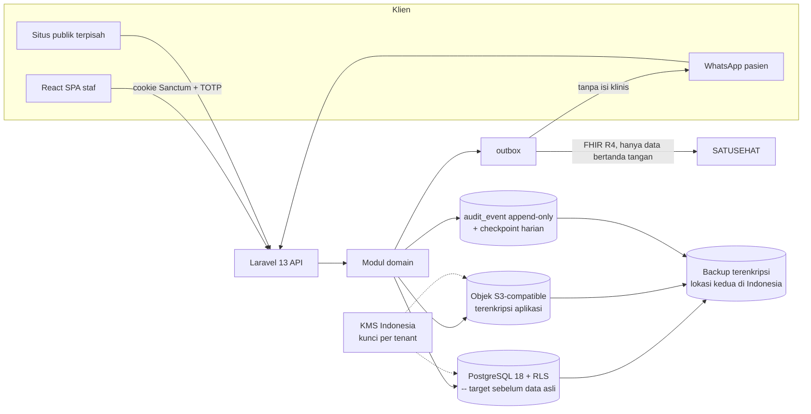
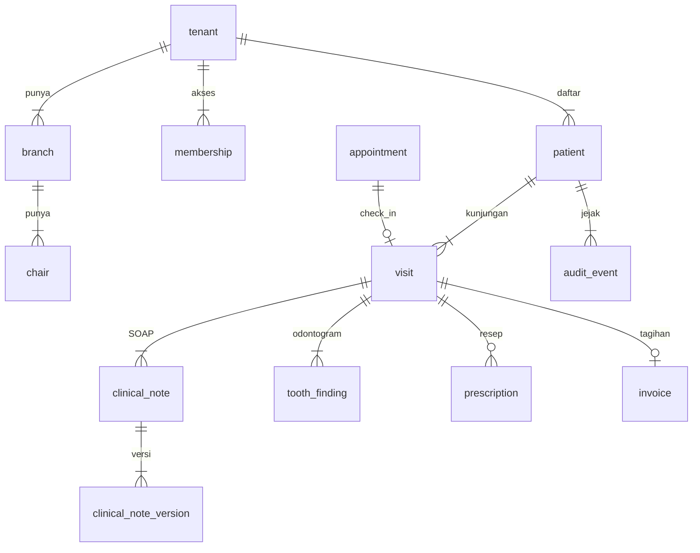
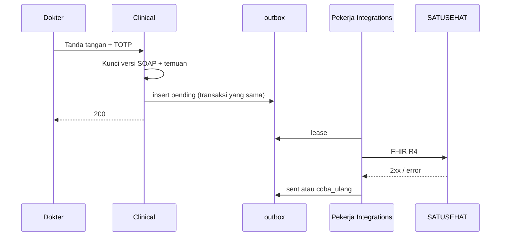

# Arsitektur target Bittodent

*Draf 1, 14 Nov 2026. Dokumen ini merangkum arsitektur agar sesuai spek, lalu merinci **retensi**, **kapasitas 5.000–10.000 pasien per tenant**, dan **kesenjangan terhadap kode di `main`**. Bukan nasihat hukum dan bukan klaim kepatuhan.*

**Dokumen acuan yang tetap berlaku** (jangan dibaca sebagai diganti): `docs/product.md`, `docs/architecture.md`, `docs/database.md`, `docs/compliance.md`, `docs/decisions.md` (D-001–D-044), `docs/agents.md`, `CLAUDE.md`. Rancangan ringkasan AI dokter ada di PR #1 (`docs/ai/ringkasan-rekam-medis.md` di cabang `design/ai-medical-summary`) — **belum digabung**, tidak diulang di sini.

**Permintaan baru Yohanes (14 Nov 2026):** rekam medis “bisa disimpan 10 tahun”; tiap tenant 5.000–10.000 pasien. Keputusan usulan: D-045, D-046, D-047.

Urutan prioritas tetap: keamanan & privasi → keselamatan klinis & keutuhan data → regulasi → produk.

---

## 1. Konteks dan batas modul

SaaS rekam medis & manajemen klinik gigi untuk Indonesia. Agen AI mengerjakan administrasi; keluaran klinis selalu **draf** sampai dokter gigi berizin menandatangani (D-001). Satu model data `tenant → cabang → kursi` (D-007); mode sederhana hanya menyembunyikan menu.

**Stack yang sudah diputuskan:** Laravel 13 API (tanpa Inertia/Blade) + React SPA (Vite) (D-029, D-015). MVP sekarang MySQL 8.4, **data palsu saja** (D-030). **Gerbang keras:** pindah ke PostgreSQL 18 + RLS `FORCE` sebelum data pasien asli (`docs/compliance.md` checklist; `docs/database.md` 11.5).

**Batas modul** mengikuti `app/backend/config/modules.php` (ditegakkan `tests/Feature/ModuleBoundaryTest`). Modul hanya saling menyentuh lewat `Contracts/` atau `Events/`. `App\Shared` tidak memakai modul. Tidak ada yang bergantung pada Reporting.

| Modul | Peran | Status di `main` (kode) |
|---|---|---|
| Tenancy, Identity | Tenant, cabang, sesi, login TOTP | Ada |
| Patients | Identitas, keluarga, wali, riwayat medis berversi, peringatan | Ada |
| Scheduling | Kursi, janji, janji terencana, bentrok | Ada |
| Clinical | Kunjungan (`visit`), SOAP berversi, odontogram, persetujuan, koreksi | Ada; mesin 9 langkah D-033 belum |
| Prescriptions | Resep + item + batal | Tabel + trigger; **belum ada API** (`app/DEVIATIONS.md` #38) |
| Tariffs, Billing, Compensation | Tarif tingkat, tagihan dari tindakan selesai, bagi hasil | Sebagian; layar kasir SPA belum |
| Recall | `reminder_log` + kanal no-op | Ada |
| Integrations | Tabel `outbox` | Enqueue saat tanda tangan; **pengirim SATUSEHAT/WhatsApp belum ada** (`OutboxService`) |
| Intake, Queue, Inventory, Reporting, Audit (tampilan) | Sesuai peta produk | Stub / kosong |
| ClinicalSummary | Ringkasan AI dokter | Hanya rancangan PR #1, bukan di `main` |

Frontend meniru modul yang sama di `app/frontend/src/modules/` (`auth`, `patients`, `scheduling`, `clinical`, `billing`, …) di atas `src/shared`.

---

## 2. Model data inti

Bentuk data dulu, lalu logika (selaras `docs/database.md`). Keadaan yang dilarang (catatan final diubah diam-diam, akses lintas tenant, hapus rekam) harus **sulit diwakili**, bukan hanya dicegah di UI.

| Entitas | Nama di desain target | Nama di kode `main` | Aturan inti |
|---|---|---|---|
| Klinik | `tenant` | `tenant` | Isolasi keras; tidak ada query lintas tenant |
| Cabang / kursi | `branch`, `chair` | sama | Data operasional terikat cabang; dokter boleh baca klinis lintas cabang dalam tenant, tercatat audit (D-027) |
| Pasien | `patient` | `patient` | Nama + DOB plaintext (D-020); NIK/HP/alamat terenkripsi + blind index |
| Janji | `appointment` | `appointment` | Mesin status di PHP; nama Inggris di kode (`booked`…) vs nama Indonesia di desain — `app/DEVIATIONS.md` #5 |
| Kunjungan | desain memakai `encounter` + 9 keadaan (D-033) | tabel **`visit`**, status hanya `berlangsung` \| `selesai` | Celah: D-033 belum di kode |
| Catatan klinis | `clinical_note` + `clinical_note_version` | sama | Versi `signed` append-only (trigger MySQL); koreksi = versi baru + `supersedes_id` (D-017) |
| Odontogram | `tooth_finding` per gigi (FDI) per permukaan, tanpa tabel ringkasan (D-021) | sama + `tooth_baseline` | Final append-only; “terkini” dihitung, bukan disalin |
| Resep | `prescription` + item + void | sama | `signed` tidak di-update; batal = baris void (D-036); e-resep SATUSEHAT menyusul |
| Tagihan / klaim | `invoice`, `invoice_line`, `invoice_adjustment`; model penjamin siap BPJS (D-008) | ada; `payer_type` di `patient` | Baris tagihan dari tindakan selesai + salinan harga (D-035). Bridging BPJS bukan MVP |
| Audit | `audit_event` partisi bulanan + `audit_checkpoint` (D-018) | `audit_event` **tanpa** partisi/checkpoint; `auth_event` global untuk login | Metadata saja, tanpa isi sensitif (`App\Shared\Audit\Audit`) |
| File | `file_object` + objek terenkripsi (D-022) | **belum ada** | Rontgen/foto/tanda tangan/audio |
| Kiriman keluar | `outbox` | ada, status tetap `pending` | Hanya data bertanda tangan; idempoten + `lease_token` (D-019) |

ID: UUIDv7. Uang: `bigint` rupiah. Waktu: UTC, tampilan zona cabang (D-023). Peran aplikasi tanpa `DELETE` di tabel klinis/keuangan.

---

## 3. Retensi dan penyimpanan

### 3.1 Apa yang sudah tertulis vs permintaan “10 tahun”

`docs/compliance.md` (Pasal 39, sumber PDF JDIH yang sudah dikutip di sana) dan D-005 / `CLAUDE.md`: simpan RME **paling singkat 25 tahun sejak kunjungan terakhir**, **tanpa hapus otomatis**. PP 28/2024 (pelaksana UU 17/2023 Pasal 299) **belum dibaca** — perlu dicek apakah mengubah retensi. Dokumen kami **tidak** menyebut aturan lebih lama khusus anak/minors.

Permintaan Yohanes “disimpan 10 tahun” **tidak ditafsirkan sebagai memendekkan Pasal 39**. Usulan D-046: 10 tahun = **jendela panas operasional**; retensi hukum tetap ≥25 tahun sejak kunjungan terakhir sampai ada tinjauan hukum.

**Hak UU PDP vs retensi.** Isi RM milik pasien, dokumen milik fasyankes (Permenkes Pasal 25–26, UU 17/2023 Pasal 297 — sudah dikutip di `compliance.md`). Pasal hapus/lupa UU PDP **tidak dikutip di dokumen kami** (jangan dikarang). Sampai ada nasihat hukum: permintaan hapus isi rekam medis **ditolak tercatat**; jangan ada job yang menghapus catatan klinis, odontogram final, atau audit.

**Legal hold.** Sengketa, audit, atau permintaan resmi menunda pemindahan ke dingin dan menunda pemusnahan *jika* suatu saat pemusnahan diizinkan setelah masa retensi. Siapa yang memasang/mencabut hold: perlu diputuskan (pemilik? DPO?).

**Audio dikte** tetap dihapus setelah catatan ditandatangani (D-038); itu pengecualian retensi yang sudah diputuskan, bukan “hapus rekam medis”.

### 3.2 Dua kandidat (lalu pilihan)

| | A. Semua panas 25 tahun | B. Panas 10 tahun + dingin sampai retensi hukum |
|---|---|---|
| Inti | Semua versi, audit, file di DB/objek primer | 10 tahun terakhir di primer; yang lebih lama *boleh* ke kelas dingin di Indonesia, tetap terenkripsi, tetap bisa dibuka |
| Kuat | Operasi sederhana, satu jalur buka rekam; **setelah A5 diperbarui, biaya file 25 tahun tetap kecil** | Selaras angka “10 tahun” tanpa merusak Pasal 39; cadangan jika volume file naik |
| Lemah | — (biaya objek bukan pembatas pada A5 saat ini) | Perlu kebijakan arsip, tes “buka arsip”, dan hold — kerja ekstra yang **belum wajib** |
| Bendera desain | — | Jangan sebar flag hapus ke modul klinis (tetap berlaku meski dingin opsional) |

**Pilihan setelah A5 (14 Nov 2026).** Untuk **file**, kandidat A (semua panas 25 tahun) sekarang memadai: ~7,3 GiB rontgen per tenant setelah 25 tahun operasi (bagian 4). Siklus dingin D-047 menjadi **opsional**, ditunda sampai volume nyata jauh lebih besar (foto tambahan, multi-cabang, atau A5 berubah). Untuk **kebijakan retensi**, D-046 tetap: tidak menghapus rekam medis di tahun ke-10; retensi hukum ≥25 tahun sejak kunjungan terakhir. Baris `clinical_note_version` / `tooth_finding` tetap di DB primer; evakuasi baris hanya jika uji D-045 membuktikan perlu. Yang perlu diutamakan di kapasitas sekarang: **pertumbuhan audit** (partisi, D-018), bukan lifecycle objek.

Rantai sidik **per baris** audit tetap ditolak (D-018: memaksa penulisan antre per tenant). Keutuhan = hak `INSERT`/`SELECT` saja + trigger + **checkpoint SHA-256 harian per tenant** (sidik gabungan baris hari itu), salinan checkpoint ikut backup ke lokasi kedua. Itu yang dipakai, bukan hash chain per event.

---

## 4. Estimasi volume (semua angka: estimasi, belum diukur)

### 4.1 Asumsi (jelas supaya bisa diganti)

| ID | Asumsi | Nilai | Dasar |
|---|---|---|---|
| A1 | Pasien terdaftar per tenant | 5.000 tipikal / 10.000 plafon | Yohanes; D-045 |
| A2 | Kunjungan per pasien terdaftar per tahun | **1,2** (stres: 2,0) | Selaras D-024: 6 juta janji / 1 juta pasien / 5 tahun = 1,2 |
| A3 | Versi SOAP per kunjungan | 1,3 | 1 final + ~0,3 koreksi; estimasi |
| A4 | Temuan odontogram baru/ubah per kunjungan | 8 | Estimasi; D-021 per gigi/permukaan |
| A5 | Lampiran (rontgen) | **~100 rontgen per klinik per tahun**, × **3 MiB** terenkripsi per file | **Angka pemilik (Yohanes), 14 Nov 2026.** Bukan fungsi jumlah pasien. Ditafsir per tenant sampai ada angka per cabang. Foto intraoral/file lain *boleh menambah*; jika 2×, file 10 tahun tetap ~5,9 GiB/tenant. |
| A6 | Baris audit terkait kunjungan | 30 | Kasar D-024: 200 juta audit / 6 juta janji ≈ 33 |
| A7 | Audit di luar kunjungan | 5 baris/pasien/tahun | Cari, buka kartu, login; estimasi |
| A8 | Batas atas pertumbuhan | Plafon penuh sepanjang 10 tahun (bukan pertumbuhan linier) | Konservatif, overestimate ±2× vs pertumbuhan linier |
| A9 | Tenant platform (perencanaan, bukan komitmen) | 50 awal / 300 (D-024) | D-024 |
| A10 | Ukuran baris + indeks (~1,5×) | visit ~0,4 KiB; versi catatan ~2 KiB; temuan ~0,3 KiB; audit ~0,5 KiB | Estimasi kasar |

Rumus 10 tahun operasional, satu tenant: `kunjungan = pasien × A2 × 10`. File rontgen: `100 × 10 × 3 MiB` (sama untuk 5.000 maupun 10.000 pasien).

### 4.2 Satu tenant, 10 tahun operasional (A2 = 1,2)

| Isi | 5.000 pasien | 10.000 pasien (plafon) |
|---|---:|---:|
| Kunjungan (`visit`) | 60.000 | 120.000 |
| Versi catatan | 78.000 | 156.000 |
| Temuan odontogram | 480.000 | 960.000 |
| Baris audit | ~2,1 juta | ~4,1 juta |
| File rontgen (jumlah / ukuran) | 1.000 / **~2,9 GiB** | 1.000 / **~2,9 GiB** |
| Perkiraan DB (baris + indeks, tanpa file) | ~2,1 GiB | ~4,2 GiB |

Kesimpulan (setelah A5 pemilik): **file tidak lagi merajai kapasitas.** Di plafon 10.000 pasien, DB (~4,2 GiB, sebagian besar audit) lebih besar daripada rontgen (~2,9 GiB). Keduanya kecil untuk satu tenant. Optimasi pertama = partisi dan retensi **audit** (D-018), bukan lifecycle objek. Siklus dingin file (D-047) **opsional**. Foto/file lain yang menambah volume belum dihitung di tabel ini.

### 4.3 Platform, 10 tahun (estimasi)

| Skenario | Pasien total | Kunjungan | Audit (baris) | File |
|---|---:|---:|---:|---:|
| 50 tenant × 5.000 | 0,25 juta | 3 juta | ~0,10 miliar | **~147 GiB** |
| 300 tenant × ~3.333 (skala D-024, 10 th) | 1 juta | 12 juta | ~0,40 miliar | **~879 GiB** |
| 300 tenant × 10.000 (stres plafon) | 3 juta | 36 juta | ~1,2 miliar | **~879 GiB** |

Kolom file sama untuk kedua skenario 300 tenant karena A5 dihitung per klinik/tahun, bukan per pasien.

D-024 merencanakan bukti 5 tahun (1 juta pasien, 200 juta audit). D-045: uji itu **tetap**, plus uji **satu tenant 10.000 pasien** (bukan meratakan 3.333).

### 4.4 Horison retensi 25 tahun

- Klinik beroperasi 10 tahun lalu berhenti: volume data hampir berhenti tumbuh; **tetap disimpan ≥25 tahun sejak kunjungan terakhir** (bukan hapus). File rontgen tetap ~2,9 GiB/tenant.
- Klinik beroperasi terus 25 tahun di plafon 10.000: kunjungan/DB ≈ 2,5× tabel 4.2 (~10 GiB DB/tenant); file rontgen = 100 × 25 × 3 MiB ≈ **~7,3 GiB/tenant**. Tetap di Indonesia, tetap terenkripsi. Menyimpan semua file di kelas panas selama 25 tahun tetap wajar pada angka ini.

---

## 5. Multi-tenant dan keamanan

**Isolasi (target).** Satu skema, `tenant_id` di setiap tabel klinik, RLS `ENABLE` + `FORCE`, peran aplikasi bukan pemilik dan tanpa `BYPASSRLS`, FK gabungan `(tenant_id, id)`, `set_config('app.tenant_id', ?, true)` per transaksi (D-016). Tanpa konteks tenant → 0 baris atau gagal, tidak pernah semua baris.

**Isolasi (kode sekarang).** Tidak ada RLS. Tembok = trait `BelongsToTenant` (global scope, gagal tertutup) + tes `ArchitectureTest` + FK komposit + user `ehr_app` tanpa `DROP`/`ALTER`. Satu query yang lolos scope = bocor. Karena itu D-030: **data palsu saja** sampai gerbang PostgreSQL lulus. Pengecualian terdokumentasi: `Membership` boleh tanpa tenant, hanya `user_id` = user login (`app/DEVIATIONS.md` #2).

**Enkripsi.** Transit: TLS 1.2+. Istirahat: disk/backup. Per kolom: AES-256-GCM, kunci **bukan** `APP_KEY` (D-020). NIK/HP: blind index HMAC-SHA256. Kode sekarang: `App\Shared\Crypto\Crypto`, **satu** `ENCRYPTION_KEY` / `BLIND_INDEX_KEY` per deployment dari `.env` (`app/DEVIATIONS.md` #10). Target produksi: DEK per tenant dibungkus KMS di Indonesia, rotasi, akses tercatat. Pengecualian D-020 jangan diperluas: `payer_member_no` di migrasi pasien saat ini **plaintext** — perlu diselaraskan (enkripsi + bidx) sebelum data asli.

**RBAC.** Satu matriks `App\Shared\Permissions\Permissions::MATRIX`: `owner`, `dentist`, `assistant`, `front_desk`, `kasir`. Pemilik baca klinis saja, setiap buka diaudit (D-040). Kasir tanpa `note.read` (D-044). Tanda tangan hanya dokter penulis + TOTP ulang (D-041). Login: Fortify TOTP wajib semua peran.

**Audit.** Append-only: grant tanpa UPDATE/DELETE + trigger MySQL pada `audit_event`. Penulisan lewat `Audit::log` / `Audit::auth`. Kolom `cross_branch` ada di `database/postgres-target/0002_schema.php`, **belum** di migrasi MySQL; kode Chart menyimpan `cross_branch` di `detail` JSON. Layar/ekspor audit (izin `audit.read`) masih stub (`app/Modules/Audit/README.md`).

---

## 6. Integrasi SATUSEHAT

Wajib MVP (D-004, Permenkes Pasal 21 — platform interoperabilitas Kemenkes; nama “SATUSEHAT” perlu dicek di pedoman resmi, `compliance.md`). Hanya data **sudah ditandatangani** yang boleh keluar. Draf agen tidak dikirim (`docs/agents.md`).

Alur target (D-019): tanda tangan dan insert `outbox` dalam **satu transaksi**; pekerja `FOR UPDATE SKIP LOCKED` + `lease_token`; coba ulang; status per cabang. Mapping use case Gigi (FHIR R4): Encounter, Observation odontogram, Condition, Procedure, MedicationRequest (resep: setelah sandbox, D-036), ImagingStudy. OAuth2 client credentials, Organization/Location/Practitioner IHS dulu. Identifier idempoten: cara SATUSEHAT menolak ganda **perlu dicek**.

**Kode sekarang:** `NoteController` memanggil `OutboxService::enqueue('satusehat', 'satusehat:note_version:{id}', …)` saat tanda tangan/koreksi (dites di `ChartApiTest`). `OutboxService` mencatat baris dan **berhenti** — komentar di kelas itu: belum ada pengirim, status tetap `pending`.

---

## 7. Skala dan kinerja

Target p95 query panas: `docs/database.md` 7.2 (belum diukur). Yang relevan di plafon 10.000 pasien: Q4 cari nama (`search_patient`, bukan trigram mentah di bawah RLS), Q5 NIK/HP lewat bidx, Q6 buka rekam, Q7 odontogram terkini, Q13 audit (hanya partisi dekat).

Rencana:

1. `tenant_id` selalu kolom pertama indeks; pagination keyset, bukan `OFFSET`.
2. Setelah gerbang PG: partisi `audit_event` per bulan (D-018); query 3 bulan terakhir tidak memindai 25 tahun.
3. Bukti D-024 + D-045: seed sintetis, `EXPLAIN (ANALYZE, BUFFERS)` dengan RLS, termasuk **tenant 10.000 pasien**. Jangan klaim cepat sebelum itu.
4. Jumlah tenant 300 pada plafon 10.000 adalah skenario stres (bagian 4.3). File rontgen platform pada A5 ≈ 0,9 TiB / 10 tahun — bukan pembatas utama keputusan cloud (D-010); pertumbuhan **audit** lebih perlu dihitung.
5. Read replica di Indonesia boleh untuk laporan, bukan untuk tulisan klinis.
6. Pencarian: nama (plaintext + fungsi tenant-bound); NIK/HP hanya cocok persis via bidx. Jangan dekripsi massal untuk mencari.

Kode sekarang: pencarian nama = awalan kata + indeks prefiks (`PatientSearch`, `app/DEVIATIONS.md` #7). Cukup untuk prototipe, tidak untuk 10.000 pasien dengan typo.

---

## 8. Backup dan pemulihan

D-025 (usulan, menunggu Q-6 RPO/RTO): pgBackRest ≥ 2.59.3, terenkripsi, akun & lokasi **terpisah** di Indonesia (Permenkes Pasal 20). Penuh mingguan, diferensial harian, WAL terus-menerus. Backup **imutable** selama masa simpan (tahan ransomware). Uji pulih **bulanan** ke server terpisah, hasil dicatat. Objek file di-backup/replikasi terpisah (versi + imutability). Checkpoint audit ikut ke lokasi kedua (penyerang yang menguasai server + kunci bisa memalsu checkpoint lokal — `docs/architecture.md` 11.5).

Usulan target awal (tetap Q-6): RPO ≤ 15 menit (WAL), RTO ≤ 4 jam untuk DB primer satu region Jakarta. Bukan keputusan final.

Kode/operasional sekarang: MySQL lokal/demo, **tanpa** pipa pgBackRest/uji pulih.

---

## 9. Kesenjangan kode `main` vs target

Didasarkan pada migrasi, modul, dan `app/DEVIATIONS.md` di commit `main` (f36fa9e), bukan spekulasi.

| # | Kesenjangan | Risiko |
|---|---|---|
| G1 | Belum PostgreSQL + RLS (D-030) | Isolasi hanya di aplikasi; data asli dilarang |
| G2 | Kunci kolom satu per deployment, bukan KMS per tenant | Rotasi/insiden kunci, kebocoran lintas tenant jika backup bocor bersama env |
| G3 | Tidak ada `file_object` / unggah rontgen terenkripsi (D-022, produk MVP) | Fitur dan kapasitas file tidak bisa diuji |
| G4 | Tidak ada `audit_checkpoint`, partisi audit, layar audit | Keutuhan jangka panjang dan investigasi lemah |
| G5 | Outbox tanpa pekerja SATUSEHAT/WhatsApp | Pasal 21 / D-004 belum terpenuhi di kode |
| G6 | Tidak ada `agent_run` / `agent_draft`; ringkasan AI hanya di PR #1 | Scribe/ringkasan belum punya jejak model |
| G7 | `visit` belum mesin 9 langkah D-033 | Alur datang→kasir bisa dilompati |
| G8 | Resep tanpa API; e-resep bukan MVP | Modul tidak bisa dipakai staf |
| G9 | `payer_member_no` plaintext | Menyimpang D-020 sebelum data asli |
| G10 | Tidak ada retensi/hold/`retention_until` | Kebijakan 10/25 tahun tidak bisa ditegakkan di sistem |
| G11 | Pickup zona WIB keras di SPA (`DEVIATIONS` #13) | Salah jam di WITA/WIT |
| G12 | Uji kompetisi janji paralel belum ada | Double booking bisa lolos di MySQL |
| G13 | Hosting produksi & sertifikasi cloud belum dipilih (D-010) | PSE / Pasal 20–22 |
| G14 | `cross_branch` belum kolom first-class di MySQL | Laporan akses lintas cabang lebih sulit |

---

## 10. Peta kerja berurutan (unit kecil, bisa diverifikasi)

Setiap unit = satu PR, tes otomatis, tanpa data pasien asli. Jangan gabung ke `main` tanpa persetujuan Yohanes.

| Unit | Isi | Bukti selesai |
|---|---|---|
| A0 | Dokumen ini + D-045–D-047 (PR ini) | Ditinjau; pertanyaan terbuka dijawab atau ditunda sadar |
| A1 | `file_object` + adaptor S3 terenkripsi aplikasi + unggah foto/rontgen sintetis | Tes unggah/unduh/hak akses; objek bukan plaintext |
| A2 | `audit_checkpoint` harian + tes rusak-sidik | Tes: ubah baris lewat jalur admin uji → alarm, checkpoint tidak ditimpa |
| A3 | Kolom `audit_event.cross_branch` + layar audit dasar (`audit.read`) | Tes D-027; kasir/front desk tidak lihat isi klinis |
| A4 | `legal_hold` + `retention_until` (hitung dari kunjungan terakhir, 25 tahun, dapat dikonfigurasi setelah nasihat hukum) — **tanpa job hapus klinis** | Tes: hold memblokir arsip file; tidak ada DELETE catatan |
| A5 | Selaraskan `payer_member_no` ke enkripsi + bidx (D-020) | Tes cari no. anggota; plaintext hilang |
| A6 | Mesin keadaan `visit` (D-033) + tes transisi | Loncat langkah ditolak |
| A7 | API resep + cetak (D-036), masih tanpa e-resep | Tes tanda tangan/void; SATUSEHAT belum dikirim |
| A8 | Pekerja outbox no-op yang memproses `lease` + adaptor palsu, lalu adaptor sandbox SATUSEHAT | Tes idempoten; baris tidak stuck tanpa jejak |
| A9 | **Gerbang PostgreSQL + RLS** (`database.md` 11.5) | Tes isolasi sebagai `ehr_app` lulus untuk setiap tabel tenant |
| A10 | `search_patient` + uji 10.000 pasien sintetis (Q4, Q5, Q6, Q7) | `EXPLAIN` memenuhi target atau target direvisi tertulis |
| A11 | KMS + DEK per tenant + rotasi | Tes buka data lama setelah rotasi; kunci tidak di `.env` produksi |
| A12 | pgBackRest + uji pulih bulanan (setelah Q-6) | Catatan RPO/RTO terukur |
| A13 | *(Opsional, ditunda.)* Lifecycle file: pindah kelas dingin setelah 10 tahun + “buka arsip” — hanya jika volume nyata jauh di atas A5 | Tes file tahun ke-11 masih bisa dibuka, lebih lambat |
| A14 | Ringkasan AI: ikuti unit S0–S7 di PR #1, jangan diduplikasi di sini | PR #1 |

Jangan menukar urutan A9 sebelum data asli. A1–A8 boleh di MySQL palsu asal mudah pindah (tanpa SQL MySQL di kode aplikasi).

---

## 11. Keputusan sintesis

Dua bentuk yang dibanding: (A) semua data panas 25 tahun, vs (B) jendela panas 10 tahun + dingin sampai retensi hukum. Setelah A5 dikunci pemilik (100 rontgen/klinik/tahun), biaya file kecil jadi **A memadai untuk objek**; B/D-047 (siklus dingin) **opsional**. D-046 tetap: jangan hapus rekam medis sebelum retensi hukum (Pasal 39 / D-005). Isolasi tenant, append-only klinis, outbox, dan checkpoint audit **tidak dirancang ulang** — sudah ada di D-016–D-019. Prioritas kapasitas bergeser ke partisi audit, bukan arsip file.

---

## 12. Pertanyaan terbuka untuk Yohanes

1. **Q-22 / D-046:** Setuju “10 tahun” = jendela panas, retensi hukum tetap ≥25 tahun sejak kunjungan terakhir, sampai PP 28/2024 + konsultan hukum berkata lain?
2. Apakah ada sumber lain (misalnya kebiasaan klinik, atau aturan yang kami belum baca) yang membuatnya yakin angka 10 tahun — supaya kami tidak salah menafsir Pasal 39?
3. **Q-6** masih terbuka: RPO/RTO yang diinginkan? (Usulan sementara: 15 menit / 4 jam.)
4. Perkiraan jumlah klinik (tenant) tahun 1 dan tahun 3? (Bagian rontgen Q-23 sudah dijawab: ~100/klinik/tahun.)
5. *(Ditutup 14 Nov 2026.)* Rontgen ~100 per klinik per tahun (Yohanes); A5 diperbarui.
6. Siapa yang boleh memasang dan mencabut **legal hold**?
7. Aturan retensi untuk pasien anak (minors): perlu dicek hukum; kami belum punya dasar di dokumen.
8. Q-5 (TTE) dan Q-7 (asuransi swasta) tetap terbuka di `decisions.md`.
