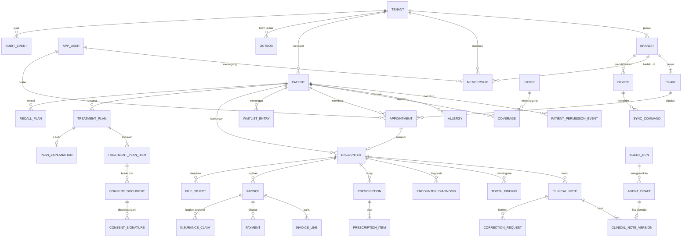
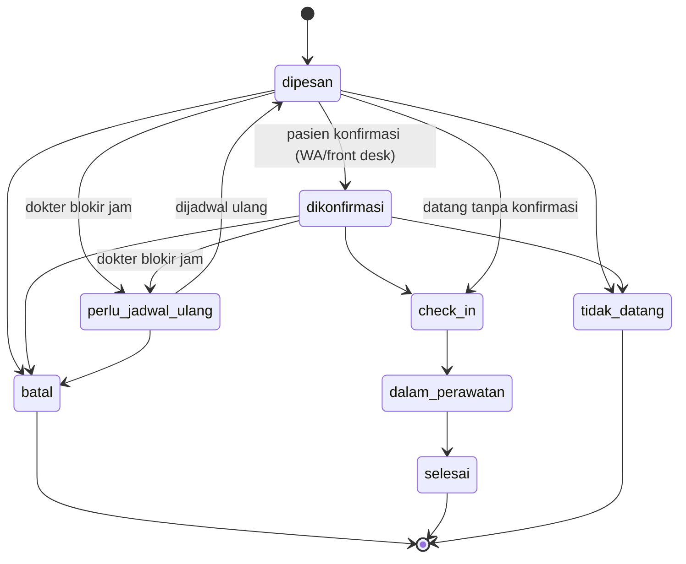
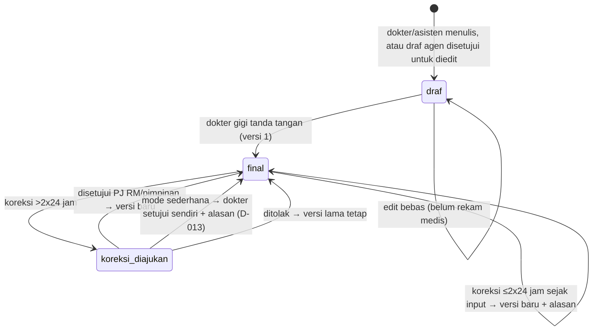
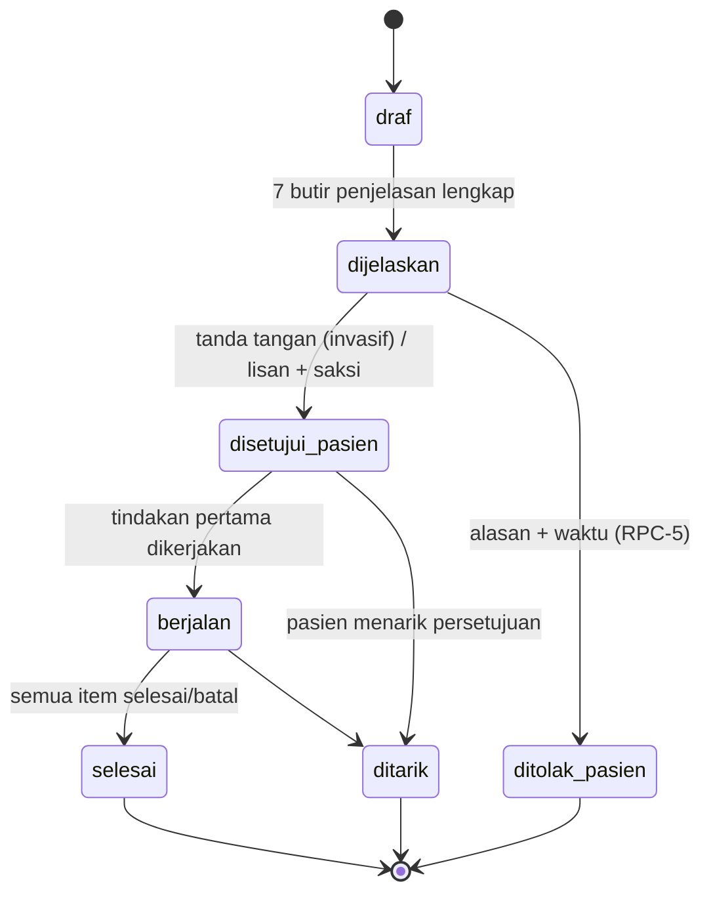
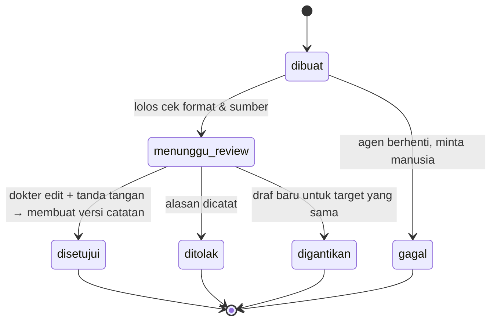
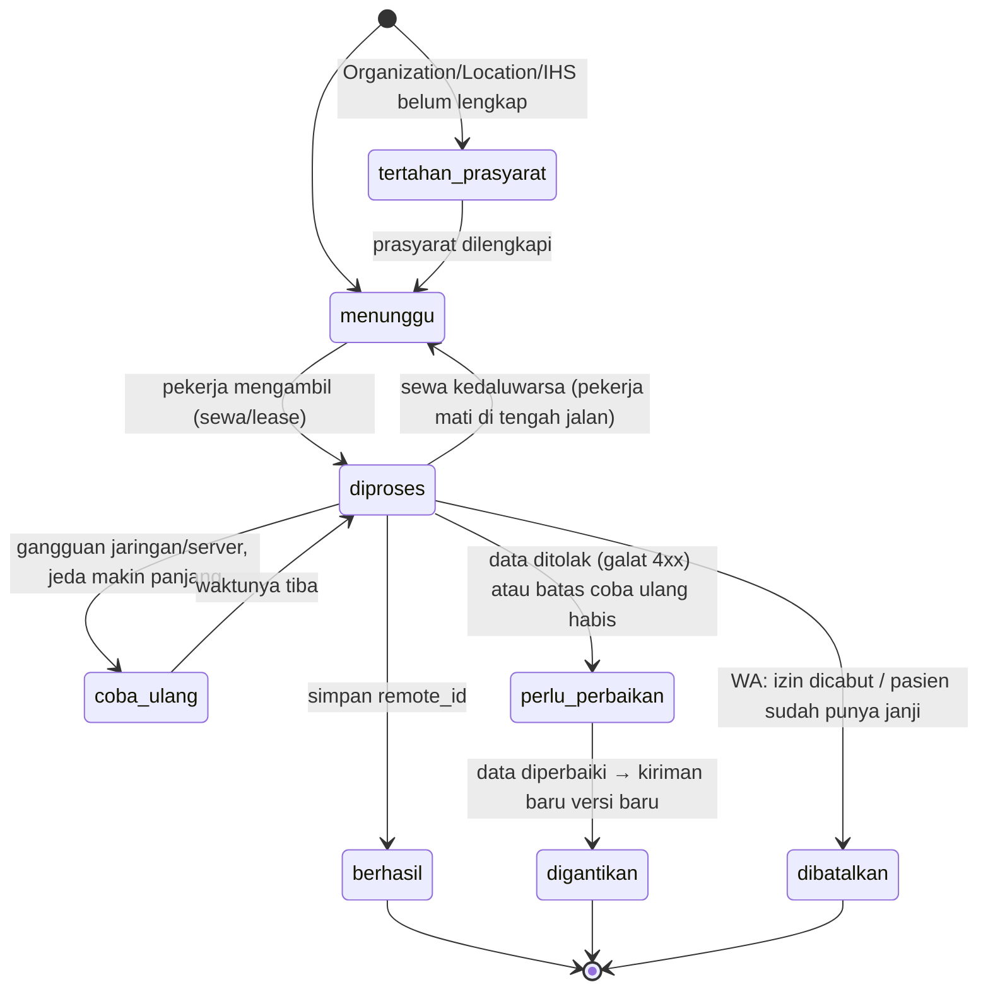

# Desain Database (draf 1)

> Stack server sejak D-029: Laravel 13. **Dokumen ini = desain TARGET di PostgreSQL 18 + RLS**, wajib sebelum data pasien asli (D-030). MVP sekarang berjalan di MySQL 8.4 dengan data palsu saja; bedanya ada di **bagian 11 (Mode MVP MySQL)**. Di target, peran, RLS, trigger, dan fungsi dibuat lewat migrasi Laravel berisi SQL tangan. Nama peran di prototipe: `ehr_owner` (pemilik), `ehr_app` (aplikasi), `ehr_search` (fungsi pencarian), lihat `app/DEVIATIONS.md`.

*14 Nov 2026. Desain saja, belum ada kode. Semua contoh memakai data palsu. Hal yang belum terverifikasi ditandai "perlu dicek". Urutan prioritas: keamanan & privasi → keselamatan klinis & keutuhan data → regulasi → fitur.*

Dokumen ini menjelaskan **bentuk data** sebelum logika ditulis. Bentuk data yang benar membuat keadaan yang dilarang (misal catatan final yang diubah diam-diam) mustahil terjadi, bukan sekadar dicegah oleh kode yang rajin.

## 0. Istilah singkat
- **Tabel** = daftar data sejenis, seperti lembar Excel. **Kolom** = satu jenis isian. **Baris** = satu data.
- **Indeks** = daftar isi yang membuat pencarian cepat tanpa membaca seluruh tabel.
- **Indeks komposit** = indeks gabungan beberapa kolom, urutannya penting. **Indeks parsial** = indeks hanya untuk sebagian baris (misal yang belum lunas). **Indeks covering** = indeks yang ikut membawa kolom tambahan (`INCLUDE`) sehingga database tidak perlu membuka tabelnya.
- **RLS (Row-Level Security)** = aturan di dalam PostgreSQL yang otomatis menyembunyikan baris milik klinik lain.
- **Foreign key (FK)** = kolom yang menunjuk ke baris di tabel lain.
- **State machine** = daftar keadaan resmi sebuah data dan perpindahan yang boleh, misal draf → final.
- **Outbox** = kotak surat keluar di database. Data yang harus dikirim ke luar (SATUSEHAT, WhatsApp) dicatat dulu di sini, lalu dikirim oleh pekerja latar belakang.
- **Blind index** = sidik pencarian. Nilai asli (misal NIK) dienkripsi, lalu disimpan juga "sidik" hasil HMAC (fungsi acak satu arah berkunci rahasia) supaya bisa dicari tanpa membuka enkripsi.
- **Keyset pagination** = cara memuat halaman berikutnya dengan "lanjut dari data terakhir yang dilihat", bukan "lewati 500 baris pertama". Tetap cepat walau datanya jutaan.

## 1. Aturan umum untuk semua tabel
| Aturan | Isi | Alasan |
|---|---|---|
| ID | `uuid` versi 7 (`uuidv7()` bawaan PostgreSQL 18). Urut menurut waktu, jadi ramah indeks. | ID acak murni membuat indeks berantakan; ID angka berurutan bisa ditebak. |
| `tenant_id` | Wajib di **setiap** tabel data klinik, `NOT NULL`, selalu kolom **pertama** di setiap indeks. | Isolasi klinik (D-016) dan kecepatan. |
| FK selalu membawa `tenant_id` | FK ditulis `(tenant_id, patient_id) → patient(tenant_id, id)`. | Dokumentasi PostgreSQL menyebut pengecekan FK **melewati RLS**. FK gabungan ini membuat baris klinik A tidak mungkin menunjuk ke pasien klinik B. |
| Waktu | `timestamptz` (disimpan UTC). Tampilan memakai zona cabang (`branch.timezone`: Asia/Jakarta, Asia/Makassar, Asia/Jayapura). | Indonesia punya 3 zona waktu (WIB, WITA, WIT). "Jadwal hari ini" dihitung per zona cabang. |
| Uang | `bigint` dalam rupiah utuh. | Rupiah tidak memakai sen; angka bulat menghindari salah pembulatan. |
| Tidak ada `DELETE` | Peran aplikasi **tidak punya hak DELETE** di tabel klinis dan keuangan. Yang ada `archived_at` (arsip). | Retensi ≥25 tahun (Permenkes 24/2022 Pasal 39, D-005). |
| Jejak pembuat | `created_at`, `created_by` (user atau agen) di setiap baris. | Audit dan tanggung jawab. |
| Status | Kolom `state` bertipe `enum` PostgreSQL, perpindahannya dicek oleh satu fungsi transisi (bagian 4). | Satu sumber kebenaran, bukan banyak kolom ya/tidak yang harus selalu sinkron. |

## 2. Daftar entitas dan hubungannya

### 2.1 Kelompok entitas
| Kelompok | Tabel | Pemilik modul |
|---|---|---|
| Klinik & akses | `tenant`, `branch`, `chair`, `app_user`, `membership` | tenancy |
| Pasien | `patient`, `patient_permission_event`, `allergy`, `medical_history`, `payer`, `coverage` | patients |
| Jadwal | `appointment`, `schedule_block`, `waitlist_entry` | scheduling |
| Klinis | `encounter`, `clinical_note`, `clinical_note_version`, `correction_request`, `tooth_finding`, `encounter_diagnosis` | charting |
| Rencana & persetujuan | `procedure_catalog`, `price_list_item`, `treatment_plan`, `treatment_plan_item`, `plan_explanation`, `consent_document`, `consent_signature` | treatment |
| Resep | `prescription`, `prescription_item` | prescribing |
| Kasir | `invoice`, `invoice_line`, `payment`, `insurance_claim`, `cash_pocket`, `pocket_transfer`, `cash_closing` | billing |
| Recall & pesan | `recall_plan`, `message_template`, `outbox` (jenis `whatsapp`) | engagement |
| SATUSEHAT | `satusehat_registration`, `outbox` (jenis `satusehat`), `external_ref` | interop |
| Agen AI | `agent_run`, `agent_draft` | agents |
| Perangkat & offline | `device`, `sync_command` | offline |
| File | `file_object` | files |
| Audit | `audit_event` (dipartisi per bulan), `audit_checkpoint` | audit |
| Referensi nasional (tanpa `tenant_id`, hanya baca) | `ref_kfa_product`, `ref_icd10`, `ref_icd9cm`, `ref_tooth_condition` | reference |

### 2.2 Diagram hubungan (ER)
*Diagram ringkas; kolom lengkap ada di bagian 3.*

## 3. Tabel kunci
*Tipe: `uuid` = ID, `text` = teks, `bytea` = data terenkripsi (byte), `enum` = pilihan tetap, `jsonb` = data terstruktur bebas. 🔒 = dienkripsi per kolom (bagian 5). 🔎 = punya blind index.*

### 3.1 Klinik, cabang, kursi, akses
**`tenant`** (satu klinik pelanggan)
| Kolom | Tipe | Aturan |
|---|---|---|
| `id` | uuid | kunci utama |
| `name` | text | wajib |
| `mode` | enum `sederhana`/`standar` | `sederhana` hanya selama cabang = 1 (REG-5); berubah otomatis saat cabang kedua dibuat |
| `dek_wrapped` | bytea | kunci data tenant yang terbungkus kunci induk (bagian 5) |
| `bidx_key_wrapped` | bytea | kunci blind index tenant, terbungkus |
| `is_demo` | boolean | `true` untuk lingkungan data palsu (RBA-6) |

**`branch`** — `tenant_id`, `name`, `timezone` (wajib), `satusehat_location_id` (nullable sampai terdaftar). Unik `(tenant_id, id)`.

**`chair`** — `tenant_id`, `branch_id`, `label`, `active`. FK `(tenant_id, branch_id)`.

**`app_user`** — satu orang (bisa bekerja di beberapa tenant). Email, status MFA, `ihs_practitioner_id` (nomor IHS dokter, nullable), `license_type` (enum `dokter_gigi`/`lainnya`), nomor STR/SIP (perlu dicek formatnya).

**`membership`** — hak akses satu user di satu tenant.
| Kolom | Tipe | Aturan |
|---|---|---|
| `tenant_id`, `user_id` | uuid | unik bersama `branch_id` + `role` |
| `branch_id` | uuid | nullable = berlaku di semua cabang tenant |
| `role` | enum `dokter_gigi`, `asisten`, `front_desk`, `kasir`, `pemilik`, `penanggung_jawab_rm` | satu orang boleh punya beberapa baris (mode sederhana: dokter + pemilik) |
| `revoked_at` | timestamptz | dicabut, bukan dihapus |

Aturan keras: hanya user dengan `license_type = dokter_gigi` **dan** peran `dokter_gigi` yang boleh menandatangani catatan klinis. Ini dicek di fungsi tanda tangan dan di constraint/trigger database (cek ganda untuk aturan keselamatan).

### 3.2 Pasien
**`patient`**
| Kolom | Tipe | Aturan |
|---|---|---|
| `mrn` | text | no. RM, unik `(tenant_id, mrn)`, dibuat berurutan per tenant. Format (usulan): `BT-` + 6 angka, mulai `BT-000001` per tenant, tanpa kode cabang; penghitung `patient_mrn_seq` dikunci per tenant (MVP MySQL: `MrnGenerator`) |
| `full_name` | text | wajib. Tidak dienkripsi supaya bisa dicari sebagian (D-020, **diterima Jerome** sebagai pengecualian terdokumentasi) |
| `name_search` | text | huruf kecil, tanpa tanda baca, dari `full_name` (dibuat otomatis) |
| `nik_enc` 🔒 | bytea | NIK terenkripsi. Wajib untuk pasien beridentitas (REG-1) |
| `nik_bidx` 🔎 | bytea | sidik NIK, unik `(tenant_id, nik_bidx)` → deteksi pasien ganda |
| `phone_enc` 🔒 / `phone_bidx` 🔎 | bytea | nomor HP dinormalkan ke format +62 sebelum disidik |
| `birth_date` | date | tidak dienkripsi (umur, pencocokan identitas). Perlu ditinjau di DPIA |
| `sex` | enum | |
| `address_enc` 🔒, `email_enc` 🔒 | bytea | |
| `social_enc` 🔒 | bytea | agama, pekerjaan, pendidikan, status kawin (Pasal 14) dalam satu paket terenkripsi |
| `status` | enum `draf_pendaftaran`, `aktif`, `meninggal`, `diarsip` | draf dari formulir pasien belum jadi rekam medis (REG-2) |
| `verified_by`, `verified_at` | | siapa yang mencocokkan KTP |
| `last_visit_at` | timestamptz | dasar hitung retensi 25 tahun |

**`patient_permission_event`** (izin pasien, hanya ditambah)
| Kolom | Tipe | Aturan |
|---|---|---|
| `purpose` | enum `pemrosesan_data`, `wa_pengingat`, `wa_recall`, `rekam_audio`, `wa_tagihan` | |
| `action` | enum `beri`, `cabut` | |
| `source` | enum `formulir`, `front_desk`, `balasan_wa` | RCL-3: balasan "berhenti" = `cabut` |
| `text_version` | text | versi teks izin yang disetujui |

Izin yang berlaku = kejadian terakhir per `(patient, purpose)`. Tidak ada kolom "boleh_wa" terpisah yang bisa tidak sinkron.

**`coverage`** (penjamin, siap BPJS, D-008) — `payer_id` (umum/asuransi swasta/BPJS), `member_no_enc` 🔒 + `member_no_bidx` 🔎, `class_code` (mengacu `coverage-class` SATUSEHAT), `valid_from/to`, `external_ref`.

**`allergy`** — `substance_code` (kode KFA zat aktif bila ada, perlu dicek ketersediaannya), `substance_text_enc` 🔒, `severity`, `active`. Dipakai untuk peringatan resep (RSP-2).

### 3.3 Jadwal
**`appointment`**
| Kolom | Tipe | Aturan |
|---|---|---|
| `branch_id`, `chair_id`, `dentist_id`, `patient_id` | uuid | FK gabungan dengan `tenant_id` |
| `starts_at`, `ends_at` | timestamptz | `ends_at > starts_at` |
| `state` | enum (bagian 4.1) | |
| `booked_via` | enum `front_desk`, `agen_wa`, `web` | |
| constraint anti-bentrok kursi | `EXCLUDE USING gist (tenant_id WITH =, chair_id WITH =, tstzrange(starts_at, ends_at) WITH &&) WHERE (state IN aktif)` | Database sendiri menolak dua janji di kursi yang sama pada jam yang tumpang tindih (JDW-1), walau dua petugas menekan simpan bersamaan |
| constraint anti-bentrok dokter | sama, dengan `dentist_id` | |

**`schedule_block`** — blokir jam dokter (JDW-4), dengan constraint yang sama terhadap dirinya sendiri. Janji yang sudah ada pada jam blokir tidak dihapus, tapi pindah ke `perlu_jadwal_ulang`.

**`waitlist_entry`** — pasien, cabang, rentang waktu yang diinginkan (`tstzrange`), `state` (`menunggu`, `ditawari`, `terjadwal`, `batal`), `offer_expires_at`.

### 3.4 Kunjungan dan catatan klinis
**`encounter`** (kunjungan) — `appointment_id` (nullable untuk pasien datang langsung), `branch_id`, `dentist_id`, `started_at`, `state` (`berlangsung`, `selesai`), `class` (rawat jalan).

**`clinical_note`** (identitas catatan; isinya ada di versi)
| Kolom | Tipe | Aturan |
|---|---|---|
| `encounter_id` | uuid | |
| `state` | enum `draf`, `final` | bagian 4.2 |
| `current_version` | int | nomor versi terbaru |
| `first_input_at` | timestamptz | dasar hitung 2x24 jam (Pasal 30: "sejak data diinput"; tafsiran ini perlu dicek) |
| `author_id` | uuid | dokter penanggung jawab |

**`clinical_note_version`** (hanya ditambah, tidak pernah diubah)
| Kolom | Tipe | Aturan |
|---|---|---|
| `note_id`, `version` | | unik `(tenant_id, note_id, version)` |
| `soap_enc` 🔒 | bytea | isi S, O, A, P |
| `content_hash` | bytea | SHA-256 dari isi asli (sebelum enkripsi) untuk bukti keutuhan |
| `signed_by`, `signed_at` | | wajib untuk versi final. Kosong = versi draf manusia |
| `reason` | text | wajib bila sudah ada versi final sebelumnya (koreksi); draf sebelum tanda tangan tidak butuh alasan |
| `source_draft_id` | uuid | nullable; diisi bila berasal dari draf agen yang disetujui |
| `draft_diff_enc` 🔒 | bytea | selisih draf agen vs versi akhir (SOAP-3, untuk mengukur akurasi) |
| `correction_request_id` | uuid | nullable; koreksi >2x24 jam harus menunjuk permintaan yang disetujui |

Penjaga di database: trigger menolak `UPDATE` dan `DELETE` pada versi yang **sudah ditandatangani**; versi draf boleh diubah sampai ditandatangani (sesuai state machine 4.2 "edit bebas"). Peran aplikasi tidak diberi hak `DELETE` maupun `TRUNCATE`, dan ada trigger `BEFORE TRUNCATE` tingkat pernyataan, karena trigger per baris **tidak** menahan `TRUNCATE` (diuji di PostgreSQL 18.7) dan `TRUNCATE` tidak tunduk pada RLS ([dokumentasi RLS](https://www.postgresql.org/docs/18/ddl-rowsecurity.html)).

**`correction_request`** — `note_id`, `base_version`, `proposed_version_enc` 🔒, `reason` (wajib), `state` (`diajukan`, `disetujui`, `ditolak`), `approver_id`, `approved_at`, `self_approved` (boolean, hanya boleh `true` jika tenant `mode = sederhana`, D-013).

**`tooth_finding`** (odontogram per gigi per permukaan)
| Kolom | Tipe | Aturan |
|---|---|---|
| `patient_id`, `encounter_id` | uuid | |
| `tooth_fdi` | smallint | penomoran FDI: gigi tetap 11–18, 21–28, 31–38, 41–48; gigi susu 51–55, 61–65, 71–75, 81–85 (CHECK). Format formulir Indonesia: perlu dicek |
| `surface` | enum `M`, `D`, `O`/`I`, `B`, `L` atau `null` = seluruh gigi | `L` dipakai untuk lingual dan palatal (tidak ada `P` di data); layar menampilkan "P" untuk gigi atas. Pemetaan ke kode SATUSEHAT diturunkan dari nomor gigi (perlu dicek kodenya) |
| `condition_code` | text | FK ke `ref_tooth_condition` (kode sesuai terminologi gigi SATUSEHAT, perlu dicek) |
| `state` | enum `draf`, `final` | Baris `final` tidak pernah diubah (termasuk statusnya). "Digantikan" **diturunkan**: ada baris lain yang `supersedes_id`-nya menunjuk baris ini (unik per baris) |
| `recorded_at`, `signed_by`, `signed_at` | | |
| `supersedes_id` | uuid | koreksi = baris baru yang menunjuk baris lama |
| `satusehat_observation_id` | text | nullable, diisi setelah terkirim |

**`encounter_diagnosis`** — `icd10_code` (FK ke `ref_icd10`), `rank` (utama/sekunder), `state` (`usulan_agen`, `dikonfirmasi`), `evidence_quote_enc` 🔒 (kutipan catatan untuk usulan agen, SOAP-6).

### 3.5 Rencana perawatan dan persetujuan
**`procedure_catalog`** (per tenant) — nama tindakan, `icd9cm_code`, `requires_written_consent` (boolean, **diisi oleh dokter gigi berizin peninjau**, bukan tim produk), `reviewed_by`, `reviewed_at`.

**`price_list_item`** — harga per cabang, berlaku `valid_from`. Rencana menyimpan **salinan harga** saat dibuat, jadi perubahan daftar harga tidak mengubah rencana lama.

**`treatment_plan`** — `patient_id`, `author_id`, `state` (bagian 4.3), `rejected_reason`.

**`treatment_plan_item`** — `tooth_fdi`, `surface`, `procedure_id`, `price_snapshot` (bigint), `alternative_of` (pilihan lain), `state`, `consent_document_id` (wajib sebelum `dikerjakan` bila tindakan butuh persetujuan tertulis, RPC-3).

**`plan_explanation`** — 7 butir penjelasan UU 17/2023 Pasal 293 ayat 3, masing-masing kolom wajib terisi (`NOT NULL`, CHECK panjang > 0) sebelum persetujuan bisa disimpan (RPC-2). Isi 🔒.

**`consent_document`** — dokumen yang dikunci saat siap ditandatangani.
| Kolom | Tipe | Aturan |
|---|---|---|
| `kind` | enum `tindakan_tertulis`, `tindakan_lisan`, `rekam_audio`, `pemrosesan_data` | |
| `template_version` | text | |
| `content_enc` 🔒 | bytea | teks lengkap yang ditunjukkan ke pasien |
| `content_sha256` | bytea | sidik digital dokumen (D-012) |
| `state` | enum `siap_tanda_tangan`, `ditandatangani`, `tidak_sah`, `ditarik` | |

**`consent_signature`** (bukti tanda tangan, terpisah dari dokumen agar nanti bisa ditambah TTE tersertifikasi, D-012)
| Kolom | Tipe | Aturan |
|---|---|---|
| `document_id` | uuid | |
| `signed_hash` | bytea | sidik dokumen saat ditandatangani; harus sama dengan `content_sha256` |
| `signer_name_enc` 🔒, `signer_relation` | | pasien sendiri / wali (hubungan) |
| `witness_user_id` | uuid | saksi tenaga kesehatan (wajib untuk tertulis) |
| `signed_at`, `device_info` | | perangkat tablet yang dipakai |
| `signature_image_file_id` | uuid | gambar coretan, disimpan terenkripsi di penyimpanan file |
| `method` | enum `coretan_tablet`, `lisan_dicatat`, `tte_tersertifikasi` | nilai terakhir untuk masa depan |

### 3.6 Resep
**`prescription_item`** — `kfa_code` (wajib jika `is_compound = false`; CHECK `kfa_code ~ '^9[23]'`), `is_compound`, `ingredients` (jsonb, wajib jika racikan), dosis, `allergy_override_reason` (wajib bila ada peringatan alergi, RSP-2).

### 3.7 Kasir
| Tabel | Kolom penting | Aturan |
|---|---|---|
| `invoice` | `branch_id`, `patient_id`, `encounter_id`, `state` (`draf`, `terbit`, `sebagian`, `lunas`, `batal`), `total`, `paid`, `balance` (dihitung), `due_date` | tagihan dibuat dari tindakan `selesai` (KSR-1) |
| `invoice_line` | `source` (tindakan/obat), `source_id`, `amount`, `payer_portion`, `patient_portion` | `payer_portion + patient_portion = amount` (CHECK) |
| `payment` | `method` (tunai/transfer/kartu), `amount`, `pocket_id`, `idempotency_key` | unik `(tenant_id, idempotency_key)`, jadi klik ganda tidak mencatat bayar dua kali |
| `insurance_claim` | `payer_id`, `amount`, `state`, `external_ref` | siap BPJS: `state` mencakup `diajukan`, `disetujui`, `ditolak` |
| `cash_pocket`, `pocket_transfer` | kantong uang dan pemindahan (KSR-4) | `reason` wajib |
| `cash_closing` | penutupan kas harian per cabang | setelah ditutup, pembayaran hari itu terkunci (KSR-6) |

### 3.8 Recall, pesan, SATUSEHAT: satu `outbox`
**`outbox`** (semua yang keluar dari sistem lewat sini, D-019)
| Kolom | Tipe | Aturan |
|---|---|---|
| `target` | enum `satusehat`, `whatsapp` | |
| `branch_id` | uuid | untuk status per cabang (SS-5) |
| `kind` | text | misal `encounter_bundle`, `odontogram_observation`, `wa_pengingat`, `wa_recall` |
| `aggregate_type`, `aggregate_id`, `aggregate_version` | | data apa, versi berapa |
| `idempotency_key` | text | unik `(tenant_id, idempotency_key)`. Contoh: `satusehat:encounter:<id>:v3`. Mendaftarkan dua kali = tidak terjadi apa-apa |
| `state` | enum (bagian 4.5) | |
| `attempts`, `next_attempt_at`, `lease_until`, `lease_token`, `last_error_code`, `last_error_text` | | `lease_token` (UUID baru tiap kali diambil) = pagar: pekerja menulis hasil hanya dengan `UPDATE ... WHERE id = :id AND state = 'diproses' AND lease_token = :token`. Pekerja yang sewanya sudah kedaluwarsa dan diambil pekerja lain tidak bisa menimpa hasil (0 baris) |
| `remote_id` | text | ID dari SATUSEHAT / penyedia WhatsApp |
| `payload_ref` | | **tidak menyimpan salinan isi klinis**. Pekerja membangun isi kiriman dari versi final saat mengirim |

**`recall_plan`** — `patient_id`, `interval_months`, `due_date`, `state` (`aktif`, `terkirim`, `dijadwalkan`, `berhenti`), `set_by` (dokter, RCL-1).

**`message_template`** — teks template WhatsApp, `approved_by` pemilik, `approved_at`. Pesan hanya boleh memakai template yang disetujui. Isi template diperiksa agar tidak memuat kolom klinis (hanya nama klinik, cabang, tanggal, jam).

**`satusehat_registration`** — ID Organization, Location per cabang, IHS dokter, status prasyarat (SS-1).

### 3.9 Agen AI
**`agent_run`** (log setiap kali agen bekerja)
| Kolom | Tipe | Aturan |
|---|---|---|
| `agent` | enum `pendaftaran`, `penjadwalan`, `scribe`, `koding`, `recall`, `tagihan` | |
| `provider`, `model_id`, `region`, `prompt_version` | text | `region` wajib Indonesia; CHECK `region = 'ap-southeast-3'` atau daftar wilayah Indonesia yang diizinkan (D-009) |
| `input_refs` | jsonb | **referensi** data yang dibaca (ID), bukan salinan isinya |
| `started_at`, `finished_at`, `outcome` | | `berhasil`, `gagal`, `berhenti_minta_manusia` |
| `tokens_in`, `tokens_out` | int | biaya |

**`agent_draft`**
| Kolom | Tipe | Aturan |
|---|---|---|
| `run_id`, `kind` (`soap`, `odontogram`, `kode_icd`, `resep`, `pendaftaran`) | | |
| `target_type`, `target_id` | | catatan/kunjungan yang dituju |
| `payload_enc` 🔒 | bytea | isi draf |
| `source_spans_enc` 🔒 | bytea | potongan transkrip untuk setiap kalimat (SOAP-2) |
| `state` | enum (bagian 4.4) | |
| `reviewer_id`, `reviewed_at`, `reject_reason` | | |

Agen **tidak punya** hak menulis ke `clinical_note_version`, `tooth_finding` berstatus final, atau `outbox`. Itu hanya bisa terjadi lewat fungsi "dokter menyetujui draf".

### 3.10 File, audit
**`file_object`** — `object_key` (acak, tanpa nama pasien), `sha256`, `mime`, `size`, `key_version`, `encounter_id`, `tooth_fdi` (ODO-4), `kind` (`rontgen`, `foto`, `tanda_tangan`, `audio`, `ekspor`), `retention_until`.

**`audit_event`** (dipartisi per bulan, hanya ditambah)
| Kolom | Tipe | Aturan |
|---|---|---|
| `occurred_at` | timestamptz | kunci partisi |
| `actor_type`, `actor_id` | | user, agen, sistem |
| `action` | enum `baca`, `buat`, `ubah_versi`, `tanda_tangan`, `ekspor`, `cetak`, `login`, `gagal_akses`, `setujui_draf`, `tolak_draf`, ... | |
| `entity_type`, `entity_id` | | |
| `branch_id`, `ip`, `user_agent` | | dari cabang mana (RBA-2) |
| `cross_branch` | boolean | `true` bila data yang dibaca milik cabang lain dari cabang pengguna (D-027) |
| `detail` | jsonb | hanya metadata, **tidak boleh berisi isi data sensitif** |

**`audit_checkpoint`** — tiap hari per tenant: jumlah baris dan sidik SHA-256 gabungan audit hari itu, ditandatangani kunci sistem. Bila ada baris audit lama yang diubah lewat jalur ilegal, sidiknya tidak cocok lagi (D-018).

## 4. State machine
*Setiap perpindahan dikerjakan satu fungsi transisi per entitas (misal `transitionAppointment(dari, aksi)`) yang memakai tabel perpindahan. Perpindahan yang tidak ada di tabel ditolak. Fungsi ini murni (tanpa database), jadi mudah dites.*

### 4.1 Janji temu

"Aktif" untuk constraint anti-bentrok = `dipesan`, `dikonfirmasi`, `check_in`, `dalam_perawatan`. `batal` membuka slot dan memicu usulan daftar tunggu (JDW-2).

### 4.2 Catatan klinis dan koreksi

`koreksi_diajukan` adalah keadaan di `correction_request`; selama itu catatan tetap `final` dengan versi lama. Versi lama tidak pernah hilang. Setiap versi final baru mendaftarkan kiriman pembaruan ke `outbox` SATUSEHAT (SS-4).

### 4.3 Rencana perawatan

Item tindakan: `direncanakan` → `siap` (persetujuan sesuai jenisnya ada) → `dikerjakan` → `selesai` → `ditagih`. Item tidak bisa ke `dikerjakan` tanpa `siap`. Item dari rencana `ditolak_pasien` tidak bisa ditagih.

### 4.4 Draf agen

Tidak ada perpindahan berbasis waktu. Draf tidak pernah jadi final otomatis (SOAP-3).

### 4.5 Kiriman keluar (outbox: SATUSEHAT dan WhatsApp)

## 5. Peta enkripsi
**Cara kerja (amplop kunci).** Setiap tenant punya kunci data (DEK). DEK disimpan dalam keadaan terbungkus oleh kunci induk (KEK) di KMS (layanan penyimpan kunci). Aplikasi membuka DEK di memori, mengenkripsi kolom dengan AES-256-GCM (enkripsi standar yang juga mendeteksi perubahan isi), dan menyimpan hasilnya sebagai `bytea` dengan awalan nomor versi kunci supaya kunci bisa dirotasi. Admin database hanya melihat byte acak.

| Data | Kolom | Dienkripsi? | Bisa dicari dengan |
|---|---|---|---|
| NIK | `patient.nik_enc` | Ya | `nik_bidx` (cocok persis) |
| Nomor HP | `patient.phone_enc` | Ya | `phone_bidx` (cocok persis, setelah dinormalkan ke +62) |
| Email, alamat, data sosial | `*_enc` | Ya | tidak dicari |
| No. kepesertaan asuransi/BPJS | `coverage.member_no_enc` | Ya | `member_no_bidx` |
| Isi SOAP, riwayat medis, teks alergi | `soap_enc`, `medical_history`, `substance_text_enc` | Ya | tidak dicari (dibuka per pasien) |
| Draf agen, transkrip, selisih draf | `payload_enc`, `source_spans_enc`, `draft_diff_enc` | Ya | tidak dicari |
| Isi dokumen persetujuan, nama penanda tangan | `content_enc`, `signer_name_enc` | Ya | sidik `content_sha256` |
| File (rontgen, foto, tanda tangan, audio, ekspor) | penyimpanan file | Ya, **dienkripsi aplikasi sebelum diunggah** | `file_object` |
| Nama pasien | `full_name`, `name_search` | **Tidak** (diterima, D-020) | indeks trigram `GIN (tenant_id, name_search gin_trgm_ops)` |
| Tanggal lahir, jenis kelamin | | Tidak (diterima, D-020) | indeks biasa |
| Kode terstruktur: ICD-10, ICD-9-CM, kode kondisi gigi, KFA, nomor gigi | | Tidak (diterima, D-020) | indeks biasa, untuk laporan dan SATUSEHAT |
| Jadwal (waktu, kursi, dokter) | | Tidak | indeks biasa |

**Pengecualian yang diterima (D-020, 14 Nov 2026).** Front desk perlu mencari "sari" dan menemukan "Sari Wulandari" (cari sebagian). Enkripsi membuat ini mustahil tanpa membocorkan pola huruf. Kode ICD dan gigi dibutuhkan untuk laporan dasar dan kiriman SATUSEHAT. Data ini tetap dilindungi oleh RLS, enkripsi disk, hak akses, dan audit baca. Ini **pengecualian terdokumentasi dari aturan "data kesehatan dienkripsi per kolom"** di CLAUDE.md dan tercatat sebagai butir DPIA (compliance.md). Risiko sisa: bila isi database bocor (misal salinan backup yang dicuri bersama kuncinya, atau akses admin yang disalahgunakan), nama, tanggal lahir, dan kode diagnosis/gigi/obat bisa terbaca. Mitigasi: enkripsi disk dan backup, RLS, peran database dengan hak minimum (aplikasi bukan pemilik tabel, admin tidak memakai peran aplikasi), dan audit setiap baca. NIK, HP, alamat, dan semua teks klinis bebas tetap dienkripsi per kolom dengan blind index untuk NIK/HP.

**Blind index.** `bidx = HMAC-SHA256(kunci_bidx_tenant, nilai_dinormalkan)`. Kunci berbeda per tenant, jadi NIK yang sama di dua klinik punya sidik berbeda (tidak bisa dicocokkan lintas klinik). Batasannya: hanya untuk cocok persis, dan orang yang memegang kunci bisa mencoba menebak NIK satu per satu. Karena itu kunci bidx disimpan terbungkus KMS seperti DEK.

**Yang tidak boleh terjadi:** isi kolom 🔒 tidak boleh masuk log aplikasi, pesan galat, `audit_event.detail`, prompt agen tanpa perlu (D-009: minimisasi), atau `outbox`.

## 6. Isolasi tenant di database (ringkas, detail di D-016)
1. Aplikasi terhubung sebagai peran `app_rw` yang **bukan pemilik tabel** dan **tanpa BYPASSRLS**. Semua tabel klinik memakai `ENABLE` dan `FORCE ROW LEVEL SECURITY`. Pemilik tabel (peran migrasi) juga **bukan superuser**: superuser dan peran BYPASSRLS selalu melewati RLS walau ada `FORCE`. Di image Docker `postgres`, `POSTGRES_USER` adalah superuser, jadi jangan biarkan ia memiliki tabel/view.
2. Setiap permintaan berjalan dalam satu transaksi yang diawali `SELECT set_config('app.tenant_id', $1, true)` (di Laravel: middleware tenant + `DB::transaction`, parameter `?`; lihat architecture.md 11.6 untuk jebakan Octane, PgBouncer, dan job antrean) (setara `SET LOCAL`: berlaku hanya di transaksi itu, aman untuk connection pooling mode transaksi). Jangan pakai `SET LOCAL ... = $1`: perintah `SET` tidak menerima parameter terikat (diuji: syntax error), sehingga godaan menyambung string = celah injeksi.
3. Kebijakan: `USING (tenant_id = current_setting('app.tenant_id')::uuid)` dan `WITH CHECK` yang sama. Jika variabel belum pernah di-set di koneksi itu, `current_setting` gagal; jika koneksi dari pool pernah memakainya, nilainya kembali `''` dan cast `::uuid` gagal. Keduanya → query gagal, tidak bocor (diuji di PostgreSQL 18.7). Varian `nullif(current_setting('app.tenant_id', true), '')::uuid` memberi 0 baris, juga aman.
3a. **View** wajib `WITH (security_invoker = true)`. Diuji: view milik superuser mengembalikan baris semua tenant ke `app_rw`. Fungsi `SECURITY DEFINER` hanya untuk kasus yang disebut di dokumen ini, dengan `search_path` terkunci.
4. FK gabungan `(tenant_id, x_id)` menutup celah FK yang melewati RLS.
5. Batas cabang (izin per cabang, JDW-5) ditegakkan oleh modul akses data dengan tipe `BranchScope` yang wajib diisi untuk query operasional (jadwal, kasir). **Pengecualian (D-027, diterima):** dokter gigi boleh melihat riwayat klinis pasien dari cabang mana pun dalam tenant yang sama, tanpa diminta alasan; setiap tampilan lintas cabang tetap tercatat di audit dengan `cross_branch = true`. Usulan tambahan: kebijakan RLS **restrictive** pada `app.branch_ids` untuk tabel jadwal dan kasir (perlu diukur dampaknya).
6. Pekerja latar belakang (antrean Laravel, D-029) memakai peran `app_worker`: boleh membaca kolom antrean `outbox` lintas tenant untuk memilih kiriman berikutnya, lalu menjalankan pekerjaannya dengan `set_config('app.tenant_id', ..., true)` milik kiriman itu. Karena `FORCE RLS`, ini butuh kebijakan khusus `outbox ... TO app_worker` (atau fungsi klaim `SECURITY DEFINER` yang sempit); tanpa itu pekerja melihat 0 baris. Kebijakan lintas tenant ini **hanya** di tabel `outbox`.
7. Tes wajib setiap rilis: untuk setiap tabel, user tenant A mencoba baca/tulis baris tenant B → harus 0 baris / ditolak, dan percobaan tercatat (RBA-5).

## 7. Desain query & indeks
*Semua angka di bagian ini adalah **target**, bukan hasil ukur. Belum ada yang diukur.*

### 7.1 Prinsip
- `tenant_id` selalu kolom pertama indeks, karena setiap query (lewat RLS) pasti menyaring `tenant_id`.
- Indeks parsial untuk daftar kerja yang kecil (belum lunas, menunggu review, jatuh tempo), supaya indeks tetap kecil walau tabel besar.
- Indeks covering (`INCLUDE`) untuk layar yang paling sering dibuka, supaya cukup baca indeks.
- **Keyset pagination**: `WHERE (sort_col, id) < (:last_sort, :last_id) ORDER BY sort_col DESC, id DESC LIMIT 50`. Tidak memakai `OFFSET`.
- Tidak ada query yang memuat "semua pasien" atau "semua audit" tanpa batas.
- Layar ringkasan (dashboard) memakai hitungan dari indeks parsial; tabel ringkasan baru dibuat hanya jika ukuran membuktikan perlu.

### 7.2 Query panas dan indeksnya
| # | Query (cerita) | Bentuk query | Indeks | Target p95 (waktu database) |
|---|---|---|---|---|
| Q1 | Jadwal hari ini per cabang, per kursi/dokter (JDW-1, JDW-5) | `WHERE tenant_id AND branch_id = ANY(:izin) AND starts_at >= :awal_hari AND starts_at < :akhir_hari` (hari menurut zona cabang) | `appointment (tenant_id, branch_id, starts_at) INCLUDE (chair_id, dentist_id, patient_id, state, ends_at)` | < 20 ms |
| Q2 | Cek bentrok saat simpan janji (JDW-1) | ditegakkan constraint, bukan query | `EXCLUDE USING gist (tenant_id =, chair_id =, tstzrange &&) WHERE aktif` + versi dokter (butuh ekstensi `btree_gist`) | < 10 ms per simpan |
| Q3 | Slot kosong terdekat untuk kursi/dokter | janji aktif kursi itu dalam 7 hari ke depan, cari celah di aplikasi | indeks gist dari Q2 + Q1 | < 30 ms |
| Q4 | Cari pasien sebagian nama (REG-1) | `WHERE tenant_id AND name_search % :q` atau `ILIKE '%q%'`, urut kemiripan, `LIMIT 20`, **lewat fungsi `search_patient(q)`** (lihat catatan di bawah) | `GIN (tenant_id, name_search gin_trgm_ops)` (ekstensi `btree_gin` + `pg_trgm`; `btree_gin` mendukung `uuid`, [dokumentasi PostgreSQL 18](https://www.postgresql.org/docs/18/btree-gin.html)) | < 50 ms |
| Q5 | Cari pasien per NIK / HP / no. asuransi; deteksi ganda | `WHERE tenant_id AND nik_bidx = :h` | `UNIQUE (tenant_id, nik_bidx) WHERE nik_bidx IS NOT NULL`; `(tenant_id, phone_bidx)`; `coverage (tenant_id, member_no_bidx)` | < 5 ms |
| Q6 | Buka rekam pasien: kepala + alergi aktif + 20 kunjungan terakhir (halaman pertama) | 3 query kecil paralel; kunjungan memakai keyset | `encounter (tenant_id, patient_id, started_at DESC, id DESC)`; `allergy (tenant_id, patient_id) WHERE active`; `clinical_note_version (tenant_id, note_id, version DESC)` | < 60 ms total database; < 300 ms layar (target) |
| Q7 | Odontogram terkini pasien (ODO-1, ODO-3) | `SELECT DISTINCT ON (tooth_fdi, surface) ... WHERE tenant_id AND patient_id AND state='final' AND NOT EXISTS (baris lain dengan supersedes_id = baris ini) ORDER BY tooth_fdi, surface, signed_at DESC` (tanpa `NOT EXISTS`, koreksi yang memindah permukaan meninggalkan temuan lama tetap tampil) | `tooth_finding (tenant_id, patient_id, tooth_fdi, surface, signed_at DESC) WHERE state = 'final'` + `UNIQUE (tenant_id, supersedes_id)` | < 20 ms (pasien dengan 50 kunjungan ≈ beberapa ratus baris) |
| Q8 | Antrean review dokter: draf agen + koreksi menunggu (SOAP-3) | `WHERE tenant_id AND reviewer/dentist = :me AND state='menunggu_review' ORDER BY created_at` | `agent_draft (tenant_id, reviewer_id, created_at) WHERE state = 'menunggu_review'`; `correction_request (tenant_id, created_at) WHERE state = 'diajukan'` | < 10 ms |
| Q9 | Tagihan belum lunas per cabang (KSR-2, KSR-5) | `WHERE tenant_id AND branch_id AND state IN ('terbit','sebagian') ORDER BY due_date` keyset | `invoice (tenant_id, branch_id, due_date, id) INCLUDE (patient_id, balance) WHERE state IN ('terbit','sebagian')` | < 20 ms |
| Q10 | Daftar recall jatuh tempo (RCL-2) | `recall_plan` jatuh tempo, tanpa janji mendatang (`NOT EXISTS` ke appointment), izin `wa_recall` masih aktif, bukan `meninggal` | `recall_plan (tenant_id, due_date) WHERE state='aktif'`; `appointment (tenant_id, patient_id, starts_at)` untuk `NOT EXISTS`; `patient_permission_event (tenant_id, patient_id, purpose, created_at DESC)` | < 200 ms per tenant (jalan malam, bukan layar) |
| Q11 | Pekerja outbox ambil kiriman berikutnya | `SELECT ... WHERE state IN ('menunggu','coba_ulang') AND next_attempt_at <= now() ORDER BY next_attempt_at LIMIT 20 FOR UPDATE SKIP LOCKED`, lalu set `diproses` + `lease_until` | `outbox (next_attempt_at) WHERE state IN ('menunggu','coba_ulang')` (lintas tenant, peran `app_worker`); `outbox (lease_until) WHERE state='diproses'` untuk sewa kedaluwarsa | < 10 ms |
| Q12 | Status sinkron per cabang (SS-5) | `count(*) GROUP BY branch_id, state` untuk target SATUSEHAT | `outbox (tenant_id, target, state, branch_id)` | < 50 ms |
| Q13 | Jejak audit per pasien/entitas, per pengguna (RBA-2) | `WHERE tenant_id AND entity_type AND entity_id AND occurred_at` rentang, keyset | per partisi bulan: `(tenant_id, entity_type, entity_id, occurred_at DESC)`, `(tenant_id, actor_id, occurred_at DESC)`, BRIN `(occurred_at)` | < 100 ms untuk 3 bulan terakhir |
| Q14 | Cari obat KFA saat menulis resep (RSP-1) | trigram nama obat di tabel referensi global, `LIMIT 20` | `ref_kfa_product GIN (name gin_trgm_ops)` | < 30 ms |
| Q15 | Daftar tunggu cocok untuk slot batal (JDW-2) | `WHERE tenant_id AND branch_id AND state='menunggu' AND wanted_range && :slot ORDER BY created_at` | `waitlist_entry USING gist (tenant_id, branch_id, wanted_range) WHERE state='menunggu'` | < 20 ms |

**Catatan penting Q4/Q15 (diuji di PostgreSQL 18.7, 245.000 pasien sintetis, peran `app_rw`, RLS aktif):** operator trigram `%` dan `ILIKE` **tidak leakproof**, jadi PostgreSQL wajib menjalankan kebijakan RLS lebih dulu dan **tidak memakai indeks trigram** sama sekali (dokumentasi RLS: hanya fungsi leakproof yang boleh dijalankan sebelum cek RLS). Hasil: seq scan ~180 ms untuk `%` dan ~35–57 ms untuk `ILIKE`, dan makin lambat seiring jumlah pasien **semua** tenant. Perbaikan yang diuji: fungsi `search_patient(q)` `SECURITY DEFINER` milik peran sempit `app_search` (BYPASSRLS, hanya `SELECT` di `patient`), yang **selalu** menyaring `tenant_id = current_setting('app.tenant_id')::uuid` → indeks dipakai, ~3 ms. Alternatif: superuser menandai `similarity_op`/`texticlike` `LEAKPROOF` (juga diuji, ~1–42 ms), tapi itu keputusan keamanan global dan harus diulang setelah upgrade ekstensi. Operator rentang `&&` (Q15, `range_overlaps`) juga tidak leakproof; tabel daftar tunggu kecil, jadi ukur dulu. Operator `=` uuid/teks/bytea, pembanding `timestamptz`, dan perbandingan baris keyset **leakproof** dan tetap memakai indeks (diuji: keyset Q6 = Index Only Scan dengan RLS aktif; indeks parsial `state = 'final'` Q7 juga terpakai).

### 7.3 Hal lain yang menjaga kecepatan
- **Koneksi**: pooler koneksi (PgBouncer mode transaksi, atau koneksi PHP-FPM biasa untuk prototipe; Laravel Octane memakai ulang koneksi antar-request). `set_config(..., true)`/`SET LOCAL` aman di mode ini; `SET` biasa (tingkat sesi) **dilarang** karena terbawa ke pengguna pool berikutnya.
- **Audit dipartisi per bulan**: partisi lama tetap ada (retensi), tapi query terbaru hanya menyentuh partisi bulan ini. Partisi dibuat otomatis oleh pekerja terjadwal.
- **Dekripsi hanya untuk yang tampil**: daftar pasien menampilkan nama + no. RM (tidak terenkripsi). NIK/HP dibuka hanya di halaman detail.
- **Statistik database**: `pg_stat_statements` aktif sejak prototipe untuk melihat query paling lambat.
- **RLS dan rencana query**: kebijakan RLS memakai perbandingan kolom langsung (tanpa sub-query ke tabel lain), sesuai saran dokumentasi PostgreSQL bahwa kasus ini paling sederhana dan paling cepat.

### 7.4 Cara membuktikan target nanti
*Sebelum mengukur, tulis dulu keputusan yang akan berubah: jika p95 query > target, indeksnya diubah atau query ditulis ulang. Jika di bawah target, jangan tambah optimasi.*

**Data palsu (seed) dengan ukuran realistis 5 tahun:**
| Data | Jumlah | Catatan |
|---|---|---|
| Tenant | 300 | 250 praktik mandiri, 45 klinik 2–5 kursi, 5 jaringan multi-cabang |
| Cabang / kursi | 400 / 1.000 | jaringan terbesar: 20 cabang |
| Pasien | 1.000.000 | sebaran timpang: jaringan terbesar 150.000 pasien, praktik kecil 1.000–3.000 |
| Janji temu | 6.000.000 | ~10% batal/tidak datang |
| Kunjungan / versi catatan | 4.000.000 / 4.800.000 | ~20% punya koreksi |
| Temuan odontogram | 40.000.000 | ~10 temuan per kunjungan |
| Tagihan / baris tagihan | 4.000.000 / 12.000.000 | 3% belum lunas |
| Outbox | 10.000.000 | 99% berhasil, sisanya campuran status |
| Audit | 200.000.000 | 60 partisi bulanan; termasuk log baca |

Data dibuat oleh skrip generator yang bisa diulang (seed tetap), semua sintetis, ditandai DATA PALSU. Skrip ini disimpan di repo sebagai alat, bukan dikerjakan manual.

**Prosedur:**
1. Jalankan di mesin seukuran target produksi (ukuran VPS perlu ditetapkan; catat CPU, RAM, disk).
2. Untuk tiap Q1–Q15: `EXPLAIN (ANALYZE, BUFFERS)` dengan peran `app_rw` dan `app.tenant_id` di-set (RLS aktif), untuk **tenant terbesar dan tenant kecil**, cache dingin dan hangat.
3. Beban: `pgbench` dengan skrip campuran (misal 70% Q1/Q4/Q6/Q7, 20% tulis janji/catatan, 10% sisanya), 3 kali putaran, catat p50/p95/p99 dan sebarannya.
4. Untuk setiap angka, catat **pembatasnya** (CPU, disk, lock, jaringan, atau alat ukurnya sendiri) dari statistik sistem saat uji, dan pastikan query benar-benar memakai indeks yang dimaksud (bukan hasil cache, bukan query yang gagal diam-diam, bukan RLS yang mati).
5. Simpan hasil (jumlah putaran, sebaran, pembatas, rencana query) di `docs/perf/` bersama versi skema.

## 8. Dampak mode offline (D-026, detail di architecture.md bagian 12)
**`device`** (perangkat klinik terdaftar)
| Kolom | Tipe | Aturan |
|---|---|---|
| `tenant_id`, `branch_id` | uuid | satu perangkat = satu cabang |
| `label` | text | misal "Tablet kursi 1" |
| `public_key` | bytea | kunci publik WebCrypto perangkat, untuk memeriksa tanda tangan perintah |
| `state` | enum `aktif`, `dicabut`, `terhapus_dikonfirmasi` | |
| `registered_by`, `registered_at`, `revoked_by`, `revoked_at`, `wipe_confirmed_at` | | perangkat hilang = `dicabut`; saat online lagi dan data terhapus = `terhapus_dikonfirmasi` |
| `last_seen_at`, `clock_skew_ms` | | selisih jam perangkat vs server saat terakhir tersambung |

**`sync_command`** (perintah dari perangkat offline, hanya ditambah)
| Kolom | Tipe | Aturan |
|---|---|---|
| `command_id` | uuid | dibuat perangkat (UUIDv7); server memeriksa formatnya dan waktunya masuk akal |
| `idempotency_key` | text | unik `(tenant_id, idempotency_key)`: kiriman ulang = jawaban yang sama, tanpa data ganda |
| `device_id`, `user_id` | uuid | |
| `kind` | enum `ubah_status_janji`, `janji_baru`, `pasien_sementara`, `draf_soap`, `draf_odontogram`, `tanda_tangan_persetujuan`, `bayar_tunai_sementara` | hanya perintah di daftar ini yang diterima (architecture.md 12.5) |
| `payload_enc` 🔒 | bytea | |
| `device_time`, `received_at` | timestamptz | dua-duanya disimpan |
| `device_signature` | bytea | tanda tangan perangkat atas isi perintah |
| `result` | enum `diterapkan`, `konflik`, `ditolak`, `duplikat` | |
| `conflict_reason`, `resolved_by`, `resolved_at` | | konflik diselesaikan manusia |

**Perubahan tabel lain**
- `audit_event`: tambah `device_id`, `device_time`, `recorded_offline` (boolean).
- `device`: tambah `failed_unlock_count`, `last_wipe_reason` (dilaporkan perangkat saat online, D-028).
- `patient`: pasien sementara dari perangkat memakai status `draf_pendaftaran` tanpa `mrn` (no. RM diberikan server), dan tanpa `nik_bidx` sampai front desk memverifikasi.
- `payment`: tambah status `sementara` (dicatat offline) → `dikonfirmasi` oleh kasir saat online.
- Tabel yang menerima ID dari perangkat (`appointment`, `clinical_note`/`clinical_note_version` berstatus draf, `tooth_finding` draf, `payment`, `consent_signature`) menerima `id` UUIDv7 dari klien; bentrok ID = perintah ditolak, bukan ditimpa.

**Query tambahan**
| # | Query | Indeks | Target p95 |
|---|---|---|---|
| Q16 | Snapshot offline: janji hari ini + kepala pasien + alergi aktif untuk cabang perangkat | indeks Q1 + `patient` kunci utama + indeks alergi Q6 | < 150 ms (cabang sibuk: ~100 janji) |
| Q17 | Daftar konflik "perlu ditinjau" per cabang | `sync_command (tenant_id, received_at) WHERE result = 'konflik' AND resolved_at IS NULL` | < 10 ms |
| Q18 | Cek status perangkat saat tersambung | kunci utama `device` | < 5 ms |

## 9. Yang sengaja tidak dibuat sekarang
- Tidak ada tabel ringkasan odontogram terpisah; Q7 cukup dengan indeks. Dibuat hanya jika pengukuran membuktikan perlu.
- Tidak ada database terpisah per klinik. Bisa dipindah nanti untuk klien besar karena setiap baris sudah membawa `tenant_id`.
- Tidak ada event sourcing penuh; versi catatan + audit sudah memenuhi kebutuhan jejak.
- Tidak ada pencarian teks bebas isi catatan klinis (terenkripsi).

## 10. Perlu dicek
- Tafsiran "2x24 jam sejak data diinput" (Pasal 30 ayat 6) untuk catatan klinis: dihitung dari input pertama atau dari tanda tangan.
- Pasal 30 ayat 7 (jalur persetujuan setelah lewat 2x24 jam) secara harfiah hanya menyebut **data administratif**. Untuk koreksi **data klinis** setelah 2x24 jam, teks Permenkes tidak mengaturnya secara eksplisit. Alur `correction_request` dan D-013 adalah pilihan desain kita, belum tentu dasar hukumnya; perlu dicek hukum.
- Kode permukaan gigi dan kode kondisi gigi di terminologi SATUSEHAT; format formulir odontogram Indonesia.
- Cara SATUSEHAT menangani kiriman ulang (pencarian berdasarkan identifier, *conditional create*) dan pembaruan data terkirim (SS-4).
- Ketersediaan kode zat aktif di KFA untuk pencocokan alergi.
- Format nomor STR/SIP dokter gigi.
- Perilaku IndexedDB dan penyimpanan permanen di browser/tablet yang dipakai klinik.

## 11. Mode MVP MySQL (D-030, data palsu saja)
MySQL 8.4 LTS tidak punya RLS (kunci per baris di dalam database). Jadi di MVP, pemisahan data antar klinik dijaga oleh kode dan oleh beberapa aturan database yang masih bisa dibuat di MySQL. **Data pasien asli dilarang** sampai pindah ke PostgreSQL (gerbang keras di compliance.md).

### 11.1 Isolasi tenant
| Lapisan | Di MVP MySQL | Di target PostgreSQL |
|---|---|---|
| Kolom | `tenant_id NOT NULL` di setiap tabel tenant, kolom pertama setiap indeks | sama |
| Filter | **Global scope Eloquent wajib** lewat trait `BelongsToTenant`: semua query model otomatis `where tenant_id = tenant aktif`; `tenant_id` diisi otomatis saat membuat baris. Bila tenant belum di-set, query **gagal** (bukan mengembalikan semua baris) | RLS `ENABLE` + `FORCE`, `set_config('app.tenant_id', ?, true)` per transaksi |
| Asal tenant | middleware dari keanggotaan pengguna di sesi, tidak pernah dari isi permintaan; disimpan di objek per-request (bukan variabel statis, penting untuk Octane) | sama, ditambah `set_config` |
| Penjaga | **tes arsitektur**: setiap model yang tabelnya punya `tenant_id` wajib memakai `BelongsToTenant`; kode di `app/` dilarang memanggil `withoutGlobalScope(s)` atau `DB::table`/SQL mentah pada tabel tenant (daftar pengecualian kosong) | RLS tetap menolak walau kode lupa filter |
| FK | **FK gabungan** `(tenant_id, x_id)` → induk `(tenant_id, id)` (induk diberi `UNIQUE (tenant_id, id)`), jadi baris tidak bisa menunjuk data klinik lain | sama |
| User database | `ehr_app` hanya `SELECT`/`INSERT`/`UPDATE` per tabel (+`DELETE` hanya di tabel teknis: sesi, cache, antrean). **Tanpa `DROP`, `ALTER`, `CREATE`, `TRIGGER`, `GRANT`.** Di MySQL `TRUNCATE` butuh hak `DROP`, jadi otomatis tertolak ([TRUNCATE TABLE](https://dev.mysql.com/doc/refman/8.4/en/truncate-table.html)) | peran non-pemilik tanpa `TRUNCATE`/`BYPASSRLS` + trigger `BEFORE TRUNCATE` |

Batas jujur: global scope hanya melindungi query lewat model. Query mentah, laporan, ekspor, atau job antrean yang lupa memasang tenant bisa bocor. Tes arsitektur mengurangi risiko itu, tidak menghilangkannya.

### 11.2 Catatan klinis dan odontogram hanya ditambah
- Trigger MySQL `BEFORE UPDATE` dan `BEFORE DELETE` di `clinical_note_version` (versi bertanda tangan) dan `tooth_finding` (baris final) menolak perubahan dengan `SIGNAL SQLSTATE '45000'`. Trigger berlaku untuk semua user, termasuk admin migrasi.
- `audit_event` juga ditolak `UPDATE`/`DELETE`.
- Batas: `TRUNCATE` tidak memicu trigger di MySQL ([TRUNCATE TABLE](https://dev.mysql.com/doc/refman/8.4/en/truncate-table.html)); penjaganya hanya hak akses (user aplikasi tanpa `DROP`). Admin database tetap bisa menghapus. Di PostgreSQL ada trigger `BEFORE TRUNCATE`.
- Koreksi = versi baru dengan `supersedes_id` (unik), sama seperti target.

### 11.3 Pencarian nama
- Pilihan MVP: indeks **FULLTEXT** InnoDB (mode boolean dengan awalan, `sari*`) atau indeks biasa pada `name_normalized` untuk pencarian awalan (`LIKE 'sari%'`). Diisolasi di satu kelas `PatientSearch` agar mudah diganti.
- Batas dibanding trigram PostgreSQL: tidak bisa mencari potongan di tengah kata ("ulan" tidak menemukan "Wulandari"), tidak tahan salah ketik, kata pendek di bawah batas token FULLTEXT (bawaan 3 huruf) dan kata umum (stopword) diabaikan ([FULLTEXT fine-tuning](https://dev.mysql.com/doc/refman/8.4/en/fulltext-fine-tuning.html)). Cukup untuk data demo.
- Jadwal bentrok: MySQL tidak punya constraint `EXCLUDE`; dicek di transaksi dengan mengunci baris kursi (`lockForUpdate`) lalu memeriksa tumpang tindih.

### 11.4 Aturan agar mudah pindah
- Kode aplikasi hanya memakai Eloquent/Query Builder; tanpa fungsi khusus MySQL (`GROUP_CONCAT`, `IFNULL`, operator JSON path, dll.).
- SQL khusus MySQL (grant, trigger, FULLTEXT) hanya di `backend/database/migrations/mysql/`, setiap file mencantumkan padanannya di PostgreSQL.
- ID UUIDv7 dibuat di PHP; waktu disimpan UTC.

### 11.5 Yang wajib berubah saat pindah ke PostgreSQL (checklist gerbang)
1. Pasang PostgreSQL 18; jalankan migrasi target (`backend/database/postgres-target/` + desain bagian 1–7): peran `ehr_owner`/`ehr_app`/`ehr_search`, RLS `ENABLE` + `FORCE` di setiap tabel tenant, view `security_invoker`, trigger tolak `UPDATE/DELETE` + `BEFORE TRUNCATE`.
2. Tambah middleware transaksi tenant `set_config('app.tenant_id', ?, true)` (global scope tetap dipertahankan sebagai lapisan kedua).
3. Ganti cek jadwal bentrok dengan constraint `EXCLUDE USING gist`.
4. Ganti `PatientSearch` ke fungsi `search_patient` + indeks trigram (bagian 7.2).
5. Pindahkan data palsu lewat seed ulang (tidak ada data asli yang perlu dipindah).
6. Jalankan tes isolasi RLS sebagai `ehr_app` untuk setiap tabel tenant; harus lulus sebelum data asli.
7. Ukur query panas dengan `EXPLAIN (ANALYZE, BUFFERS)` (D-024).

### 11.6 Tambahan prototipe (14 Nov 2026, unit C1–C3, 0c–0d)
- Bentrok jadwal dokter (D-042): dicek di transaksi, kunci kursi lalu dokter.
- Tanda tangan (D-041): `author_id`, `signed_by`, `signed_at`, `content_hash`; koreksi berversi + `correction_request` bila perlu persetujuan.
- Tabel baru (semua `tenant_id` + `BelongsToTenant` + FK gabungan): status tindakan, keadaan dasar gigi (berversi), keluarga/penanggung/wali, riwayat medis berversi, janji terencana, `reminder_log`, `invoice`/`invoice_line`/`adjustment`, tarif dengan tingkat kesulitan (berversi per tanggal), resep + item resep (kode KFA; dosis dll. terenkripsi).
- Trigger tolak `UPDATE/DELETE` (folder `migrations/mysql/`) juga untuk: versi riwayat medis, keadaan dasar, penyesuaian tagihan, `reminder_log`, resep bertanda tangan.
- Daftar penyimpangan lengkap: `app/DEVIATIONS.md` (#1–40).

