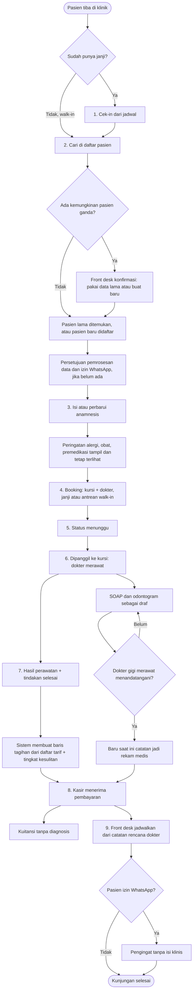
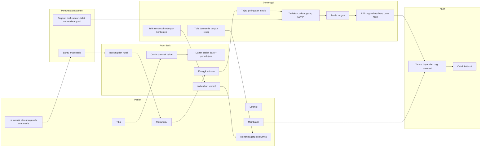
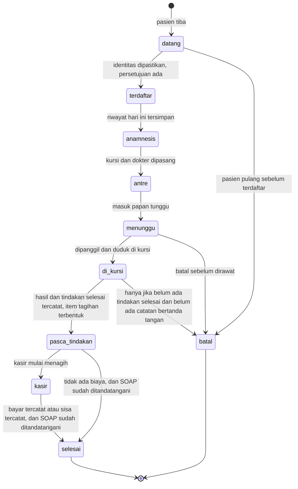

# Alur kunjungan klinik (9 langkah)

*14 Nov 2026. Alur ini adalah tulang punggung fondasi Bitto, sesuai permintaan Jerome. Semua contoh memakai data palsu. Istilah teknis dijelaskan singkat di tempat pertama kali muncul.*

Urutan prioritas: keamanan & privasi pasien → keselamatan klinis & keutuhan data → regulasi → fitur.

Dokumen terkait: [zendenta-drawer-booking.md](../research/zendenta-drawer-booking.md) (inspirasi laci dan booking), [user-stories.md](../user-stories.md), [architecture.md](../architecture.md) (peta modul), [decisions.md](../decisions.md) (D-033 sampai D-036).

## Ringkasan 9 langkah

| Langkah | Apa yang terjadi | Siapa yang mengerjakan | Bentuk layar |
|---|---|---|---|
| 1. Pasien masuk | Pasien tiba di klinik (punya janji atau datang langsung) | Front desk | Halaman Jadwal + **laci** cek-in |
| 2. Pasien cek daftar | Cari pasien lama atau daftar baru; cek kemungkinan data ganda | Front desk | **Laci** pencarian / pendaftaran singkat; profil lengkap = halaman penuh |
| 3. Isi anamnesis | Riwayat medis, alergi, obat, premedikasi (obat yang harus diminum sebelum tindakan); tiap ubahan disimpan sebagai versi baru | Perawat/asisten, atau front desk di praktik kecil; dokter meninjau | **Laci** anamnesis hari ini; riwayat lengkap = halaman penuh |
| 4. Didaftarkan booking | Pasien mendapat janji + kursi (yang sudah dijadwalkan, atau walk-in yang baru diantrekan) | Front desk | **Laci** booking di atas kalender |
| 5. Menunggu | Pasien di ruang tunggu sampai dipanggil ke kursi | Front desk | Papan tunggu di halaman Jadwal; **laci** item antrean |
| 6. Dokter melakukan tindakan | Odontogram dan perawatan di kursi; catatan SOAP masih draf | Dokter gigi (asisten boleh siapkan draf) | **Halaman penuh** Charting |
| 7. Dokter masukkan hasil dan item tagihan | Hasil perawatan dicatat; tindakan yang selesai otomatis jadi baris tagihan (dokter tidak mengetik harga) | Dokter gigi | Charting + **laci** ringkas tindakan/tarif |
| 8. Kasir menagih pasien | Bayar tunai/transfer/kartu/QRIS sementara, bagi bagian asuransi, cetak kuitansi tanpa diagnosis | Kasir / front desk | **Laci** pembayaran; riwayat tagihan = halaman penuh |
| 9. Jadwal berikutnya | Dari catatan rencana kunjungan dokter, front desk yang membuat janji; pengingat WhatsApp jika pasien izin | Dokter menulis rencana; front desk menjadwalkan | **Laci** janji berikutnya |

**Catatan dokter menjadi rekam medis hanya setelah dokter gigi yang merawat menandatangani.** Sebelum itu isinya draf. Koreksi tidak menimpa yang lama, hanya menambah versi. Batas ubah bebas 2×24 jam, setelah itu perlu persetujuan (Permenkes 24/2022 Pasal 30; D-013, D-017).

## Dua pintu masuk

- **Sudah punya janji:** janji dalam keadaan `dipesan` atau `dikonfirmasi` (mesin keadaan janji ada di database.md bagian 4.1). Front desk memulai dari langkah 1 (cek-in).
- **Datang langsung (walk-in):** belum ada janji. Front desk mulai dari langkah 2, lalu membuat booking/antrean di langkah 4, setelah identitas dan anamnesis cukup aman untuk merawat.

Mesin keadaan **janji** dan **kunjungan** terpisah, tapi saling terhubung: cek-in janji membuka kunjungan; selesai/batal di satu sisi harus konsisten di sisi lain (D-033).

## Diagram alur

## Lintasan peran (siapa mengerjakan apa)

## Rincian tiap langkah

### 1. Pasien masuk

Front desk melihat papan jadwal hari ini. Jika nama pasien ada di janji, buka **laci cek-in**: cocokkan identitas (bukan hanya nama), catat jam datang. Jika pasien tidak ada di jadwal, lanjut langkah 2 sebagai walk-in.

Jam datang, jam duduk di kursi, dan jam selesai dirawat dicatat (temuan Open Dental yang masuk MVP).

### 2. Cek daftar (pasien lama vs baru, cek ganda)

Pencarian memakai nama, tanggal lahir, no. RM, atau NIK. NIK disimpan terenkripsi; di layar staf hanya 4 angka terakhir, kecuali dibuka dengan jejak audit.

- Jika ketemu satu pasien: pakai data itu, jangan buat no. RM baru.
- Jika beberapa hasil mirip (nama + tanggal lahir sama, atau NIK sama): sistem **menahan** pendaftaran baru sampai front desk memilih data lama atau menegaskan ini orang berbeda. Setiap penggabungan atau penegasan tercatat di jejak audit.
- Pasien baru: isi data identitas minimal (no. RM, nama, NIK) dan data sosial sesuai Permenkes 24/2022 Pasal 14, plus keluarga / penanggung biaya / wali bila relevan (tagihan dan persetujuan pasien anak).
- Formulir yang diisi pasien lewat tautan tetap berstatus draf sampai front desk mencocokkan identitas (REG-2).

### 3. Anamnesis dan riwayat medis

Anamnesis = tanya jawab tentang keluhan dan riwayat kesehatan, dicatat sebelum tindakan. Isi lama **tidak ditimpa**: setiap ubahan membuat versi baru (siapa, kapan, apa yang berubah).

Yang wajib terlihat sebagai peringatan, di laci dan di pita pasien aktif:

- alergi
- obat yang sedang diminum
- penyakit / catatan mendesak
- premedikasi

Peringatan ini ikut tampil di Charting, resep, dan pembayaran. Asisten boleh mengisi; dokter wajib melihat sebelum merawat.

### 4. Booking dan antrean

- Pasien berjanji: kursi dan dokter sudah terpasang; cek-in mengikat kunjungan ke janji itu. Sistem menolak bentrok kursi atau dokter (JDW-1).
- Walk-in: front desk memilih dokter dan kursi yang kosong, atau memasukkan daftar tunggu dulu, lalu menempatkan ke slot. Pola inspirasi Zendenta: formulir singkat di **laci**, kalender tetap terlihat.
- Mode sederhana (praktik mandiri): orang yang sama boleh menekan cek-in dan merawat, tapi langkah keadaannya tetap tercatat.

### 5. Menunggu

Papan tunggu menampilkan urutan pasien. Keadaan antrean:

| Keadaan antrean | Arti |
|---|---|
| `menunggu` | Sudah terdaftar, belum dipanggil |
| `dipanggil` | Dipanggil ke kursi; jika tidak datang dalam batas waktu klinik, bisa kembali ke `menunggu` atau ditandai terlambat |
| `terlambat` | Terlewat panggilan; front desk yang menyesuaikan urutan |
| `batal_antre` | Batal sebelum dirawat |

### 6. Dokter melakukan tindakan

Halaman penuh Charting (odontogram 2D untuk mengisi data; tampilan 3D hanya untuk dilihat, data sama). SOAP (Subjektif, Objektif, Analisis, Perencanaan) ditulis dokter, atau disusun dari dikte dokter sebagai draf. AI tidak mendiagnosis dan tidak meresepkan.

**Baru setelah dokter gigi yang merawat menandatangani, catatan itu menjadi rekam medis.** Asisten, front desk, pemilik, dan agen AI tidak bisa menandatangani. Nama, waktu, dan tanda tangan wajib (UU 17/2023 Pasal 296 ayat 4; Permenkes 24/2022 Pasal 16 ayat 2).

Koreksi: versi baru + alasan; isi lama tetap ada. Dalam 2×24 jam sejak data diinput, dokter boleh mengoreksi. Setelah itu perlu persetujuan (D-013 di praktik mandiri: dokter itu sendiri + alasan wajib).

Jika perlu obat, dokter menulis resep di sistem (obat dari kamus KFA, dosis terstruktur, peringatan alergi/dobel). **Di MVP resep dicetak dan ditandatangani dokter di kertas** (resep tertulis biasa). Data tetap tersimpan terstruktur di Bitto. Kirim WhatsApp dan e-resep SATUSEHAT (`MedicationRequest` / Nomor Resep Nasional) menyusul setelah modul nasional keluar dari sandbox (D-036).

### 7. Hasil perawatan dan item tagihan

Dokter menandai tindakan yang benar-benar dikerjakan, termasuk **tingkat kesulitan** bila tarif punya varian. Daftar tingkat dimulai dari templat Bitto yang bisa diubah (contoh: tambalan menurut jumlah permukaan atau kerumitan); templat itu titik awal pengaturan, **bukan panduan klinis** (D-035). Tingkat tertinggi wajib diisi alasan.

Dokter hanya mencatat tindakan dan tingkat kesulitannya. Modul tagihan, bukan modul klinis, yang mengambil harga dari daftar tarif cabang yang berlaku hari itu, lalu **menyalin angka itu ke baris tagihan** (foto harga). Perubahan tarif nanti tidak mengubah tagihan yang sudah tercatat (D-035). Ringkas tagihan boleh tampil di samping Charting lewat pintu depan modul tagihan, tanpa kode klinis bergantung pada daftar harga.

Bagi hasil dokter dihitung dari aturan yang berlaku pada tanggal tindakan, bukan dari aturan yang diubah kemudian. **Default:** sesudah biaya bahan dan lab dikurangi; pemilik boleh mengatur pengecualian (D-034). Dokter boleh melihat laporan bagi hasil miliknya sendiri, hanya baca, tanpa aturan atau angka dokter lain (D-039). Pengaturan tetap hanya diubah pemilik.

### 8. Kasir

Kasir membuka **laci pembayaran** dari antrean atau tagihan.

- Cara bayar: tunai, transfer, kartu, atau QRIS **sementara** (status “sementara” sampai kas dicocokkan atau transfer terkonfirmasi — rincian rekonsiliasi QRIS: perlu dicek per penyedia).
- Boleh bayar sebagian; sisa tercatat. Bagian asuransi swasta dipisah dari bagian pasien (KSR-3). BPJS belum di MVP (D-008).
- Kuitansi memuat nama klinik, cabang, tanggal, item tindakan/obat, dan jumlah uang. **Tanpa diagnosis dan tanpa rincian klinis.**
- Diskon dan koreksi tagihan disimpan terpisah dari baris tagihan, dengan jejak audit.

Pembayaran boleh dimulai setelah item tagihan terbentuk. Kunjungan belum boleh ditutup `selesai` sebelum catatan klinis ditandatangani (agar rekam medis dilengkapi segera setelah pelayanan, UU 17/2023 Pasal 296 ayat 3).

### 9. Janji berikutnya dari catatan dokter

Dokter menulis rencana kunjungan (tanggal usulan, tindakan, durasi, dokter). Itu bagian dari rekam medis, bukan janji jadi.

Front desk yang membuat janji di kalender, menyesuaikan slot kosong. Jika pasien izin WhatsApp, pengingat terkirim tanpa isi klinis, dan setiap kiriman tercatat agar tidak dobel (termasuk saat janji dipindah).

## Laci vs halaman penuh

| Pakai **laci** (panel sisi, konteks jadwal/pasien tetap kelihatan) | Pakai **halaman penuh** |
|---|---|
| Cek-in, pencarian pasien, pendaftaran singkat | Profil pasien lengkap, keluarga, penanggung, wali |
| Anamnesis hari ini / ubah riwayat singkat | Riwayat medis lengkap dan semua versinya |
| Buat/ubah janji, daftar tunggu, detail item antrean | Kalender hari/minggu (kanvas utama Jadwal) |
| Ringkas pasien (pasien aktif, alergi, peringatan) | Charting: odontogram + SOAP + tanda tangan |
| Ringkas tindakan selesai + foto harga | Rencana perawatan dan persetujuan tindakan |
| Pembayaran dan kuitansi | Daftar tagihan, tutup kas, laporan |
| Janji berikutnya dari catatan dokter | Pengaturan tarif, tingkat kesulitan, bagi hasil (pemilik) |
| Tulis dan kunci resep dari Charting, lalu cetak untuk ditandatangani di kertas | Riwayat resep pasien |

Login, TOTP, dan pemulihan akun tetap layar penuh.

## Mesin keadaan kunjungan

*Mesin keadaan = peta status yang boleh berpindah. Perpindahan di luar peta ditolak dan dites (D-033).*

Aturan tambahan:

- Tidak ada loncatan ke `selesai` tanpa catatan klinis bertanda tangan (kecuali `batal` sebelum merawat).
- `pasca_tindakan` boleh terjadi meski SOAP masih draf; item tagihan sudah ada, pembayaran boleh dimulai.
- Resep (data terstruktur) hanya boleh dikunci dan dicetak oleh dokter gigi berizin yang merawat, dari kunjungan `di_kursi` atau setelahnya, dan tidak dari draf AI. Di MVP, tanda tangan pada kertas dilakukan secara biasa; e-resep SATUSEHAT bukan syarat penutupan kunjungan (D-036).
- Janji terkait: `check_in` selaras dengan `datang`/`terdaftar`; `dalam_perawatan` dengan `di_kursi`; `selesai`/`batal` mengikuti kunjungan. Perlu perluasan kolom `encounter.state` di database.md (saat ini hanya `berlangsung` dan `selesai`).

## Yang tidak boleh dilupakan di setiap langkah

- Data satu klinik tidak terlihat klinik lain.
- Pita alergi dan peringatan tidak boleh tertutup laci.
- Isi klinis tidak masuk pesan WhatsApp atau kuitansi.
- Semua baca/ubah/cetak/tanda tangan masuk jejak audit yang hanya bisa ditambah.
