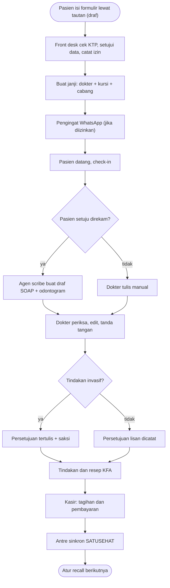
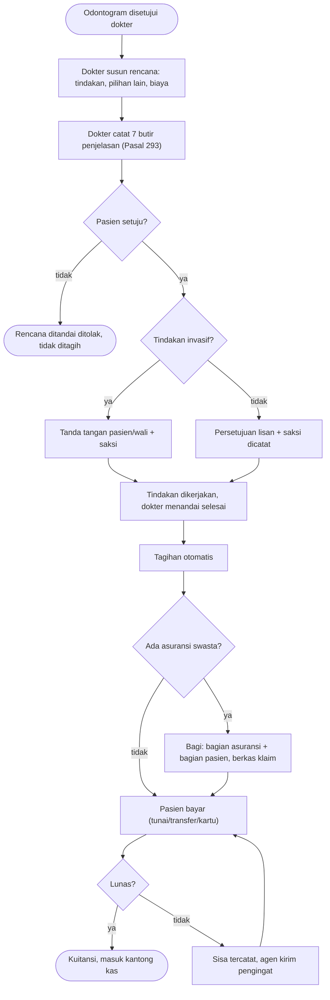
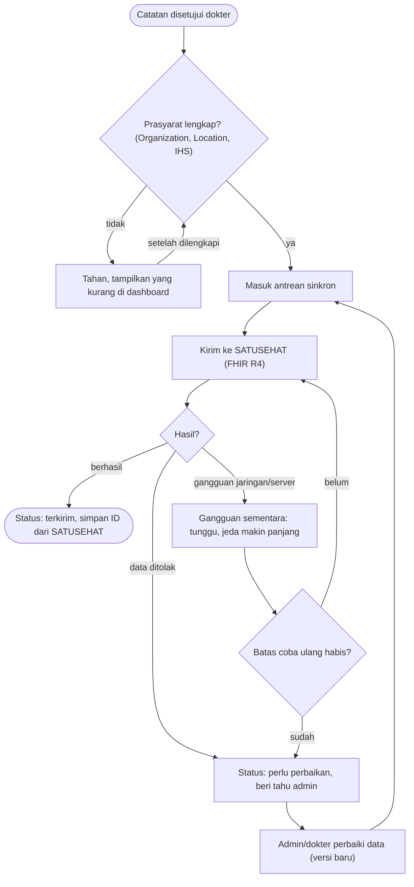
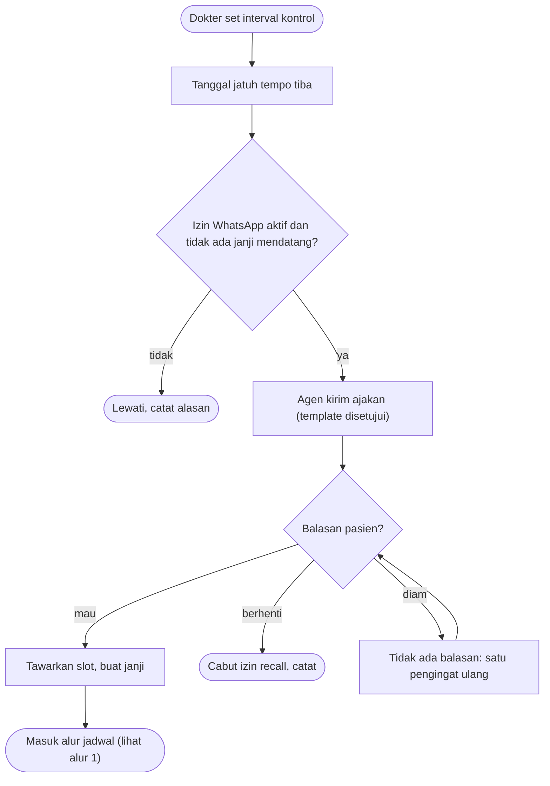

# Cerita Pengguna dan Alur MVP (draf 1)

*14 Nov 2026, draf 2. Disusun dari product.md, agents.md, compliance.md, architecture.md, alur kunjungan, dan keputusan D-001 sampai D-040. Semua contoh memakai data palsu. Poin regulasi yang belum terverifikasi ditandai "perlu dicek" atau "belum terverifikasi".*

## Cara membaca
- **Cerita pengguna** = kebutuhan dari sudut pandang pemakai: "Sebagai <peran>, saya ingin ..., supaya ...".
- **Kriteria penerimaan** = syarat agar cerita dianggap selesai, ditulis Diberikan (keadaan awal) / Ketika (aksi) / Maka (hasil yang harus terjadi).
- **Prioritas**: **Wajib** = harus ada di MVP; **Penting** = sebaiknya ada di MVP, boleh menyusul jika waktu sempit; **Nanti** = setelah MVP.
- **Peran**: dokter gigi, asisten, front desk/kasir, pemilik, pasien, sistem. Struktur data: tenant (klinik) → cabang → kursi; mode sederhana untuk praktik mandiri (D-007).

## Aturan yang berlaku di semua cerita
- Isi klinis dari agen AI selalu **draf** sampai dokter gigi berizin menyetujui (D-001).
- Pemrosesan AI hanya di Indonesia; tanpa routing Geo/Global (D-009).
- Koreksi catatan: bebas sampai 2x24 jam, setelah itu perlu persetujuan (Permenkes 24/2022 Pasal 30).
- Rekam medis disimpan minimal 25 tahun sejak kunjungan terakhir, tidak ada hapus (Pasal 39).
- Tindakan invasif/berisiko tinggi wajib persetujuan tertulis (UU 17/2023 Pasal 293).
- BPJS tidak di MVP, tapi data siap BPJS (D-008). Sinkron SATUSEHAT masuk MVP (D-004).
- Hanya data palsu di luar produksi (D-010).

## Ringkasan jumlah cerita

| Modul | Wajib | Penting | Nanti | Total |
|---|---|---|---|---|
| Pendaftaran pasien | 3 | 2 | 0 | 5 |
| Jadwal, kursi, dan daftar tunggu | 3 | 2 | 0 | 5 |
| Odontogram | 2 | 2 | 0 | 4 |
| Rencana perawatan dan persetujuan tindakan | 4 | 1 | 0 | 5 |
| Catatan SOAP dan scribe suara | 6 | 1 | 0 | 7 |
| Resep dengan kode KFA | 6 | 0 | 3 | 9 |
| Kasir, tagihan, dan asuransi swasta | 3 | 3 | 0 | 6 |
| Bagi hasil dokter | 4 | 0 | 0 | 4 |
| Tingkat kesulitan tindakan | 3 | 0 | 0 | 3 |
| Recall dan pengingat kontrol lewat WhatsApp | 3 | 0 | 1 | 4 |
| Sinkron SATUSEHAT | 4 | 1 | 0 | 5 |
| Peran, akses, audit, dan retensi | 7 | 2 | 1 | 10 |
| **Total** | **48** | **14** | **5** | **67** |

## REG · Pendaftaran pasien
*Data identitas minimal: no. RM, nama, NIK; data sosial: agama, pekerjaan, pendidikan, status kawin (Permenkes 24/2022 Pasal 14).*

### REG-1 [Wajib]
Sebagai **petugas front desk**, saya ingin mendaftarkan pasien baru dengan no. RM, nama, NIK, dan data sosial, supaya data identitas lengkap sesuai Permenkes 24/2022 Pasal 14.

- **Diberikan** pasien baru belum punya rekam medis, **ketika** saya menyimpan formulir tanpa NIK, **maka** sistem menolak dan menandai NIK sebagai wajib.
- **Diberikan** NIK yang diketik sudah ada di klinik ini, **ketika** saya menyimpan, **maka** sistem menampilkan kemungkinan pasien ganda dan tidak membuat no. RM baru tanpa konfirmasi saya.
- *Catatan:* Alur pasien tanpa identitas (Pasal 14 ayat 3, pakai surat pengantar instansi): perlu dicek apakah perlu di MVP.

### REG-2 [Wajib]
Sebagai **pasien**, saya ingin mengisi formulir pendaftaran dan riwayat medis lewat tautan sebelum datang, supaya antre di klinik lebih singkat.

- **Diberikan** agen pendaftaran mengirim tautan formulir, **ketika** pasien mengirim isian, **maka** data masuk sebagai draf berlabel "menunggu verifikasi" dan belum menjadi rekam medis.
- **Diberikan** ada draf dari pasien, **ketika** front desk mencocokkan KTP dan menyetujui, **maka** data menjadi data pasien resmi dan jejak audit mencatat siapa yang memverifikasi.

### REG-3 [Wajib]
Sebagai **petugas front desk**, saya ingin mencatat persetujuan pemrosesan data dan izin dihubungi lewat WhatsApp, supaya pesan hanya terkirim ke pasien yang setuju (UU PDP Pasal 20).

- **Diberikan** pasien tidak memberi izin WhatsApp, **ketika** agen penjadwalan akan mengirim pengingat, **maka** pesan tidak terkirim dan alasannya tercatat.
- **Diberikan** pasien mencabut izin, **ketika** front desk mengubah status izin, **maka** semua pesan otomatis untuk pasien itu berhenti sejak saat itu.

### REG-4 [Penting]
Sebagai **petugas front desk**, saya ingin memilih jenis penjamin (umum atau asuransi swasta) dan menyimpan data kepesertaan, supaya tagihan langsung tahu siapa yang membayar, dan data siap untuk BPJS nanti (D-008).

- **Diberikan** pasien memilih penjamin BPJS, **ketika** data disimpan di MVP, **maka** nomor dan kelas kepesertaan tersimpan, tapi sistem menampilkan bahwa klaim BPJS belum didukung.

### REG-5 [Penting]
Sebagai **pemilik praktik mandiri**, saya ingin memakai mode sederhana saat mendaftar, supaya bisa mulai tanpa mengatur cabang dan peran.

- **Diberikan** pemilik baru memilih mode sederhana, **ketika** pendaftaran klinik selesai, **maka** sistem membuat satu cabang dan satu kursi otomatis, dan dokter boleh merangkap peran pemilik.
- **Diberikan** klinik mode sederhana menambah cabang kedua, **ketika** pemilik menyimpan cabang baru, **maka** klinik beralih ke mode standar tanpa pindah data.

## JDW · Jadwal, kursi, dan daftar tunggu
*Kursi = kursi/ruang tindakan. Daftar tunggu = antrean pasien yang mau maju jika ada slot kosong.*

### JDW-1 [Wajib]
Sebagai **petugas front desk**, saya ingin membuat janji temu untuk dokter dan kursi tertentu di cabang saya, supaya jadwal tidak bentrok.

- **Diberikan** dokter atau kursi sudah terisi di jam itu, **ketika** saya menyimpan janji baru, **maka** sistem menolak dan menampilkan slot kosong terdekat.

### JDW-2 [Wajib]
Sebagai **petugas front desk**, saya ingin menambahkan pasien ke daftar tunggu beserta waktu yang dia mau, supaya slot yang batal bisa cepat terisi.

- **Diberikan** ada janji yang dibatalkan, **ketika** slot itu terbuka, **maka** sistem mengusulkan pasien daftar tunggu yang cocok, urut dari yang paling lama menunggu.
- **Diberikan** pasien daftar tunggu ditawari slot, **ketika** pasien belum menjawab, **maka** slot belum dianggap terisi.

### JDW-3 [Wajib]
Sebagai **pasien**, saya ingin menerima pengingat dan permintaan konfirmasi lewat WhatsApp, supaya tidak lupa janji.

- **Diberikan** pasien sudah memberi izin WhatsApp, **ketika** waktu pengingat tiba (diatur klinik, misal H-1), **maka** pesan berisi nama klinik, cabang, tanggal, dan jam saja, tanpa diagnosis atau tindakan.
- **Diberikan** pasien membalas batal, **ketika** balasan diterima, **maka** janji ditandai batal, slot terbuka, dan alur daftar tunggu berjalan.
- *Catatan:* Aturan template WhatsApp Business: perlu dicek.

### JDW-4 [Penting]
Sebagai **dokter gigi**, saya ingin memblokir jam saat saya tidak praktik, supaya pasien tidak dijadwalkan di jam itu.

- **Diberikan** sudah ada janji di jam yang saya blokir, **ketika** saya menyimpan blokir, **maka** janji itu ditandai "perlu dijadwal ulang", tidak dihapus, dan front desk diberi tahu.

### JDW-5 [Penting]
Sebagai **pemilik klinik multi-cabang**, saya ingin melihat jadwal semua cabang dalam satu tampilan, supaya saya tahu kursi mana yang kosong.

- **Diberikan** saya punya izin untuk cabang A dan B saja, **ketika** saya membuka tampilan jadwal, **maka** hanya jadwal cabang A dan B yang tampil.

## ODO · Odontogram
*Odontogram = peta gigi pasien. Formulir standar Indonesia terbaru belum kami baca; acuan teknis: use case Gigi SATUSEHAT.*

### ODO-1 [Wajib]
Sebagai **dokter gigi**, saya ingin mengisi odontogram pada kunjungan pertama dengan nomor gigi dan simbol standar, supaya kondisi gigi tercatat seragam.

- **Diberikan** pasien belum punya odontogram, **ketika** saya menyimpan isian, **maka** odontogram tersimpan sebagai versi pertama dengan nama dan waktu saya.
- **Diberikan** odontogram sudah ada, **ketika** saya mengubah kondisi satu gigi, **maka** versi baru dibuat dan versi lama tetap bisa dilihat.
- *Catatan:* Sistem penomoran gigi dan simbol pada formulir standar Indonesia: perlu dicek ke panduan rekam medis gigi Kemenkes.

### ODO-2 [Wajib]
Sebagai **asisten dokter**, saya ingin menyiapkan draf isian odontogram, supaya dokter cukup memeriksa dan menyetujui.

- **Diberikan** draf odontogram dibuat asisten atau agen, **ketika** dokter belum menyetujui, **maka** draf berlabel DRAF, tidak dianggap rekam medis, dan tidak dikirim ke SATUSEHAT.

### ODO-3 [Penting]
Sebagai **dokter gigi**, saya ingin membandingkan odontogram antar-kunjungan, supaya perubahan kondisi gigi terlihat.

- **Diberikan** pasien punya dua versi atau lebih, **ketika** saya memilih dua tanggal, **maka** gigi yang berubah ditandai.

### ODO-4 [Penting]
Sebagai **dokter gigi**, saya ingin melampirkan foto atau rontgen ke gigi tertentu, supaya bukti gambar tersimpan bersama catatan.

- **Diberikan** saya mengunggah file gambar, **ketika** saya memilih gigi, **maka** gambar terhubung ke gigi dan kunjungan itu, disimpan terenkripsi.

## RPC · Rencana perawatan dan persetujuan tindakan
*Persetujuan tindakan = izin pasien setelah dijelaskan (UU 17/2023 Pasal 293).*

### RPC-1 [Wajib]
Sebagai **dokter gigi**, saya ingin membuat rencana perawatan berisi tindakan per gigi, pilihan lain, dan perkiraan biaya, supaya pasien bisa memutuskan dengan jelas.

- **Diberikan** odontogram sudah disetujui, **ketika** saya menambahkan tindakan ke gigi, **maka** tindakan masuk rencana dengan harga dari daftar harga cabang.

### RPC-2 [Wajib]
Sebagai **dokter gigi**, saya ingin mencatat penjelasan yang saya berikan kepada pasien, supaya persetujuan sah sesuai UU 17/2023 Pasal 293 ayat 3.

- **Diberikan** saya akan meminta persetujuan, **ketika** salah satu butir penjelasan (diagnosis, indikasi, tindakan dan tujuan, risiko, pilihan lain, risiko jika tidak dilakukan, prognosis) masih kosong, **maka** sistem tidak mengizinkan persetujuan disimpan.

### RPC-3 [Wajib]
Sebagai **dokter gigi**, saya ingin meminta persetujuan tertulis untuk tindakan invasif atau berisiko tinggi, supaya tindakan tidak dimulai tanpa izin tertulis (Pasal 293 ayat 5 dan 8).

- **Diberikan** tindakan ditandai invasif atau berisiko tinggi, **ketika** belum ada persetujuan tertulis yang ditandatangani pasien atau walinya dan disaksikan tenaga kesehatan, **maka** tindakan tidak bisa ditandai dimulai atau selesai.
- **Diberikan** tindakan tidak invasif, **ketika** pasien setuju secara lisan, **maka** persetujuan lisan dicatat dengan nama saksi dan waktu.
- *Catatan:* Daftar tindakan gigi yang wajib persetujuan tertulis harus ditetapkan oleh dokter gigi berizin yang meninjau, bukan oleh tim produk. Sistem hanya menyediakan pengaturan daftarnya. Belum ditetapkan.

### RPC-4 [Wajib]
Sebagai **pasien**, saya ingin menandatangani persetujuan di tablet atau HP, supaya tidak perlu kertas.

- **Diberikan** formulir persetujuan tampil, **ketika** pasien atau walinya menandatangani di tablet, **maka** dokumen dikunci dan tercatat: waktu, nama penanda tangan, saksi, perangkat yang dipakai, dan sidik digital (hash) dokumen; salinan bisa dikirim ke pasien.
- **Diberikan** dokumen persetujuan sudah ditandatangani, **ketika** isi dokumen diubah, **maka** sidik digital tidak cocok lagi, sistem menandai dokumen tidak sah, dan perubahan perlu persetujuan baru.
- *Catatan:* D-012: tanda tangan sederhana di tablet dipakai dulu. Tanda tangan elektronik tersertifikasi mungkin diperlukan nanti (Pasal 31 Permenkes 24/2022, Q-5): perlu dicek. Desain menyimpan bukti tanda tangan terpisah agar bisa ditingkatkan tanpa ubah alur.

### RPC-5 [Penting]
Sebagai **dokter gigi**, saya ingin mencatat jika pasien menolak atau menarik persetujuan, supaya keputusan pasien terdokumentasi.

- **Diberikan** pasien menolak tindakan, **ketika** saya menyimpan penolakan, **maka** rencana ditandai ditolak dengan alasan dan waktu, dan tindakan tidak bisa ditagihkan.

## SOAP · Catatan SOAP dan scribe suara
*SOAP = Subjektif, Objektif, Analisis, Perencanaan. Scribe = agen yang mengubah suara dokter menjadi draf catatan.*

### SOAP-1 [Wajib]
Sebagai **dokter gigi**, saya ingin menulis catatan SOAP dan menguncinya dengan tanda tangan, supaya catatan sah: nama, waktu, tanda tangan (Permenkes 24/2022 Pasal 16 ayat 2).

- **Diberikan** saya selesai menulis catatan, **ketika** saya menandatangani, **maka** catatan terkunci dengan nama, waktu, dan tanda tangan saya.
- **Diberikan** pengguna bukan dokter gigi, **ketika** dia mencoba menandatangani, **maka** sistem menolak.

### SOAP-2 [Wajib]
Sebagai **dokter gigi**, saya ingin mendiktekan catatan (suara menjadi teks) dan mendapat draf SOAP serta draf odontogram, supaya saya tidak mengetik dari nol, tanpa AI yang menambah isi sendiri (D-037).

- **Diberikan** pasien belum setuju direkam, **ketika** saya membuka layar catatan, **maka** tombol rekam tidak aktif dan alasan “belum ada izin rekam” tampil.
- **Diberikan** pasien sudah setuju dan saya selesai mendikte, **ketika** agen menyusun keluaran, **maka** hasil masuk SOAP/odontogram sebagai draf yang berlabel jelas (bukan rekam medis), dan setiap kalimat bisa ditelusuri ke potongan transkripnya.
- **Diberikan** saya hanya mendikte temuan gigi 46, **ketika** draf tampil, **maka** sistem tidak menambah diagnosis, nama obat, atau kode ICD/KFA yang tidak saya ucapkan.

### SOAP-3 [Wajib]
Sebagai **dokter gigi**, saya ingin mengubah lalu menyetujui draf dari agen, supaya hanya isi yang saya benarkan yang menjadi rekam medis (D-001).

- **Diberikan** draf agen terbuka (termasuk draf dari dikte), **ketika** saya mengedit dan menandatangani, **maka** catatan menjadi final, perbedaan draf dan versi akhir tersimpan untuk mengukur akurasi.
- **Diberikan** draf dari dikte belum saya tinjau, **ketika** hari kerja berakhir, **maka** draf tetap draf dan muncul di daftar tugas saya, tidak pernah final otomatis.

### SOAP-4 [Wajib]
Sebagai **dokter gigi**, saya ingin mengoreksi catatan yang salah, supaya catatan tetap akurat tanpa menghapus jejak.

- **Diberikan** catatan saya buat kurang dari 2x24 jam lalu, **ketika** saya mengoreksi, **maka** versi baru dibuat, versi lama tetap tersimpan, alasan koreksi wajib diisi.
- **Diberikan** sudah lewat 2x24 jam, **ketika** saya mengoreksi, **maka** koreksi menunggu persetujuan penanggung jawab rekam medis atau pimpinan klinik.
- **Diberikan** klinik mode sederhana (praktik mandiri) dan sudah lewat 2x24 jam, **ketika** dokter mengoreksi catatannya sendiri, **maka** dokter menyetujui koreksinya sendiri dengan alasan wajib diisi; versi asli tetap tersimpan dan jejak audit mencatat semuanya (D-013).
- *Catatan:* Pasal 30 ayat 7 menyebut persetujuan setelah 2x24 jam untuk data administratif. Dasar hukum persetujuan sendiri oleh dokter di praktik mandiri (D-013): perlu dicek.

### SOAP-5 [Wajib]
Sebagai **pemilik klinik**, saya ingin memastikan suara dan teks pasien hanya diproses di Indonesia, supaya data kesehatan tidak keluar negeri (D-009, D-037).

- **Diberikan** layanan suara→teks in-region di Jakarta sedang tidak tersedia, **ketika** dokter merekam, **maka** rekaman tidak dikirim ke wilayah lain (termasuk Transcribe di Singapura) dan tidak memakai inferensi Geo/Global; dokter diberi tahu untuk menulis manual atau mencoba lagi.
- **Diberikan** perangkat sedang offline, **ketika** dokter membuka dikte, **maka** tombol rekam tidak aktif (D-026, D-037).

### SOAP-6 [Penting]
Sebagai **dokter gigi**, saya ingin mendapat usulan kode ICD-10 dan ICD-9-CM dari catatan final, supaya pengkodean lebih cepat.

- **Diberikan** catatan sudah final, **ketika** agen koding mengusulkan kode, **maka** setiap kode disertai kutipan catatan, dan baru dipakai setelah saya konfirmasi.

### SOAP-7 [Wajib]
Sebagai **dokter gigi**, saya ingin berkas audio tidak tersimpan lebih lama dari perlu, supaya data suara pasien tidak menumpuk.

- **Diberikan** catatan dari dikte sudah saya tandatangani, **ketika** tanda tangan tersimpan (D-038), **maka** berkas audio dihapus dan transkrip serta selisih draf vs versi akhir tetap ada di jejak audit.
- **Diberikan** catatan masih draf, **ketika** saya membuka riwayat dikte, **maka** audio masih ada untuk saya putar ulang, dan belum dihapus.

## RSP · Resep dengan kode KFA
*KFA = Kamus Farmasi dan Alat Kesehatan dari Kemenkes. Akses API KFA perlu persetujuan Kemenkes. MVP (D-036): resep tertulis biasa, dicetak dan ditandatangani dokter di kertas; data disimpan terstruktur di Bitto. E-resep SATUSEHAT menyusul. Dasar isi cetak: Permenkes 34/2021 Pasal 7.*

### RSP-1 [Wajib]
Sebagai **dokter gigi**, saya ingin menulis resep dengan memilih obat dari kamus KFA, supaya kode obat sesuai SATUSEHAT.

- **Diberikan** saya mengetik nama obat, **ketika** hasil muncul, **maka** sistem menampilkan obat dengan kode KFA (92xxxxxx atau 93xxxxxx).
- **Diberikan** obat bukan racikan, **ketika** tidak ada kode KFA, **maka** resep tidak bisa disimpan.
- **Diberikan** obat racikan, **ketika** saya menyimpan, **maka** resep boleh tanpa kode produk, tapi bahan-bahannya dicatat.

### RSP-2 [Wajib]
Sebagai **dokter gigi**, saya ingin melihat peringatan alergi pasien saat menulis resep, supaya pasien aman.

- **Diberikan** pasien punya catatan alergi terhadap zat tertentu, **ketika** saya memilih obat yang mengandung zat itu, **maka** sistem menampilkan peringatan dan saya harus mengisi alasan jika tetap lanjut.

### RSP-3 [Wajib]
Sebagai **dokter gigi**, saya ingin mencetak resep tertulis biasa untuk ditandatangani di kertas, supaya pasien bisa menebus obat di apotek, dan isi kertas cocok dengan data di Bitto (D-036).

- **Diberikan** resep sudah dikunci di sistem, **ketika** saya mencetak, **maka** kertas memuat isi wajib Permenkes 34/2021 Pasal 7 (nama dan SIP dokter, alamat praktik, tanggal, nama dan usia pasien, nama/bentuk/kekuatan/jumlah/aturan pakai obat) plus ruang paraf atau tanda tangan, tanpa diagnosis.
- **Diberikan** resep masih draf, **ketika** saya memilih cetak, **maka** sistem menolak sampai saya mengunci resep.
- **Diberikan** resep tercetak, **ketika** data dikunci, **maka** sidik isi yang dicetak tersimpan dan jejak audit mencatat pencetakan.

### RSP-4 [Nanti]
Sebagai **asisten dokter**, saya ingin mencatat obat yang diberikan dari stok klinik, supaya stok dan data pengeluaran obat sesuai.

- **Diberikan** obat diberikan di klinik, **ketika** saya mencatat pengeluaran, **maka** kode yang dipakai adalah kode produk aktual 93xxxxxx dan stok berkurang.

### RSP-5 [Wajib]
Sebagai **dokter gigi berizin**, saya ingin hanya saya yang dapat membuat dan mengunci resep pasien yang saya rawat, lalu mencetaknya untuk ditandatangani di kertas, supaya resep sah dan tidak ditulis oleh staf atau oleh AI.

- **Diberikan** saya sudah login sebagai dokter gigi dengan SIP aktif di cabang itu, **ketika** saya mengunci resep untuk dicetak, **maka** resep tersimpan dengan nama saya, nomor SIP, waktu, dan sidik isi, dan statusnya terkunci. Tanda tangan pada kertas tetap dilakukan secara biasa.
- **Diberikan** pengguna berperan asisten, front desk, kasir, atau pemilik, **ketika** mereka mencoba membuat atau mengunci resep, **maka** sistem menolak dan mencatat percobaan itu.
- **Diberikan** agen AI menyusun teks dari dikte, **ketika** draf muncul, **maka** sistem tidak memilih atau menyarankan obat; baris resep hanya terbentuk jika saya sendiri memilih obat dari kamus KFA (D-001, D-036).

### RSP-6 [Wajib]
Sebagai **dokter gigi**, saya ingin mengisi resep secara terstruktur (dosis, cara minum, seberapa sering, dan lama pemakaian) serta melihat peringatan alergi dan obat dobel, supaya pasien lebih aman, tanpa sistem yang meresepkan untuk saya.

- **Diberikan** saya memilih obat, **ketika** dosis, rute, frekuensi, atau durasi masih kosong, **maka** resep tidak bisa dikunci atau dicetak.
- **Diberikan** pasien punya alergi terhadap zat di obat itu, atau obat yang sama masih aktif, **ketika** saya memilih obat tersebut, **maka** peringatan tampil dan saya harus mengisi alasan jika tetap lanjut. Sistem tidak menolak secara membabi buta dan tidak menawarkan pengganti.
- *Dasar: Permenkes 34/2021 Pasal 1 angka 6 dan Pasal 7 (isi wajib resep, boleh elektronik) — [PDF JDIH Kemkes](https://jdih.kemkes.go.id/storage/documents/pdfs/2021permenkes034.pdf). Daftar obat yang masuk/tidak masuk kewenangan dokter gigi secara rinci: **belum terverifikasi** (kewenangan mengikuti kompetensi, UU 17/2023 Pasal 285; rinciannya di Peraturan Pemerintah, perlu ditinjau dokter gigi berizin).*

### RSP-7 [Wajib]
Sebagai **dokter gigi**, saya ingin resep yang sudah ditandatangani tidak bisa diubah, supaya isi yang sudah diberikan ke pasien atau apotek tidak berubah diam-diam.

- **Diberikan** resep sudah ditandatangani, **ketika** siapa pun mencoba mengubah dosis atau obat, **maka** sistem menolak.
- **Diberikan** saya perlu memperbaiki resep, **ketika** saya membatalkan resep lama dengan alasan wajib lalu menerbitkan resep baru, **maka** resep lama tertandai batal (tetap tersimpan), resep baru punya nomor sendiri, dan keduanya tercatat di jejak audit.

### RSP-8 [Nanti]
Sebagai **dokter gigi**, saya ingin mengirim salinan resep ke pasien lewat WhatsApp, supaya pasien bisa menebus obat tanpa membawa kertas saja, tanpa membocorkan diagnosis.

- **Diberikan** resep sudah dikunci dan pasien memberi izin WhatsApp, **ketika** saya mengirim, **maka** pesan berisi nama klinik, nama pasien, daftar obat dan aturan pakai, plus kode atau QR untuk verifikasi, tanpa diagnosis.
- *Tidak masuk MVP (D-036).*

### RSP-9 [Nanti]
Sebagai **sistem**, saya ingin mengirim resep yang sudah dikunci ke SATUSEHAT sebagai e-resep (`MedicationRequest` dan Nomor Resep Nasional) setelah modul kefarmasian resmi keluar dari sandbox, supaya klinik siap terhubung ke sistem nasional.

- **Diberikan** resep masih draf, **ketika** antrean sinkron berjalan, **maka** resep tidak dikirim.
- **Diberikan** resep sudah dikunci dan fitur e-resep SATUSEHAT sudah diaktifkan, **ketika** antrean berjalan, **maka** data dipetakan ke `Medication` + `MedicationRequest` (satu paket per jenis obat), dengan kode KFA, aturan pakai, dan dokter penulis sebagai `requester`, sesuai [Pelayanan Kefarmasian SATUSEHAT](https://satusehat.kemkes.go.id/platform/docs/id/interoperability/kefarmasian/) dan [MedicationRequest](https://satusehat.kemkes.go.id/platform/docs/id/fhir/resources/medication-request/).
- *Tidak masuk MVP (D-036). Dokumentasi yang dibaca 14 Nov 2026 menyatakan modul masih dikembangkan dan hanya di lingkungan uji (sandbox), v1.3 tanggal 28 Nov 2024.*

## KSR · Kasir, tagihan, dan asuransi swasta
*MVP: pasien umum dan asuransi swasta. BPJS menyusul (D-008).*

### KSR-1 [Wajib]
Sebagai **petugas kasir**, saya ingin membuat tagihan otomatis dari tindakan yang selesai, supaya tidak ada tindakan yang lupa ditagih.

- **Diberikan** tindakan ditandai selesai dan disetujui dokter, **ketika** saya membuka kasir, **maka** tagihan berisi tindakan, obat, dan harga cabang itu.

### KSR-2 [Wajib]
Sebagai **petugas kasir**, saya ingin mencatat pembayaran tunai, transfer, atau kartu, termasuk bayar sebagian, supaya saldo pasien selalu benar.

- **Diberikan** pasien membayar sebagian, **ketika** saya menyimpan pembayaran, **maka** sisa tagihan tercatat dan kuitansi menunjukkan sisa itu.

### KSR-3 [Wajib]
Sebagai **petugas kasir**, saya ingin membagi tagihan antara bagian asuransi swasta dan bagian pasien, supaya klaim asuransi dan pembayaran pasien tidak tercampur.

- **Diberikan** pasien punya asuransi swasta, **ketika** saya memasukkan nilai yang ditanggung, **maka** sistem membuat dua bagian tagihan dan berkas klaim untuk asuransi.
- *Catatan:* Format klaim tiap asuransi swasta: perlu dicek per asuransi (Q-7).

### KSR-4 [Penting]
Sebagai **pemilik klinik**, saya ingin membuat kantong uang (misal kas harian, dana perawatan) dan memindahkan dana antar-kantong, supaya keuangan klinik rapi.

- **Diberikan** saya memindahkan dana antar-kantong, **ketika** saya menyimpan, **maka** pemindahan tercatat dengan nama, waktu, dan alasan.

### KSR-5 [Penting]
Sebagai **pemilik klinik**, saya ingin agar agen tagihan mengirim pengingat tagihan yang belum lunas, supaya piutang turun tanpa kerja manual.

- **Diberikan** tagihan lewat jatuh tempo, **ketika** agen mengirim pengingat, **maka** pesan tidak menyebut rincian tindakan; diskon atau penghapusan hanya bisa saya setujui.

### KSR-6 [Penting]
Sebagai **petugas kasir**, saya ingin menutup kas harian per cabang, supaya uang fisik cocok dengan catatan.

- **Diberikan** hari kerja selesai, **ketika** saya menutup kas, **maka** sistem menampilkan selisih dan kas hari itu terkunci.

## BGH · Bagi hasil dokter
*Bagi hasil = bagian pendapatan tindakan yang menjadi hak dokter, menurut perjanjian dengan klinik. Default: dihitung sesudah biaya bahan dan lab dikurangi (D-034, jawaban Q-17). Hanya pemilik yang mengatur dan melihat laporan semua dokter. Dokter boleh melihat laporan miliknya sendiri, hanya baca, tanpa aturan atau angka dokter lain (D-039, jawaban Q-20).*

### BGH-1 [Wajib]
Sebagai **pemilik klinik**, saya ingin mengatur bagi hasil per dokter dan per kelompok tindakan, boleh persentase atau nominal tetap, dan boleh dihitung sebelum atau sesudah biaya bahan/lab, supaya perjanjian masing-masing dokter tercatat dengan benar.

- **Diberikan** aturan baru disimpan tanpa pilihan dasar hitung, **ketika** sistem menyimpan, **maka** dasar hitung default adalah **sesudah** biaya bahan dan lab dikurangi.
- **Diberikan** saya pemilik yang sedang login, **ketika** saya menyimpan aturan baru dengan tanggal mulai berlaku, **maka** aturan itu hanya dipakai untuk tindakan pada atau setelah tanggal tersebut, dan jejak audit mencatat siapa yang mengubah.
- **Diberikan** pengguna bukan pemilik, **ketika** mereka membuka halaman pengaturan bagi hasil, **maka** akses ditolak dan percobaan tercatat.

### BGH-2 [Wajib]
Sebagai **pemilik klinik**, saya ingin perhitungan bagi hasil lama tidak berubah saat saya mengubah aturan, supaya laporan bulan lalu tetap sama dengan yang sudah disepakati.

- **Diberikan** tindakan 10 November sudah dihitung dengan aturan lama, **ketika** saya mengubah persentase mulai 15 November, **maka** angka bagi hasil 10 November tidak berubah; hanya tindakan mulai 15 November yang memakai aturan baru.

### BGH-3 [Wajib]
Sebagai **pemilik klinik**, saya ingin melihat laporan bagi hasil bulanan per dokter, supaya pembayaran ke dokter bisa dicocokkan.

- **Diberikan** bulan November sudah ada tindakan selesai, **ketika** saya membuka laporan dokter A, **maka** tampil daftar tindakan, dasar hitung (default sesudah bahan/lab, atau pengecualian yang diatur), jumlah hak dokter, dan total bulan itu.
- **Diberikan** saya mengunduh atau mencetak laporan, **ketika** berkas dibuat, **maka** aksi itu tercatat di jejak audit.

### BGH-4 [Wajib]
Sebagai **dokter gigi**, saya ingin melihat laporan bagi hasil milik saya sendiri, hanya untuk dibaca, supaya saya bisa mencocokkan hak saya tanpa melihat perjanjian dokter lain (D-039).

- **Diberikan** saya dokter A yang sedang login, **ketika** saya membuka laporan bagi hasil, **maka** yang tampil hanya tindakan dan jumlah milik saya, hanya baca, tanpa tombol ubah aturan.
- **Diberikan** di klinik yang sama ada aturan atau angka bagi hasil dokter B, **ketika** saya membuka laporan atau mencoba alamat halaman dokter B, **maka** sistem menolak, tidak menampilkan aturan atau angka dokter B, dan percobaan tercatat di jejak audit.
- **Diberikan** saya mengunduh atau mencetak laporan milik saya, **ketika** berkas dibuat, **maka** aksi itu tercatat di jejak audit.

## KSL · Tingkat kesulitan tindakan
*Tingkat kesulitan = varian tarif untuk tindakan yang sama. Bitto menyediakan templat awal yang bisa diubah (contoh: tambalan menurut jumlah permukaan atau kerumitan). Templat ini titik awal pengaturan, bukan panduan klinis (D-035, jawaban Q-18).*

### KSL-1 [Wajib]
Sebagai **pemilik klinik**, saya ingin daftar tarif mendukung beberapa tingkat kesulitan per tindakan, supaya harga tambalan sederhana dan tambalan sulit tidak disamakan.

- **Diberikan** klinik baru memakai templat awal, **ketika** pemilik membuka daftar tarif, **maka** ada contoh tingkat untuk tambalan (jumlah permukaan atau kerumitan) yang bisa diubah, ditambah, atau dihapus, dengan catatan bahwa templat itu bukan panduan klinis.
- **Diberikan** tindakan “tambalan” punya beberapa tingkat yang sudah diisi harganya, **ketika** staf melihat daftar tarif, **maka** tingkat itu tampil dengan harga masing-masing dan tanggal mulai berlaku.
- **Diberikan** suatu tindakan tidak punya varian, **ketika** dokter mencatat tindakan itu, **maka** sistem memakai satu harga standar dan tidak meminta tingkat.

### KSL-2 [Wajib]
Sebagai **dokter gigi**, saya ingin memilih tingkat kesulitan saat mencatat tindakan yang sudah dikerjakan, supaya tagihan sesuai pekerjaan sebenarnya, tanpa saya mengetik harga.

- **Diberikan** saya menandai tambalan selesai dan memilih tingkat tertinggi, **ketika** saya menyimpan, **maka** sistem meminta alasan/catatan; tanpa alasan, tidak tersimpan.
- **Diberikan** saya sudah menyimpan tindakan, **ketika** tagihan dibuat, **maka** baris tagihan menyimpan salinan nama tindakan, tingkat, alasan (jika ada), dan harga saat itu. Perubahan daftar tarif kemudian tidak mengubah angka di tagihan itu.

### KSL-3 [Wajib]
Sebagai **pemilik klinik**, saya ingin tingkat kesulitan bisa mempengaruhi bagi hasil dokter jika saya mengaturnya demikian, supaya pekerjaan yang lebih sulit bisa dihargai berbeda.

- **Diberikan** aturan bagi hasil dokter A untuk tambalan tingkat 3 berbeda dari tingkat 1, **ketika** tindakan tingkat 3 selesai, **maka** laporan bagi hasil memakai aturan tingkat 3 yang berlaku pada tanggal tindakan.
- **Diberikan** aturan bagi hasil tidak membedakan tingkat, **ketika** tindakan selesai, **maka** bagi hasil memakai aturan kelompok tindakan biasa.

## RCL · Recall dan pengingat kontrol lewat WhatsApp
*Recall = ajakan kontrol rutin, misal tiap 6 bulan. Masuk MVP (D-011).*

### RCL-1 [Wajib]
Sebagai **dokter gigi**, saya ingin menetapkan jadwal kontrol rutin untuk pasien, supaya pasien kembali tepat waktu.

- **Diberikan** saya menyetujui catatan kunjungan, **ketika** saya memilih interval kontrol, **maka** tanggal jatuh tempo recall tersimpan.

### RCL-2 [Wajib]
Sebagai **pemilik klinik**, saya ingin agar agen recall mengirim ajakan kontrol lewat WhatsApp dengan template yang saya setujui, supaya pasien lama kembali.

- **Diberikan** pasien jatuh tempo dan sudah memberi izin WhatsApp, **ketika** agen berjalan, **maka** pesan terkirim memakai template yang disetujui.
- **Diberikan** pasien sudah punya janji mendatang, menolak, atau ditandai meninggal, **ketika** agen berjalan, **maka** pesan tidak dikirim.

### RCL-3 [Wajib]
Sebagai **pasien**, saya ingin berhenti menerima ajakan kontrol kapan saja, supaya saya tidak terganggu.

- **Diberikan** pasien membalas berhenti, **ketika** balasan diterima, **maka** izin recall dicabut dan tercatat.

### RCL-4 [Nanti]
Sebagai **pemilik klinik**, saya ingin melihat laporan hasil recall, supaya tahu berapa pasien kembali.

- **Diberikan** recall sudah berjalan sebulan, **ketika** saya membuka laporan, **maka** tampil jumlah terkirim, booking, dan menolak per cabang.

## SS · Sinkron SATUSEHAT
*SATUSEHAT = platform data kesehatan Kemenkes (standar FHIR R4). Permenkes 24/2022 Pasal 21 mewajibkan rekam medis elektronik terhubung.*

### SS-1 [Wajib]
Sebagai **pemilik klinik**, saya ingin mendaftarkan klinik, setiap cabang, dan nomor IHS dokter ke SATUSEHAT, supaya data bisa dikirim.

- **Diberikan** prasyarat (Organization, Location per cabang, IHS dokter) belum lengkap, **ketika** kunjungan selesai, **maka** data tidak dikirim dan dashboard menampilkan apa yang kurang.

### SS-2 [Wajib]
Sebagai **sistem**, saya ingin mengirim data kunjungan ke SATUSEHAT setelah dokter menyetujui catatan, supaya klinik memenuhi kewajiban terhubung.

- **Diberikan** catatan masih draf, **ketika** antrean sinkron berjalan, **maka** draf tidak pernah dikirim.
- **Diberikan** catatan sudah final, **ketika** antrean sinkron berjalan, **maka** kunjungan, diagnosis, odontogram, dan tindakan dikirim sesuai use case Gigi. E-resep SATUSEHAT (`MedicationRequest` / Nomor Resep Nasional) **tidak** dikirim di MVP (D-036, RSP-9).

### SS-3 [Wajib]
Sebagai **pemilik klinik**, saya ingin agar pengiriman yang gagal dicoba ulang otomatis dan diberi tahu jika tetap gagal, supaya tidak ada data yang hilang diam-diam.

- **Diberikan** pengiriman gagal karena gangguan jaringan atau server, **ketika** sistem mencoba ulang, **maka** jeda coba ulang makin panjang, maksimal sesuai batas yang diatur.
- **Diberikan** pengiriman ditolak karena data salah, **ketika** sistem menerima pesan galat, **maka** status menjadi "perlu perbaikan", tidak dicoba ulang otomatis, dan admin diberi tahu apa yang harus diperbaiki.

### SS-4 [Wajib]
Sebagai **dokter gigi**, saya ingin agar koreksi catatan yang sudah terkirim juga diperbarui di SATUSEHAT, supaya data nasional ikut benar.

- **Diberikan** catatan terkirim lalu dikoreksi, **ketika** koreksi disetujui, **maka** sistem mengirim pembaruan dan mencatat versi mana yang terkirim.
- *Catatan:* Cara memperbarui atau membatalkan data yang sudah terkirim di SATUSEHAT: perlu dicek di dokumentasi.

### SS-5 [Penting]
Sebagai **pemilik klinik**, saya ingin melihat status sinkron per cabang, supaya tahu ada masalah sebelum diaudit.

- **Diberikan** ada kunjungan berstatus gagal, **ketika** saya membuka dashboard, **maka** tampil jumlah terkirim, menunggu, dan perlu perbaikan per cabang.

## RBA · Peran, akses, audit, dan retensi
*Jejak audit = catatan permanen siapa melakukan apa dan kapan. Retensi = lama data wajib disimpan.*

### RBA-1 [Wajib]
Sebagai **pemilik klinik**, saya ingin mengatur peran setiap pengguna per cabang (dokter gigi, asisten, front desk/kasir, pemilik), supaya orang hanya melihat yang perlu (Permenkes 24/2022 Pasal 30).

- **Diberikan** front desk membuka data pasien, **ketika** halaman tampil, **maka** catatan klinis lengkap tidak terlihat, hanya ringkasan yang perlu.

### RBA-2 [Wajib]
Sebagai **pemilik klinik**, saya ingin agar setiap baca, ubah, ekspor, dan cetak tercatat di jejak audit, supaya bisa menelusuri jika ada masalah.

- **Diberikan** pengguna membuka rekam medis, **ketika** aksi terjadi, **maka** jejak audit mencatat siapa, apa, kapan, dan dari cabang mana, dan catatan itu tidak bisa diubah atau dihapus.

### RBA-3 [Wajib]
Sebagai **pengguna**, saya ingin masuk dengan verifikasi dua langkah, supaya akun saya tidak mudah dibobol.

- **Diberikan** kata sandi benar, **ketika** kode verifikasi kedua belum dimasukkan, **maka** akses ditolak.

### RBA-4 [Wajib]
Sebagai **pemilik klinik**, saya ingin agar rekam medis tidak bisa dihapus selama minimal 25 tahun sejak kunjungan terakhir, supaya klinik patuh Permenkes 24/2022 Pasal 39.

- **Diberikan** pengguna mana pun mencari tombol hapus pasien, **ketika** halaman tampil, **maka** tidak ada tombol hapus; yang ada hanya arsip.
- *Catatan:* Perubahan aturan retensi oleh PP 28/2024: perlu dicek.

### RBA-5 [Wajib]
Sebagai **pemilik klinik**, saya ingin agar data klinik saya terpisah total dari klinik lain, supaya rahasia pasien terjaga.

- **Diberikan** pengguna klinik A, **ketika** dia mencoba membuka data klinik B dengan cara apa pun, **maka** sistem menolak dan mencatat percobaan itu.

### RBA-6 [Wajib]
Sebagai **tim produk**, saya ingin agar lingkungan demo dan uji hanya berisi data palsu, supaya tidak ada data pasien asli di luar produksi (D-010).

- **Diberikan** lingkungan demo dibuka, **ketika** halaman tampil, **maka** ada tanda jelas "DATA PALSU" dan semua pasien berasal dari data sintetis.

### RBA-10 [Wajib]
Sebagai **pemilik klinik**, saya ingin membuka catatan klinis pasien (meski saya bukan dokter) hanya untuk dibaca, supaya saya bisa meninjau mutu atau menangani keluhan, tanpa mengubah atau menandatangani catatan dokter (D-040).

- **Diberikan** saya pemilik yang sedang login, **ketika** saya membuka catatan pasien, **maka** catatan tampil hanya baca; tidak ada tombol ubah atau tanda tangan, dan sistem menolak jika saya mencoba mengubah atau menandatangani.
- **Diberikan** saya membuka catatan, **ketika** halaman tampil, **maka** jejak audit mencatat siapa, kapan, dan pasien mana; catatan itu tampil di layar audit pemilik dan tidak bisa diubah atau dihapus.
- **Diberikan** pasien atau calon pasien membaca pemberitahuan privasi klinik, **ketika** teks itu ditampilkan, **maka** di situ dijelaskan bahwa pemilik klinik boleh membuka isi catatan, hanya untuk dibaca.

### RBA-7 [Penting]
Sebagai **pemilik klinik**, saya ingin mengekspor seluruh data klinik saya, supaya klinik punya akses penuh ke datanya (Permenkes 24/2022 Pasal 22 ayat 5).

- **Diberikan** saya meminta ekspor, **ketika** ekspor selesai, **maka** file terenkripsi siap diunduh dan ekspor tercatat di jejak audit.

### RBA-8 [Penting]
Sebagai **petugas front desk**, saya ingin memberikan salinan isi rekam medis kepada pasien yang meminta, supaya hak pasien atas isi rekam medis terpenuhi (Pasal 26).

- **Diberikan** pasien meminta salinan, **ketika** dokter atau pimpinan menyetujui, **maka** salinan dibuat dan pemberiannya tercatat.

### RBA-9 [Nanti]
Sebagai **pemilik klinik**, saya ingin memberi akses darurat sementara, supaya pelayanan darurat tidak terhambat.

- **Diberikan** akses darurat dipakai, **ketika** sesi berakhir, **maka** akses dicabut otomatis dan ditinjau pemilik.

## Alur

Alur 9 langkah kunjungan (datang sampai janji berikutnya, termasuk laci vs halaman penuh dan mesin keadaan kunjungan) ada di [flows/kunjungan.md](flows/kunjungan.md). Ringkasan lama di bawah tetap berlaku sebagai pelengkap, dan harus dibaca selaras dengan alur itu.

### Alur 1: Kunjungan pertama pasien, dari awal sampai selesai
Dari pendaftaran sampai data terkirim ke SATUSEHAT. Semua isi klinis dari agen tetap draf sampai dokter menyetujui.

### Alur 2: Rencana perawatan sampai pembayaran
Tindakan tidak bisa dimulai tanpa persetujuan yang sesuai, dan tidak bisa ditagih jika ditolak.

### Alur 3: Sinkron SATUSEHAT dengan coba ulang dan penanganan gagal
Hanya catatan final yang dikirim. Gangguan sementara dicoba ulang; data yang ditolak harus diperbaiki manusia.

### Alur 4: Recall kontrol rutin
Agen recall hanya mengirim ke pasien yang mengizinkan, memakai template yang disetujui pemilik.

## Keputusan terkait (14 Nov 2026)
- **D-033 sampai D-040:** mesin keadaan kunjungan; bagi hasil, templat tingkat kesulitan, resep MVP, dikte sebagai draf, retensi audio, laporan bagi hasil milik dokter, dan akses baca pemilik ke catatan klinis. Lihat decisions.md.
- **D-011:** Recall lewat WhatsApp masuk MVP. RCL-1 dan RCL-2 naik ke Wajib.
- **D-012:** Persetujuan pasien cukup tanda tangan sederhana di tablet, dicatat dengan waktu, penanda tangan, perangkat, dan sidik digital (hash) dokumen. Tanda tangan elektronik tersertifikasi mungkin diperlukan nanti (Q-5): perlu dicek. Desain harus bisa ditingkatkan. RPC-4 naik ke Wajib.
- **D-013:** Di praktik mandiri, koreksi setelah 2x24 jam disetujui dokter itu sendiri dengan alasan wajib; versi asli tetap ada dan jejak audit lengkap. Dasar hukum (Permenkes 24/2022 Pasal 30): perlu dicek.

## Hal yang masih terbuka
1. **Daftar tindakan gigi invasif/berisiko tinggi** yang wajib persetujuan tertulis harus ditetapkan oleh dokter gigi berizin yang meninjau, bukan oleh tim produk.
2. Jenis tanda tangan elektronik untuk jangka panjang (Q-5): perlu dicek.
3. ~~Q-17 dan Q-18~~ Ditutup 14 Nov 2026: default bagi hasil sesudah bahan dan lab (D-034); templat tingkat kesulitan bisa diubah, bukan panduan klinis (D-035).
4. ~~Q-19~~ Ditutup 14 Nov 2026: MVP resep tercetak dan ditandatangani dokter, data terstruktur + KFA; e-resep SATUSEHAT menyusul (D-036).
5. ~~Q-4, Q-20, dan Q-21~~ Ditutup 14 Nov 2026: audio dikte dihapus setelah tanda tangan (D-038); dokter melihat laporan bagi hasil miliknya sendiri, hanya baca (D-039); pemilik boleh membuka catatan klinis, hanya baca, setiap buka tercatat dan dijelaskan di pemberitahuan privasi (D-040).

## Status di prototipe (14 Nov 2026, data palsu)
Sudah bisa diklik di `app/`: login + TOTP (REG/RBA), pendaftaran + cari pasien (REG-1..3), jadwal per kursi + cek-in + tolak bentrok kursi dan dokter (JDW-1..2), odontogram draf → tanda tangan → koreksi (ODO-1..2, SOAP-1..4 sebagian), peringatan medis selalu tampil, riwayat medis berversi, keluarga/wali, janji terencana, tagihan dari tindakan + penyesuaian (API, belum ada layar kasir). Belum: layar kasir, resep (hanya tabel), antrean, anamnesis, bagi hasil, WhatsApp, SATUSEHAT, mode offline.

